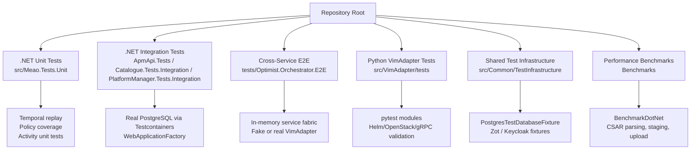
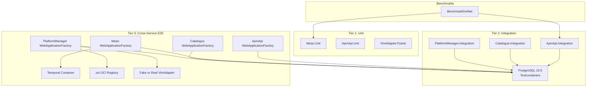
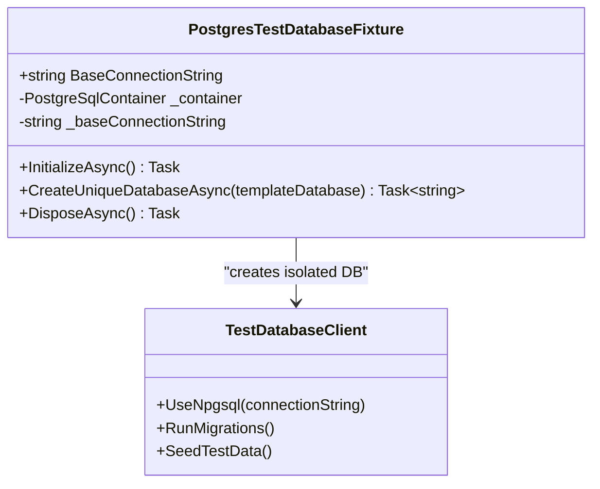
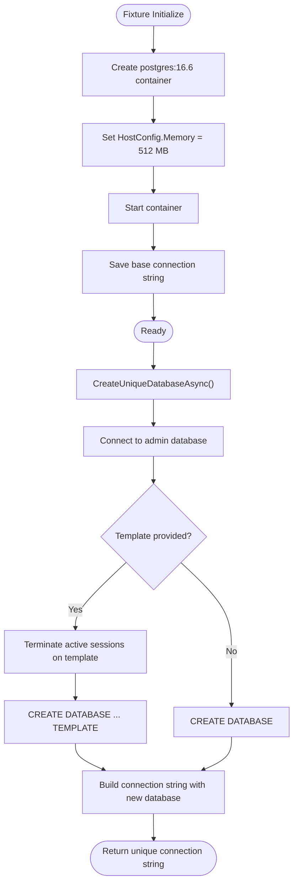
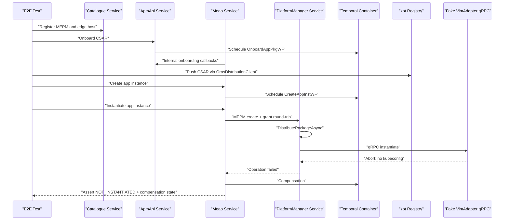
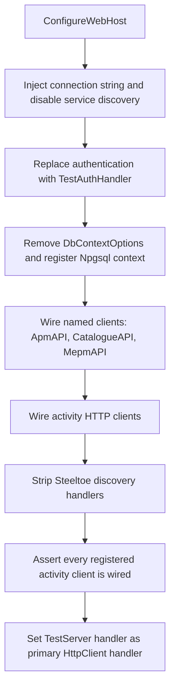
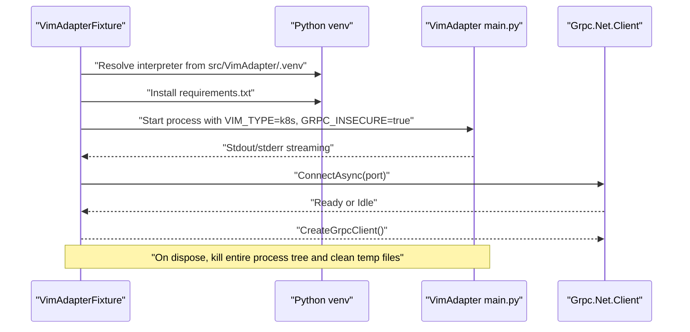
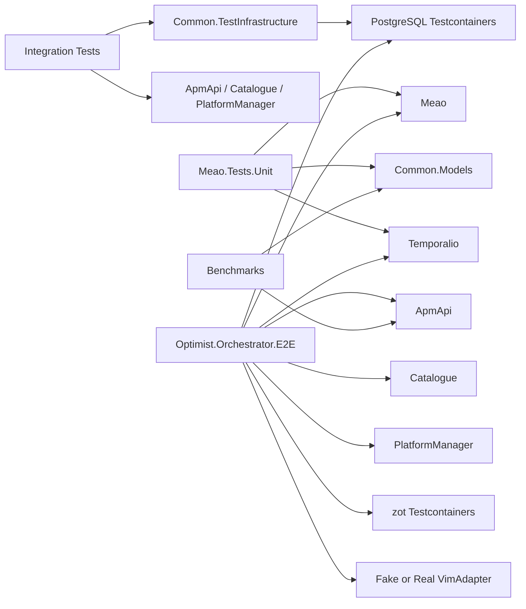
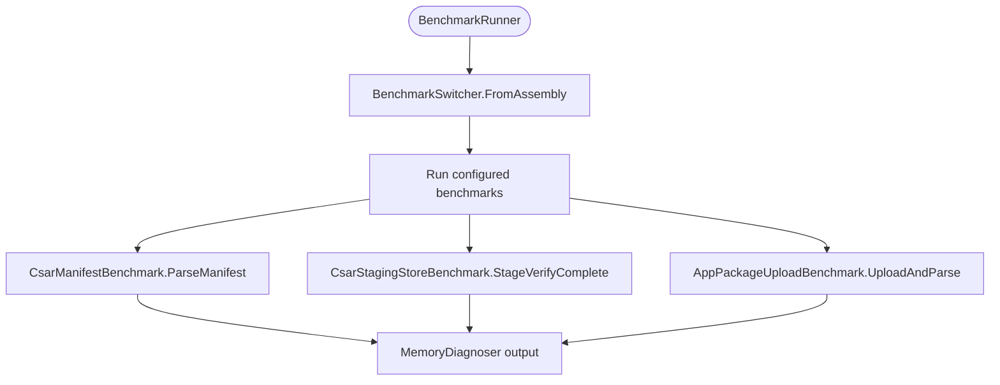

# Testing Strategy

<cite>
**Referenced Files in This Document**
- `docs/TESTING.md`
- `docs/ADR/0037-postgresql-unification-and-testcontainers-strategy.md`
- `docs/ADR/0044-shared-testcontainers-fixture-library.md`
- `docs/ADR/0054-cross-service-e2e-harness.md`
- `.github/workflows/ci.yml`
- `.github/workflows/e2e.yml`
- `src/Common/TestInfrastructure/PostgresTestDatabaseFixture.cs`
- `tests/Optimist.Orchestrator.E2E/Fixtures/E2ESystemFixture.cs`
- `tests/Optimist.Orchestrator.E2E/Fixtures/CrossServiceE2ECollection.cs`
- `tests/Optimist.Orchestrator.E2E/Fixtures/MeaoApiFactory.cs`
- `tests/Optimist.Orchestrator.E2E/Fixtures/VimAdapterFixture.cs`
- `tests/Optimist.Orchestrator.E2E/Fixtures/RealVimE2ESystemFixture.cs`
- `tests/Optimist.Orchestrator.E2E/FullLifecycleToVimBoundaryE2ETests.cs`
- `src/Meao.Tests.Unit/ApmAndAuthActivitiesTests.cs`
- `Benchmarks/Program.cs`
- `Benchmarks/CsarPipelineBenchmarks.cs`
- `Benchmarks/AppPackageUploadBenchmark.cs`
</cite>

## Table of Contents
1. [Introduction](#introduction)
2. [Project Structure](#project-structure)
3. [Core Components](#core-components)
4. [Architecture Overview](#architecture-overview)
5. [Detailed Component Analysis](#detailed-component-analysis)
6. [Dependency Analysis](#dependency-analysis)
7. [Performance Considerations](#performance-considerations)
8. [Troubleshooting Guide](#troubleshooting-guide)
9. [Conclusion](#conclusion)

## Introduction
This document explains the multi-layered testing strategy for the Optimist.Orchestrator repository. It covers:

- Unit tests, component integration tests, and cross-service end-to-end tests.
- The shared TestContainers-based test infrastructure for PostgreSQL, zot, Keycloak, Temporal, and VimAdapter.
- Patterns for testing Temporal workflows, VIM adapter interactions, and external dependency mocks.
- Local and CI execution commands.
- Performance benchmarking using BenchmarkDotNet.
- Guidance on writing effective tests, interpreting results, and integrating continuous testing.

The project uses two independent ecosystems:

| Ecosystem | Stack | Framework | Main Locations |
|---|---|---|---|
| .NET | .NET 8 (C#) | xUnit + Microsoft.NET.Test.Sdk | `src/Meao.Tests.Unit`, `src/ApmApi/ApmApi.Tests`, `src/Catalogue/Catalogue.Tests.Integration`, `src/PlatformManager/PlatformManager.Tests.Integration`, `tests/Optimist.Orchestrator.E2E` |
| Python | Python 3.11 | pytest + pytest-asyncio | `src/VimAdapter/tests/` |

Docker is required for any .NET integration test because the shared PostgreSQL fixture runs a real PostgreSQL container via Testcontainers. Cross-service E2E tests additionally use Testcontainers for Temporal, zot, and Keycloak where applicable.

**Section sources**
- `docs/TESTING.md#L1-L200`

## Project Structure
The testing layout is layered by scope and cost:

**Diagram sources**
- `docs/TESTING.md#L1-L200`
- `src/Common/TestInfrastructure/PostgresTestDatabaseFixture.cs#L1-L68`
- `tests/Optimist.Orchestrator.E2E/Fixtures/E2ESystemFixture.cs#L1-L200`
- `Benchmarks/Program.cs#L1-L22`

**Section sources**
- `docs/TESTING.md#L1-L200`
- `docs/ADR/0037-postgresql-unification-and-testcontainers-strategy.md#L1-L44`

## Core Components
The testing system is built around five core components:

1. **Shared Test Infrastructure (`Common.TestInfrastructure`)**  
   Provides `PostgresTestDatabaseFixture`, which manages a pinned PostgreSQL 16.6 Testcontainers instance and exposes per-test isolated databases through `CreateUniqueDatabaseAsync`. Other fixtures include zot and Keycloak containers used by integration and E2E suites.

2. **.NET Unit and Integration Test Projects**  
   - `Meao.Tests.Unit`: workflow phase logic, policy verification, activity behavior, wire contracts, and Temporal replay gates.  
   - `ApmApi.Tests`: package management API, persistence, and integration tests.  
   - `Catalogue.Tests.Integration`: registry API integration including JWT authentication.  
   - `PlatformManager.Tests.Integration`: LCM API, worker, CSAR digest, and mixed SQLite/PostgreSQL tests.

3. **Cross-Service E2E Harness (`Optimist.Orchestrator.E2E`)**  
   Boots four microservices with in-memory HTTP wiring, a real Temporal container, unique PostgreSQL databases, a fake gRPC VimAdapter boundary, and a real anonymous zot registry. It supports both an in-memory fake VIM mode and a real Kubernetes working-PoC gate.

4. **Python VimAdapter Test Suite**  
   pytest-based tests covering configuration storage, CSAR distribution and manifest handling, Helm and OpenStack adapters, gRPC server behavior, file system operations, and validation.

5. **BenchmarkDotNet Suite**  
   Micro-benchmarks for CSAR manifest parsing, durable CSAR staging, and AppD upload and deserialization.

**Section sources**
- `docs/TESTING.md#L1-L200`
- `docs/ADR/0044-shared-testcontainers-fixture-library.md#L1-L38`

## Architecture Overview
The testing architecture follows a three-tier model plus performance benchmarks:

**Diagram sources**
- `docs/ADR/0037-postgresql-unification-and-testcontainers-strategy.md#L1-L44`
- `docs/ADR/0054-cross-service-e2e-harness.md#L1-L100`
- `src/Common/TestInfrastructure/PostgresTestDatabaseFixture.cs#L1-L68`
- `tests/Optimist.Orchestrator.E2E/Fixtures/E2ESystemFixture.cs#L1-L200`

**Section sources**
- `docs/ADR/0037-postgresql-unification-and-testcontainers-strategy.md#L1-L44`
- `docs/ADR/0054-cross-service-e2e-harness.md#L1-L100`

## Detailed Component Analysis

### Shared Testcontainers Fixture Library
The shared fixture library centralizes database and infrastructure setup so all .NET test projects can rely on the same isolation guarantees and image pin.

Key behaviors:

- Starts one PostgreSQL 16.6 container during fixture initialization.
- Applies a 512 MB memory limit to the container host configuration.
- Creates uniquely named test databases such as `test_<guid>` through direct SQL against the admin database.
- Supports optional template cloning from an existing database when needed.
- Disposes the Testcontainers instance during cleanup.

**Diagram sources**
- `src/Common/TestInfrastructure/PostgresTestDatabaseFixture.cs#L1-L68`

**Section sources**
- `src/Common/TestInfrastructure/PostgresTestDatabaseFixture.cs#L1-L68`
- `docs/ADR/0044-shared-testcontainers-fixture-library.md#L1-L38`

### Cross-Service End-to-End Harness
The E2E harness is the first true cross-service regression gate in the repository. It drives a real CSAR through ApmApi, Meao, Catalogue, and PlatformManager up to the Mm6 VimAdapter boundary.

**Diagram sources**
- `tests/Optimist.Orchestrator.E2E/FullLifecycleToVimBoundaryE2ETests.cs#L1-L200`
- `tests/Optimist.Orchestrator.E2E/Fixtures/E2ESystemFixture.cs#L1-L200`
- `docs/ADR/0054-cross-service-e2e-harness.md#L1-L100`

Important design points:

- **In-memory service fabric:** Each service is hosted via `WebApplicationFactory`; cross-service HTTP flows through injected `TestServer` handlers rather than real TCP sockets between services.
- **Real network boundary:** The VimAdapter boundary uses real Kestrel with forced HTTP/2 cleartext and a dynamically allocated loopback port.
- **Process-wide environment safety:** Environment variables such as `TEMPORAL_TARGET_HOST`, `DISABLE_SERVICE_DISCOVERY`, `K8S_PLUGIN`, `K8S_PLUGIN_PORT`, `MEAO_ZOT`, and `MEPM_ZOT` are saved before boot and restored after disposal.
- **Boot ordering:** Temporal → PostgreSQL → zot → Fake VimAdapter → process env → Catalogue → ApmApi → Meao → PlatformManager.
- **Failure-is-the-assertion pattern:** The flagship test asserts that instantiation aborts at the VimAdapter boundary with the documented “no kubeconfig” error and verifies compensation.

**Section sources**
- `tests/Optimist.Orchestrator.E2E/Fixtures/E2ESystemFixture.cs#L1-L200`
- `tests/Optimist.Orchestrator.E2E/Fixtures/CrossServiceE2ECollection.cs#L1-L14`
- `tests/Optimist.Orchestrator.E2E/FullLifecycleToVimBoundaryE2ETests.cs#L1-L200`
- `docs/ADR/0054-cross-service-e2e-harness.md#L1-L100`

### Meao WebApplicationFactory and In-Memory HTTP Wiring
The Meao factory is the most complex wiring point because Meao calls other services through named HttpClient registrations backed by Steeltoe service discovery.

Key responsibilities:

- Replaces authentication with a test scheme and authorization fallback.
- Injects the correct PostgreSQL connection string.
- Substitutes Keycloak token acquisition with a cross-service test JWT.
- Redirects named HttpClient calls to target service `TestServer` handlers.
- Strips Steeltoe discovery handlers so logical Consul hosts do not resolve to localhost:8500.
- Enforces that every activity HTTP client registered by Meao is covered by the fixture; uncovered names fail fast at construction.

**Diagram sources**
- `tests/Optimist.Orchestrator.E2E/Fixtures/MeaoApiFactory.cs#L1-L200`

**Section sources**
- `tests/Optimist.Orchestrator.E2E/Fixtures/MeaoApiFactory.cs#L1-L200`

### VimAdapter Fixture and Real Process Lifecycle
The VimAdapter fixture manages the real Python VimAdapter subprocess used by the real-VIM E2E tier.

Key behaviors:

- Allocates a dynamic loopback port.
- Resolves the pinned Python interpreter from `.venv`.
- Validates Helm CLI availability and pyhelm3 importability.
- Streams stdout and stderr into diagnostic logs.
- Polls gRPC readiness with a timeout and captures process output on failure.
- Kills the full process tree on disposal.

**Diagram sources**
- `tests/Optimist.Orchestrator.E2E/Fixtures/VimAdapterFixture.cs#L1-L200`

**Section sources**
- `tests/Optimist.Orchestrator.E2E/Fixtures/VimAdapterFixture.cs#L1-L200`
- `tests/Optimist.Orchestrator.E2E/Fixtures/RealVimE2ESystemFixture.cs#L1-L200`

### Temporal Workflow Testing Patterns
Temporal workflow testing spans unit-level activity behavior and replay determinism.

- **Activity unit tests** mock HTTP responses and assert Temporal retry semantics. For example, `ApmAndAuthActivitiesTests` verifies non-retryable application failures for client errors, retryable failures for missing tokens, and normal success paths.
- **Workflow replay tests** use `Temporalio.Testing.WorkflowReplayer` against committed JSON histories to guarantee deterministic command sequences across activity options, timeouts, and start bounds.
- **Policy coverage tests** verify that activity call sites invoke centralized policies rather than inline retry literals.
- **Attempt count tests** empirically validate configured attempt counts for standard, long-running, compensation, and best-effort policies.

Recommended patterns:

- Prefer replay fixtures for workflows that must remain deterministic.
- Keep retry and timeout configuration in centralized policy objects.
- Mock external HTTP dependencies with explicit response codes and payloads.
- Assert both successful outcomes and failure transitions.

**Section sources**
- `src/Meao.Tests.Unit/ApmAndAuthActivitiesTests.cs#L1-L181`
- `docs/TESTING.md#L1-L200`

### VIM Adapter Testing Strategies
VIM adapter testing covers both the Python service and the boundary exercised by the orchestrator.

Patterns:

- Use pytest with asyncio auto mode for async gRPC and Helm/Kubernetes operations.
- Isolate filesystem-backed state under `k8sconfigs`.
- Validate CSAR manifest parsing, OCI reference forwarding, and distribution flow.
- Exercise the real gRPC server endpoint through a dedicated channel.
- In cross-service E2E, prefer the fake VimAdapter for speed and contract drift detection, and the real VimAdapter only when validating live Kubernetes interaction.

**Section sources**
- `docs/TESTING.md#L1-L200`
- `tests/Optimist.Orchestrator.E2E/Fixtures/VimAdapterFixture.cs#L1-L200`

### Mock Implementations for External Dependencies
The suite uses several kinds of fakes and stubs:

| Dependency | Mocking Approach | Purpose |
|---|---|---|
| PostgreSQL | Testcontainers with `PostgresTestDatabaseFixture` | Real engine, isolated per test or collection |
| Temporal | Testcontainers + workflow replay fixtures | Deterministic orchestration testing |
| zot | Anonymous Testcontainers registry | Real OCI push and digest resolution |
| VimAdapter | Proto-compiled fake gRPC server | Contract validation and failure assertion |
| Keycloak | Test JWT generator and `TestAuthHandler` | Authentication without external identity provider |
| HTTP clients | `TestServer` message handlers | In-process cross-service wiring |
| Activities | Delegating `IHttpClientFactory` and custom `HttpMessageHandler` | Controlled HTTP responses for Temporal activities |

**Section sources**
- `docs/TESTING.md#L1-L200`
- `tests/Optimist.Orchestrator.E2E/Fixtures/E2ESystemFixture.cs#L1-L200`
- `src/Meao.Tests.Unit/ApmAndAuthActivitiesTests.cs#L1-L181`

## Dependency Analysis
The test layer depends on production code, shared infrastructure, and external runtime services.

**Diagram sources**
- `docs/TESTING.md#L1-L200`
- `src/Common/TestInfrastructure/PostgresTestDatabaseFixture.cs#L1-L68`
- `tests/Optimist.Orchestrator.E2E/Fixtures/E2ESystemFixture.cs#L1-L200`
- `Benchmarks/CsarPipelineBenchmarks.cs#L1-L126`

**Section sources**
- `docs/TESTING.md#L1-L200`

## Performance Considerations
Performance testing is separate from functional testing and focuses on hot paths in CSAR handling.

### Benchmark Suite
The benchmark project uses BenchmarkDotNet with `DefaultConfig.Instance` and `[MemoryDiagnoser]` attributes.

| Benchmark Class | Target Area | What It Measures |
|---|---|---|
| `CsarManifestBenchmark` | CSAR manifest parsing | Time and memory for reading `.mf` through `CsarManifestParser` |
| `CsarStagingStoreBenchmark` | Durable CSAR staging | Stage → verify → complete lifecycle against `FileSystemCsarStagingStore` |
| `AppPackageUploadBenchmark` | Upload and AppD parse | End-to-end upload helper path and AppD deserialization |

**Diagram sources**
- `Benchmarks/Program.cs#L1-L22`
- `Benchmarks/CsarPipelineBenchmarks.cs#L1-L126`
- `Benchmarks/AppPackageUploadBenchmark.cs#L1-L105`

### Load Testing Guidance
The repository does not include an explicit load-testing framework such as k6, Locust, or JMeter. Load testing should be treated as a separate concern and layered on top of the existing E2E harness:

- Use the cross-service E2E harness as a baseline for valid request shapes and state transitions.
- Drive repeated instances through the ApmApi onboarding and Meao instantiation endpoints.
- Measure Temporal workflow throughput, PostgreSQL latency, and VimAdapter gRPC latency.
- Separate short micro-benchmarks (BenchmarkDotNet) from sustained load tests (external tooling).
- Record baselines before changes to CSAR parsing, staging, and upload helpers.

[No sources needed since this section provides general guidance]

## Troubleshooting Guide

### Docker Is Not Running
Symptoms:

- PostgreSQL fixture fails during `InitializeAsync`.
- Integration tests cannot start ephemeral databases.
- E2E tests fail while booting Temporal, zot, or Keycloak.

Resolution:

- Ensure Docker is running locally.
- Verify `docker info` succeeds.
- Restart the Docker daemon if necessary.

**Section sources**
- `docs/TESTING.md#L1-L200`
- `src/Common/TestInfrastructure/PostgresTestDatabaseFixture.cs#L1-L68`

### VimAdapter Interpreter Resolution Fails
Symptoms:

- VimAdapter subprocess cannot launch.
- Pytest cannot run inside the expected virtualenv.
- CI reports interpreter mismatch.

Resolution:

- Use the pinned Python 3.11 interpreter.
- Install dependencies into `src/VimAdapter/.venv`.
- Confirm `uv` or `python -m venv` produces the expected interpreter.
- Check captured stdout/stderr from `VimAdapterFixture`.

**Section sources**
- `tests/Optimist.Orchestrator.E2E/Fixtures/VimAdapterFixture.cs#L1-L200`
- `.github/workflows/ci.yml#L1-L146`

### Cross-Service HTTP Resolves to Consul Instead of TestServer
Symptoms:

- Meao outbound calls try to reach Consul on localhost:8500.
- Workflows time out waiting for ApmApi or Catalogue.
- Absolute URIs without ports dial random local TCP listeners.

Resolution:

- Ensure named HttpClient wiring covers every registered activity client.
- Verify Steeltoe discovery handlers are stripped.
- Confirm the primary `TestServer` handler is set last.
- Do not exempt clients without a reachability argument.

**Section sources**
- `tests/Optimist.Orchestrator.E2E/Fixtures/MeaoApiFactory.cs#L1-L200`

### gRPC VimAdapter Connection Uses HTTP/1.1
Symptoms:

- gRPC client fails with HTTP/2 prior-knowledge errors.
- Instantiation fails before reaching the adapter implementation.

Resolution:

- Use the fake VimAdapter server, which forces HTTP/2 on cleartext endpoints.
- Avoid relying on default Kestrel cleartext HTTP/1.1 behavior.

**Section sources**
- `docs/ADR/0054-cross-service-e2e-harness.md#L1-L100`

### Temporal Replay Non-Determinism
Symptoms:

- Workflow replay throws non-determinism exceptions.
- Changes to activity timeouts, retries, or command order break historical execution.

Resolution:

- Centralize retry and timeout policies.
- Keep workflow logic deterministic.
- Add or update replay fixtures when workflow event history changes.

**Section sources**
- `docs/TESTING.md#L1-L200`

### E2E Test Environment Variables Leak
Symptoms:

- Other test suites observe `TEMPORAL_TARGET_HOST`, `DISABLE_SERVICE_DISCOVERY`, or Vim/zot environment values.
- Process-global state persists after a failed E2E boot.

Resolution:

- Rely on `E2ESystemFixture` and `RealVimE2ESystemFixture`, which save and restore process-wide environment variables.
- Avoid setting process-global variables outside these fixtures.
- Remember that xUnit v2 does not invoke `DisposeAsync` when `InitializeAsync` faults, so the fixtures explicitly restore environment state in catch blocks.

**Section sources**
- `tests/Optimist.Orchestrator.E2E/Fixtures/E2ESystemFixture.cs#L1-L200`
- `tests/Optimist.Orchestrator.E2E/Fixtures/RealVimE2ESystemFixture.cs#L1-L200`

## Conclusion
The testing strategy combines fast unit tests, realistic integration tests against PostgreSQL, a cross-service E2E harness that exercises the full orchestration pipeline, and Python-based VIM adapter tests. Shared Testcontainers fixtures provide consistent database isolation, while the E2E harness validates cross-service seams, Temporal workflows, OCI registry behavior, and the gRPC VimAdapter boundary. Performance testing is handled separately through BenchmarkDotNet focused on CSAR parsing, staging, and upload paths.

For developers:

- Write unit tests for pure logic and Temporal activity behavior.
- Use `PostgresTestDatabaseFixture` for integration tests requiring SQL fidelity.
- Extend the E2E harness for cross-service scenarios rather than adding ad hoc scripts.
- Treat real-VIM Kubernetes tests as heavier, cluster-dependent validations.
- Use benchmarks to compare performance-sensitive changes before committing them.

For CI:

- PR and push gates run ADR validation, Helm linting, Trivy scans, Python pytest, and the full .NET test suite.
- Cross-service E2E tests run nightly and on demand, never on ordinary push/PR.
- Results are uploaded only on failure for diagnostics.

**Section sources**
- `.github/workflows/ci.yml#L1-L146`
- `.github/workflows/e2e.yml#L1-L96`
- `docs/TESTING.md#L1-L200`