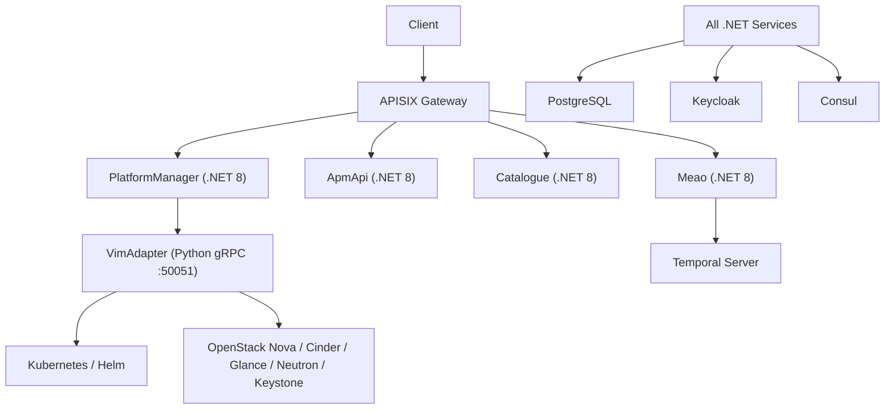
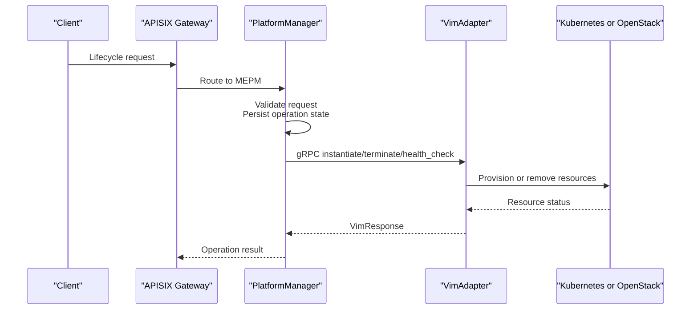
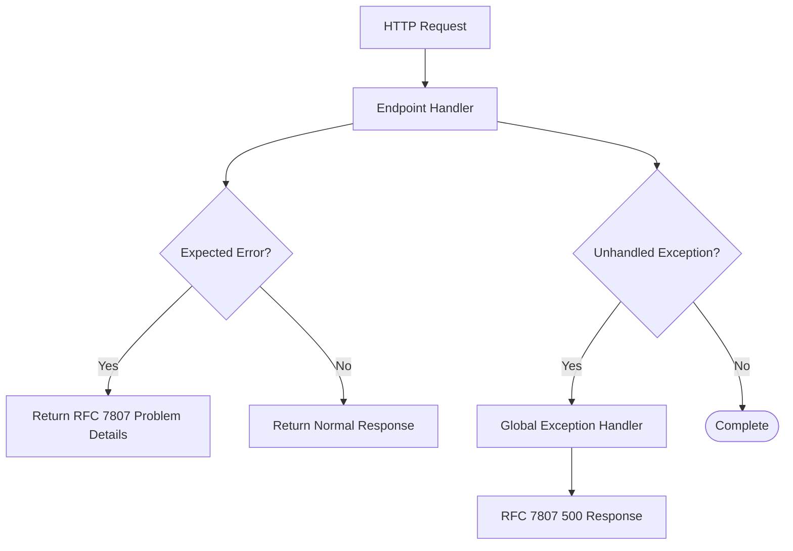
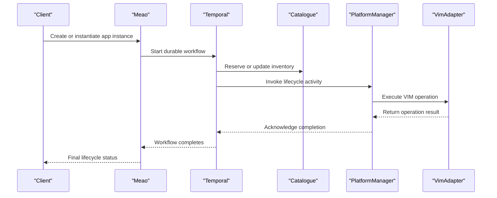
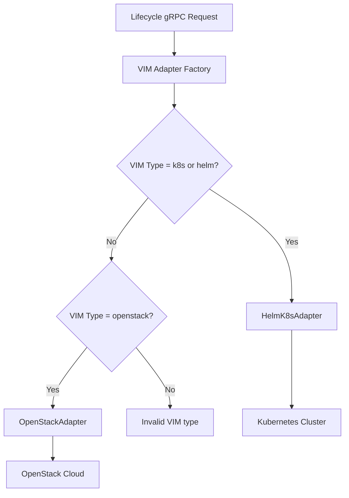
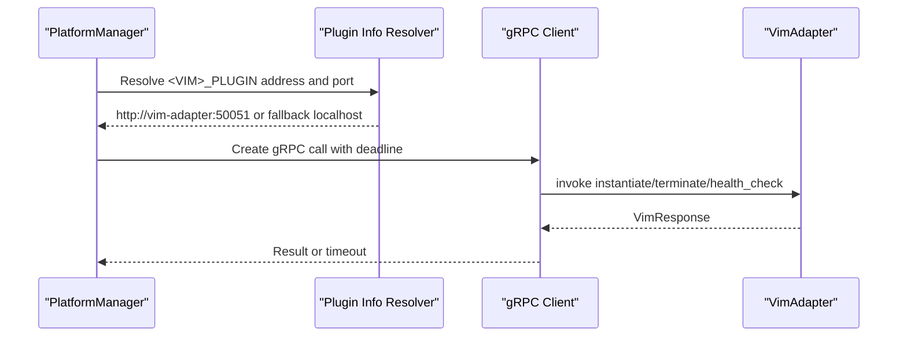
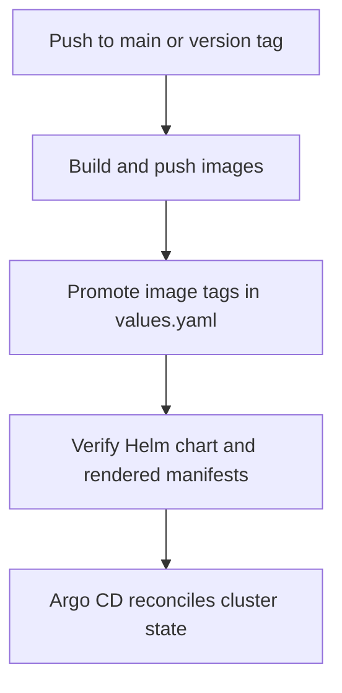

# Troubleshooting & FAQ

<cite>
**Referenced Files in This Document**   
- `docs/ERROR_HANDLING_AND_VALIDATION_ARCHITECTURE.md`
- `docs/OPENSTACK_VIM_ADAPTER.md`
- `src/VimAdapter/README.md`
- `docs/DEPLOYMENT.md`
- `docs/GETTING-STARTED.md`
- `docs/CONFIGURATION.md`
- `docs/PRODUCTION_READINESS_AND_KUBERNETES_RESTART_RECOVERABILITY_AUDIT.md`
- `docker-compose.yml`
- `docker-compose.infra.yml`
- `src/Meao/appsettings.json`
- `src/PlatformManager/PlatformManager/appsettings.json`
- `src/ApmApi/appsettings.json`
- `src/Catalogue/appsettings.json`
- `charts/optimist-apps/values.yaml`
- `charts/optimist-apps/templates/deployment.yaml`
- `.github/workflows/cd.yml`
</cite>

## Table of Contents
1. [Introduction](#introduction)
2. [Project Structure and Operational Boundaries](#project-structure-and-operational-boundaries)
3. [System Architecture Overview](#system-architecture-overview)
4. [Common Error Scenarios](#common-error-scenarios)
5. [Service Connectivity Troubleshooting](#service-connectivity-troubleshooting)
6. [Authentication and Authorization Failures](#authentication-and-authorization-failures)
7. [Workflow Execution Errors](#workflow-execution-errors)
8. [VIM Adapter Troubleshooting](#vim-adapter-troubleshooting)
9. [Diagnostic Techniques and Log Analysis Patterns](#diagnostic-techniques-and-log-analysis-patterns)
10. [Configuration Issues](#configuration-issues)
11. [Performance Problems](#performance-problems)
12. [Operational Challenges](#operational-challenges)
13. [Recovery Procedures](#recovery-procedures)
14. [FAQ](#faq)
15. [Conclusion](#conclusion)

## Introduction

This document is the operational troubleshooting and FAQ guide for Optimist.Orchestrator. It focuses on diagnosing and resolving failures across the distributed system: API services, Keycloak authentication, Temporal workflows, PostgreSQL, service discovery, Kubernetes deployment, and the VIM adapter used to manage lifecycle operations against Kubernetes or OpenStack.

The system implements ETSI MEC roles:

- **MEO (Meao):** orchestration engine with durable Temporal workflows.
- **MEPM (PlatformManager):** lifecycle execution controller that calls the VIM adapter.
- **APM (ApmApi):** package management.
- **Catalogue:** internal inventory and census store.
- **VimAdapter:** gRPC plugin that translates lifecycle commands into Helm/Kubernetes or OpenStack operations.

This guide does not replace per-service code-level debugging; instead, it organizes symptoms, root causes, diagnostic steps, and recovery actions so operators can move from “something failed” to a concrete fix.

**Section sources**
- `docs/GETTING-STARTED.md#L1-L40`
- `docs/DEPLOYMENT.md#L17-L40`

## Project Structure and Operational Boundaries

The application consists of five main runtime components plus infrastructure dependencies. Understanding which component owns each failure is essential before diving into logs.

| Component | Runtime | Primary Role | Common Failure Surface |
|---|---|---|---|
| Meao | .NET 8 | MEO orchestrator and Temporal worker | Workflow hangs, Temporal connectivity, subscription registration |
| ApmApi | .NET 8 | Package upload and onboarded-package retrieval | Upload size, staging path permissions, database connectivity |
| Catalogue | .NET 8 | Internal MEO inventory and census | Service discovery, database migration races |
| PlatformManager | .NET 8 | MEPM LCM controller | gRPC to VimAdapter, Consul configuration, background queue recovery |
| VimAdapter | Python 3.11.16 | VIM plugin over gRPC | kubeconfig/clouds.yaml, Helm CLI, Kubernetes cluster, OpenStack SDK |
| Infrastructure | Containers | APISIX, Keycloak, Temporal, PostgreSQL, Prometheus, Grafana, OTEL, Consul | Networking, credentials, ports, readiness probes |

**Diagram sources**
- `docker-compose.yml#L1-L119`
- `docker-compose.infra.yml#L1-L200`
- `docs/DEPLOYMENT.md#L17-L40`

**Section sources**
- `docs/DEPLOYMENT.md#L17-L40`
- `docs/GETTING-STARTED.md#L41-L120`

## System Architecture Overview

At a high level, lifecycle requests enter through the gateway and are routed to MEPM or other APIs. MEPM then invokes the VIM adapter over gRPC. Long-running lifecycle work is coordinated by Temporal through Meao. Persistent state lives in PostgreSQL, while Keycloak provides authentication and Consul provides service discovery.

**Diagram sources**
- `docs/OPENSTACK_VIM_ADAPTER.md#L12-L58`
- `src/VimAdapter/README.md#L12-L48`
- `docs/PRODUCTION_READINESS_AND_KUBERNETES_RESTART_RECOVERABILITY_AUDIT.md#L60-L96`

### Error Handling Model

For the .NET services, expected errors such as validation failures, missing resources, expired grants, and business rule violations return RFC 7807 Problem Details responses directly from endpoints. Unexpected crashes—database outages, unhandled exceptions, network failures—are caught by a global exception handler and also returned as standardized Problem Details rather than leaking stack traces.

**Diagram sources**
- `docs/ERROR_HANDLING_AND_VALIDATION_ARCHITECTURE.md#L9-L70`
- `docs/ERROR_HANDLING_AND_VALIDATION_ARCHITECTURE.md#L106-L160`

**Section sources**
- `docs/ERROR_HANDLING_AND_VALIDATION_ARCHITECTURE.md#L1-L70`
- `docs/ERROR_HANDLING_AND_VALIDATION_ARCHITECTURE.md#L100-L160`

## Common Error Scenarios

This section groups frequent symptoms by component and maps them to likely causes and diagnostics.

### Meao (Orchestrator Engine)

| Symptom | Likely Cause | Diagnostic Step | Resolution |
|---|---|---|---|
| Workflow never completes after pod restart | In-memory background queue may lose in-flight items during crash | Inspect `AppInstanceLcmOpOcc` state and check whether replacement pods re-enqueue stranded operations | Implement startup recovery to rehydrate orphaned processing operations |
| Subscription callback base URL is invalid | Missing or incorrect public URL configuration | Check `MEAO_PUBLIC_URL` and environment resolution | Set the public URL for non-development environments |
| Cannot discover downstream services | Consul is unreachable or misconfigured | Verify Consul host/port and Steeltoe registration | Start Consul and confirm service names match app settings |
| Health endpoint returns 200 but database queries fail | Health checks do not include PostgreSQL connectivity | Add database-aware readiness probe | Separate liveness and readiness probes and tag database health |

### ApmApi (Package Management)

| Symptom | Likely Cause | Diagnostic Step | Resolution |
|---|---|---|---|
| Upload fails due to size | Exceeds configured maximum upload size | Check `AppSettings.MaxUploadSize` and request payload | Increase limit or reduce CSAR size |
| Onboarded package returns 404 after restart | Local filesystem storage is ephemeral | Inspect container volume mounts and persistent storage configuration | Use persistent storage or OCI artifact distribution |
| Startup fails when registry config is partially set | Dormant `AppRepo` validation requires password when endpoint is set | Check `AppRepo__RepoEndpoint` and `AppRepo__RepoPassWord` | Remove unused registry configuration or provide required fields |
| Staging directory write fails in Kubernetes | Container user cannot write image-layer path | Check mounted `/app/data/csar-staging` and pod security context | Mount persistent storage under `/app/data` |

### Catalogue (Inventory and Census)

| Symptom | Likely Cause | Diagnostic Step | Resolution |
|---|---|---|---|
| Multiple replicas race on migrations | Concurrent startup runs EF Core migrations | Check Pod events and database migration history | Run migrations in a dedicated job or init container |
| Readiness says healthy but queries fail | Health checks do not verify PostgreSQL | Inspect `/health` behavior | Add database readiness checks |
| Service not found by other services | Consul registration disabled or misconfigured | Check `Consul__Host`, `Consul__Port`, and service name | Correct appsettings and environment variables |

### PlatformManager (Lifecycle Controller)

| Symptom | Likely Cause | Diagnostic Step | Resolution |
|---|---|---|---|
| gRPC call to VimAdapter falls back to localhost | Missing `K8S_PLUGIN` or port configuration | Inspect `<VIM>_PLUGIN` resolution chain | Set `K8S_PLUGIN` and `K8S_PLUGIN_PORT` |
| Lifecycle operation times out | VIM adapter call exceeds timeout | Check `LcmWorker:VimOperationTimeout` and adapter-side polling limits | Tune timeout or investigate slow VIM provisioning |
| Background queue loses operations after restart | In-memory channel drops on pod termination | Check process logs around startup and queue initialization | Rehydrate stranded operations from persisted state |
| Authentication fails | Missing Keycloak client secret | Check `KEYCLOAK_CLIENT_SECRET_PLATFORMMANAGER` | Inject correct client secret via secrets |

### VimAdapter (VIM Plugin)

| Symptom | Likely Cause | Diagnostic Step | Resolution |
|---|---|---|---|
| gRPC server does not start | Wrong Python version or missing dependencies | Check container Python version and installed packages | Use pinned Python 3.11.16 and install requirements |
| Config upload succeeds but instantiate fails | Host config not saved under expected host IP | Inspect `k8sconfigs/{host_ip}` or `openstack_configs/{host_ip}` | Re-upload host configuration |
| Helm installation fails | Missing Helm CLI or invalid kubeconfig | Check PATH and kubeconfig contents | Install Helm in image or configure proper kubeconfig mount |
| OpenStack instantiation fails | Invalid clouds.yaml or missing OpenStack service | Check adapter logs and mapped OpenStack exceptions | Fix credentials, region, or enable required OpenStack services |
| Cold-path CSAR pull fails | `oras` CLI not available or digest ref invalid | Check subprocess invocation and allowed registries | Install `oras` or use warm pre-staged path |

**Section sources**
- `docs/PRODUCTION_READINESS_AND_KUBERNETES_RESTART_RECOVERABILITY_AUDIT.md#L96-L204`
- `docs/CONFIGURATION.md#L140-L240`
- `docs/OPENSTACK_VIM_ADAPTER.md#L12-L194`
- `src/VimAdapter/README.md#L1-L120`

## Service Connectivity Troubleshooting

### APISIX Gateway

**Symptoms:**
- External requests do not reach backend services.
- Routes appear missing in APISIX.
- Admin API is unreachable.

**Diagnostics:**
- Confirm APISIX is listening on port 9080 for clients and 9180 for admin.
- Check the APISIX init sidecar logs for route provisioning.
- Verify etcd is reachable at `http://etcd:2379`.
- Confirm the APISIX Admin API key matches the provisioner configuration.

**Likely Causes:**
- APISIX started before etcd was ready.
- Route provisioning script failed silently.
- Admin API key mismatch between sidecar and APISIX configuration.

**Resolution:**
- Ensure etcd starts before APISIX.
- Review the APISIX init sidecar output for retries and provisioning errors.
- Align the admin API key value between the sidecar environment and APISIX configuration.

**Section sources**
- `docker-compose.infra.yml#L12-L80`
- `docker-compose.infra.yml#L80-L150`

### Consul Service Discovery

**Symptoms:**
- `.NET` services cannot resolve each other.
- APISIX cannot route to registered services.
- Service names like `apm`, `meao`, `catalogue`, `mepm` are unknown.

**Diagnostics:**
- Check Consul UI at port 8500.
- Verify each service’s Consul host and port in app settings.
- Confirm Steeltoe registration is enabled.

**Likely Causes:**
- Consul container not running.
- Incorrect `Consul__Host` or `Consul__Port`.
- Service registration disabled by environment.

**Resolution:**
- Start Consul explicitly if using local development outside compose.
- Correct the service discovery configuration in appsettings or environment variables.
- Enable registration only when Consul is available.

**Section sources**
- `docs/GETTING-STARTED.md#L70-L110`
- `src/Meao/appsettings.json#L19-L37`
- `src/ApmApi/appsettings.json#L28-L42`
- `src/Catalogue/appsettings.json#L29-L46`
- `src/PlatformManager/PlatformManager/appsettings.json#L24-L37`

### PostgreSQL Connectivity

**Symptoms:**
- Application starts but throws database-related exceptions.
- Migration errors occur on multi-pod startup.
- Readiness reports healthy while database queries fail.

**Diagnostics:**
- Test direct connection to PostgreSQL using the configured connection string.
- Check database usernames, passwords, and database names.
- Inspect multiple pods attempting migrations simultaneously.

**Likely Causes:**
- Connection string points to wrong host or database.
- Credentials mismatch between `.env` and compose configuration.
- Concurrent migration execution.
- Health endpoint does not validate database connectivity.

**Resolution:**
- Align `.env` and service connection strings.
- Run migrations in a single-replica job or init container.
- Add database-aware readiness probes.

**Section sources**
- `docs/PRODUCTION_READINESS_AND_KUBERNETES_RESTART_RECOVERABILITY_AUDIT.md#L120-L170`
- `docs/CONFIGURATION.md#L20-L60`

### Temporal Server

**Symptoms:**
- Meao cannot connect to Temporal.
- Workflows do not start or replay.
- Worker logs show connection failures.

**Diagnostics:**
- Verify Temporal frontend is reachable at the configured target host.
- Check Docker Compose or Helm values for `TEMPORAL_TARGET_HOST`.
- Confirm Temporal containers are running and its database is ready.

**Likely Causes:**
- Wrong hostname or port.
- Temporal not started before Meao.
- Network isolation between Meao and Tempal pods.

**Resolution:**
- Set `TEMPORAL_TARGET_HOST=temporal:7233` in local compose or the Helm chart.
- Ensure dependency ordering is respected during deployment.

**Section sources**
- `docs/CONFIGURATION.md#L200-L240`
- `charts/optimist-apps/values.yaml#L50-L80`

## Authentication and Authorization Failures

### Keycloak Configuration

**Symptoms:**
- Requests return 401 or 403.
- Token validation fails.
- Client secrets are missing.

**Diagnostics:**
- Check Keycloak realm and client configuration.
- Verify `KEYCLOAK_CLIENT_SECRET_<SERVICE>` is injected.
- Confirm the Keycloak auth server URL matches the deployed environment.

**Likely Causes:**
- Missing client secret environment variable.
- Keycloak client not created or secret rotated.
- Auth server URL pointing to local development Keycloak in production.

**Resolution:**
- Inject the correct client secret via environment or secrets manager.
- Verify Keycloak realm imports and client registrations.
- Update `Keycloak__auth-server-url` per environment.

**Section sources**
- `docs/CONFIGURATION.md#L140-L200`
- `src/Meao/appsettings.json#L9-L18`
- `src/PlatformManager/PlatformManager/appsettings.json#L6-L17`
- `src/ApmApi/appsettings.json#L18-L27`
- `src/Catalogue/appsettings.json#L19-L28`

### Deferred Authentication Context

Some authentication decisions are intentionally deferred to later phases of lifecycle operations. If an error occurs after token validation but before resource creation, inspect both HTTP authorization and workflow activity logs. The distinction matters because the request may be authorized at the API boundary but still fail inside VIM provisioning.

**Section sources**
- `docs/ERROR_HANDLING_AND_VALIDATION_ARCHITECTURE.md#L1-L70`

## Workflow Execution Errors

### Temporal Workflow Lifecycle

**Diagram sources**
- `docs/PRODUCTION_READINESS_AND_KUBERNETES_RESTART_RECOVERABILITY_AUDIT.md#L60-L96`
- `docs/OPENSTACK_VIM_ADAPTER.md#L60-L120`

### Common Workflow Symptoms

| Symptom | Likely Cause | Diagnostic Focus |
|---|---|---|
| Workflow stays in progress after pod restart | Background queue did not recover in-memory work | Check persisted operation state and queue rehydration |
| Duplicate workflow runs | Non-idempotent workflow ID | Ensure workflow IDs include app instance identifiers |
| Workflow times out waiting for callback | Timeout too short or downstream service unavailable | Inspect Temporal task queue and downstream latency |
| Placement or catalog updates succeed but VIM step fails | VIM adapter or infrastructure failure | Inspect PlatformManager and VimAdapter logs |

### Recovery Behavior

Temporal event sourcing makes Meao resilient to pod crashes: when a replacement pod boots, it polls the task queue and replays event history from the durable store. This prevents lost orchestration state, assuming the underlying data store and task queue remain available.

**Section sources**
- `docs/PRODUCTION_READINESS_AND_KUBERNETES_RESTART_RECOVERABILITY_AUDIT.md#L60-L96`

## VIM Adapter Troubleshooting

### Architecture Boundary

The VimAdapter is the boundary between the platform manager and the actual virtualization infrastructure. It exposes gRPC lifecycle operations and selects an adapter based on `VIM_TYPE`:

- `k8s` or `helm` → Helm/Kubernetes adapter.
- `openstack` → OpenStack adapter.

**Diagram sources**
- `src/VimAdapter/README.md#L12-L48`
- `src/VimAdapter/README.md#L120-L200`

### Kubernetes/Helm Adapter

**Typical Failure Points:**
- Missing or stale kubeconfig.
- Helm CLI not installed.
- CSAR chart not pre-staged and cold pull unavailable.
- Kubernetes cluster unreachable.
- Bundled images not importable.

**Diagnostics:**
- Verify host config exists under `k8sconfigs/{host_ip}`.
- Check that Helm is available on PATH inside the adapter.
- Inspect CSAR ingress path: warm pre-staged chart vs cold OCI pull.
- Confirm allowed plaintext registries for edge-local zot references.

**Resolutions:**
- Re-upload host configuration through the lifecycle controller.
- Include Helm in the VimAdapter image or ensure PATH availability.
- Pre-stage CSAR charts to avoid cold pulls where `oras` is unavailable.
- Pin CSAR references to `sha256:<digest>` against allowed registries.

**Section sources**
- `src/VimAdapter/README.md#L49-L120`
- `src/VimAdapter/README.md#L120-L200`

### OpenStack Adapter

**Typical Failure Points:**
- Invalid `clouds.yaml`.
- Missing Keystone identity setup.
- Heat requested but no orchestration service.
- OpenStack SDK exception mapping issues.
- Optional `openstacksdk` dependency absent.

**Diagnostics:**
- Validate `clouds.yaml` per host IP.
- Check OpenStack services: Nova, Cinder, Glance, Neutron, Keystone.
- Inspect adapter logs for mapped OpenStack exceptions.
- Confirm whether heat orchestration is enabled by app parameters.

**Resolutions:**
- Fix credentials, region, interface, and identity API version.
- Disable heat orchestration unless OpenStack orchestration is available.
- Ensure `openstacksdk` is installed when using the OpenStack adapter.
- Treat adapter exceptions as structured VIM errors rather than raw SDK dumps.

**Section sources**
- `docs/OPENSTACK_VIM_ADAPTER.md#L12-L194`
- `src/VimAdapter/README.md#L200-L320`

### gRPC Communication Between PlatformManager and VimAdapter

**Diagram sources**
- `docs/CONFIGURATION.md#L140-L200`
- `docs/OPENSTACK_VIM_ADAPTER.md#L140-L170`

**Section sources**
- `docs/CONFIGURATION.md#L140-L200`
- `docs/OPENSTACK_VIM_ADAPTER.md#L140-L170`

## Diagnostic Techniques and Log Analysis Patterns

### Step-by-Step Distributed Debugging Strategy

1. **Identify the boundary.** Determine whether the failure is at the gateway, API layer, workflow layer, persistence layer, or VIM adapter boundary.
2. **Check service health.** Confirm all infrastructure containers are running and ports are reachable.
3. **Validate authentication.** Confirm Keycloak is reachable and client secrets are present.
4. **Validate service discovery.** Confirm Consul has the expected service entries.
5. **Validate persistence.** Confirm PostgreSQL connections and migrations.
6. **Validate external infrastructure.** Confirm Kubernetes cluster or OpenStack cloud access.
7. **Trace the request.** Follow logs from gateway → API → workflow → VIM adapter → infrastructure.

### Log Analysis Patterns

| Area | What to Look For | Meaning |
|---|---|---|
| .NET global exception handler | 500 responses with standardized problem details | Unexpected runtime error; inspect service logs for the original exception |
| FluentValidation pipeline | 400 ValidationProblemDetails | Client request body failed validation |
| Temporal worker logs | Task queue polling, workflow replay, activity invocations | Workflow progress and durability |
| PlatformManager gRPC logs | Plugin address resolution, timeout, VimResponse | VIM adapter connectivity and operation outcome |
| VimAdapter logs | Config load, Helm/OpenStack calls, exception mapping | VIM provisioning details |
| Kubernetes events | Pod restarts, OOM kills, probe failures | Deployment and scheduling issues |
| OpenStack SDK exceptions | Mapped NotFound, BadRequest, Conflict, HTTP, SDK errors | Cloud-side resource or permission problems |

### Recommended Diagnostics Checklist

- [ ] APISIX routes exist and admin API responds.
- [ ] Keycloak realm and clients are imported.
- [ ] Consul is running and registers expected services.
- [ ] PostgreSQL is reachable by all .NET services.
- [ ] Temporal frontend is reachable by Meao.
- [ ] VimAdapter gRPC endpoint is reachable by PlatformManager.
- [ ] Kubernetes cluster credentials are valid for Helm operations.
- [ ] OpenStack `clouds.yaml` is valid for VM operations.
- [ ] Health endpoints distinguish liveness from readiness.
- [ ] Database migrations run without concurrent races.

**Section sources**
- `docs/ERROR_HANDLING_AND_VALIDATION_ARCHITECTURE.md#L1-L160`
- `docs/OPENSTACK_VIM_ADAPTER.md#L60-L120`
- `docs/PRODUCTION_READINESS_AND_KUBERNETES_RESTART_RECOVERABILITY_AUDIT.md#L96-L204`

## Configuration Issues

### Configuration Resolution Order

.NET configuration priority is:

1. Environment-specific appsettings files.
2. Launch settings.
3. Environment variables.
4. Command-line arguments.

The `.env` file is primarily consumed by infrastructure containers and some compose interpolation. Application-level secrets such as Keycloak client secrets are typically provided via `env_file` or environment variables.

**Section sources**
- `docs/CONFIGURATION.md#L20-L60`

### Common Misconfigurations

| Area | Issue | Impact | Fix |
|---|---|---|---|
| Keycloak client secret | Secret not injected | JWT validation fails across services | Inject `KEYCLOAK_CLIENT_SECRET_<SERVICE>` |
| Consul host/port | Wrong host or disabled registration | Services cannot discover each other | Set `Consul__Host` and `Consul__Port` |
| VimAdapter gRPC address | Missing `K8S_PLUGIN` | Falls back to localhost | Set plugin address and port |
| VimOperationTimeout | Too short for VIM provisioning | Lifecycles time out prematurely | Increase `LcmWorker:VimOperationTimeout` |
| Meao public URL | Missing in non-development | Subscription callbacks fail | Set `MEAO_PUBLIC_URL` |
| ApmApi AppRepo | Partial registry config | Startup validation fails | Remove unused registry config or complete it |
| Kubernetes health paths | Missing database probe | Traffic routed to unhealthy pods | Add database-aware readiness probe |

**Section sources**
- `docs/CONFIGURATION.md#L140-L240`
- `src/Meao/appsettings.json#L1-L37`
- `src/PlatformManager/PlatformManager/appsettings.json#L1-L37`
- `src/ApmApi/appsettings.json#L1-L42`
- `src/Catalogue/appsettings.json#L1-L46`

## Performance Problems

### Known Performance Characteristics

- Direct read endpoints use asynchronous database access without tracking, keeping latency low.
- Client resilience uses Polly with retry, circuit breaker, and timeout after Consul service discovery.
- VimAdapter cold-path CSAR pulls have a bounded timeout and rely on pre-staged warm paths when possible.
- OpenStack adapter polling waits up to 60 seconds for infrastructure operations, safely under the default 2-minute platform manager timeout.

**Section sources**
- `docs/PRODUCTION_READINESS_AND_KUBERNETES_RESTART_RECOVERABILITY_AUDIT.md#L96-L120`
- `src/VimAdapter/README.md#L120-L200`
- `docs/OPENSTACK_VIM_ADAPTER.md#L140-L170`

### Optimization Recommendations

- Avoid scaling background watchdogs without leader election.
- Monitor Temporal task queue depth and activity duration.
- Watch VimAdapter provisioning latency and infrastructure timeouts.
- Prevent unnecessary cold-path CSAR pulls by pre-staging charts.
- Use persistent storage to avoid repeated uploads and config recreation.

## Operational Challenges

### Deployment and Rollback

The deployment system supports two pathways:

- **Docker Compose:** local development and proof-of-concept evaluation.
- **Kubernetes with Helm and GitOps:** production deployment using GitHub Actions, Argo CD, and an App-of-Apps pattern.

The CI/CD pipeline builds images, pushes them to the registry, promotes image tags in the Helm values file, verifies rendered manifests, and lets Argo CD reconcile cluster state.

**Diagram sources**
- `.github/workflows/cd.yml#L1-L200`
- `docs/DEPLOYMENT.md#L80-L160`

**Section sources**
- `docs/DEPLOYMENT.md#L17-L40`
- `docs/DEPLOYMENT.md#L80-L160`
- `.github/workflows/cd.yml#L1-L200`

### Kubernetes Resilience Gaps

The production readiness audit identifies several important gaps:

- In-memory background queues drop in-flight operations on pod restart.
- Local filesystem storage for packages and configs is ephemeral.
- Database migrations can race across replicas.
- Health checks may not detect database failures.
- Termination grace period can truncate long-running VIM operations.
- Multi-replica watchdogs may run redundantly.

These are tracked as roadmap items and should be considered when designing recovery procedures.

**Section sources**
- `docs/PRODUCTION_READINESS_AND_KUBERNETES_RESTART_RECOVERABILITY_AUDIT.md#L12-L40`
- `docs/PRODUCTION_READINESS_AND_KUBERNETES_RESTART_RECOVERABILITY_AUDIT.md#L96-L204`

## Recovery Procedures

### Failed Deployment Recovery

**Procedure:**
1. Identify whether the failure is in CI/CD or in-cluster reconciliation.
2. For CI/CD failures, inspect the build, Trivy scan, Helm lint, or manifest verification jobs.
3. For in-cluster failures, inspect Argo CD sync status and deployment rollout gates.
4. If images were promoted but pods did not become healthy, revert the Helm values commit.
5. If persistent storage is involved, verify PVC binding and ownership before rollback.

**Section sources**
- `docs/DEPLOYMENT.md#L80-L160`
- `charts/optimist-apps/values.yaml#L1-L40`
- `charts/optimist-apps/templates/deployment.yaml#L1-L124`

### Orphaned Lifecycle Operations

**Symptoms:**
- Operation remains in processing state.
- Workflow waits indefinitely.
- Replacement pod starts but does not resume work.

**Recovery Steps:**
1. Find the orphaned operation in persisted state.
2. Confirm the previous pod is terminated.
3. Re-enqueue the operation from persisted state.
4. Allow Temporal to resume workflow execution.
5. Verify the operation reaches a terminal state.

This procedure addresses the known gap where in-memory channels do not survive pod restarts.

**Section sources**
- `docs/PRODUCTION_READINESS_AND_KUBERNETES_RESTART_RECOVERABILITY_AUDIT.md#L96-L140`

### Data Corruption and Ephemeral Storage

**Symptoms:**
- Uploaded CSAR disappears after restart.
- Host kubeconfig or clouds.yaml is missing.
- Multi-replica reads return 404.

**Root Cause:**
Local filesystem storage is written to the container image layer or ephemeral volume without persistent claims in several places.

**Recovery Steps:**
1. Stop writes to prevent split-brain state.
2. Restore uploaded packages from backup or re-onboard them.
3. Re-upload host configurations to VimAdapter.
4. Plan persistent storage or OCI artifact distribution for durable state.

**Section sources**
- `docs/PRODUCTION_READINESS_AND_KUBERNETES_RESTART_RECOVERABILITY_AUDIT.md#L140-L204`

### Database Migration Recovery

**Symptoms:**
- Migrations fail intermittently.
- Pods boot but database tables are missing.
- Migration history shows partial progress.

**Recovery Steps:**
1. Scale affected service to one replica temporarily.
2. Inspect migration history and lock contention.
3. Apply pending migrations manually if safe.
4. Move migrations out of normal pod startup.
5. Never ignore migration failures at startup.

**Section sources**
- `docs/PRODUCTION_READINESS_AND_KUBERNETES_RESTART_RECOVERABILITY_AUDIT.md#L120-L170`

### System Restoration Process

A practical restoration order is:

1. Restore PostgreSQL backups.
2. Bootstrap Keycloak realm and clients.
3. Initialize Consul and APISIX routes.
4. Start Temporal.
5. Start MEPM and APM with durable storage.
6. Start Catalogue and Meao.
7. Re-upload VIM host configurations.
8. Resume or replay workflows through Temporal.
9. Verify end-to-end lifecycle against a test application package.

**Section sources**
- `docs/GETTING-STARTED.md#L120-L200`
- `docs/DEPLOYMENT.md#L160-L200`

## FAQ

### Why does my request return RFC 7807 Problem Details?

If the response is a structured JSON error with fields such as type, title, status, detail, and instance, it is following the unified error contract. Validation failures are 400 responses; unexpected server errors are 500 responses. Inspect the service logs to find the underlying cause.

**Section sources**
- `docs/ERROR_HANDLING_AND_VALIDATION_ARCHITECTURE.md#L1-L70`

### Why does PlatformManager fall back to calling VimAdapter on localhost?

When `K8S_PLUGIN` or the corresponding port is missing, the plugin info resolver falls back to `127.0.0.1:50051`. In containerized environments this usually means PlatformManager cannot reach the VimAdapter service name.

**Section sources**
- `docs/CONFIGURATION.md#L140-L200`

### Why does VimAdapter require Python 3.11.16?

The adapter’s local development pin and deployed container base are pinned to Python 3.11.16. Using another interpreter can break dependency resolution and asyncio gRPC behavior.

**Section sources**
- `docs/GETTING-STARTED.md#L41-L80`
- `src/VimAdapter/README.md#L1-L40`

### Why does OpenStack instantiation fail even though Nova is available?

OpenStack provisioning depends on multiple services: identity, networking, block storage, image store, and optionally orchestration. Identity setup failure aborts the entire operation, and missing orchestration services fail fast when heat is requested.

**Section sources**
- `docs/OPENSTACK_VIM_ADAPTER.md#L60-L120`

### Why does Kubernetes terminate VimAdapter or PlatformManager mid-operation?

The default Kubernetes termination grace period is 30 seconds, but VIM provisioning can take longer. The Helm chart adds extended grace periods for PlatformManager and VimAdapter, but operators must still tune timeouts and monitor long-running operations.

**Section sources**
- `docs/PRODUCTION_READINESS_AND_KUBERNETES_RESTART_RECOVERABILITY_AUDIT.md#L170-L204`
- `charts/optimist-apps/values.yaml#L120-L160`
- `charts/optimist-apps/templates/deployment.yaml#L15-L40`

### Why is my CSAR not found after restarting ApmApi?

CSARs may be stored on the container’s ephemeral filesystem. Without persistent storage, a restart or rescheduled pod loses uploaded content. The recommended durable path is OCI artifact distribution or persistent volume claims.

**Section sources**
- `docs/PRODUCTION_READINESS_AND_KUBERNETES_RESTART_RECOVERABILITY_AUDIT.md#L140-L170`

### Why does Meao need `MEAO_PUBLIC_URL`?

In non-development environments, the public URL is required so subscription callbacks can reach Meao reliably. Without it, startup may throw an invalid operation exception or callbacks may point to an unreachable address.

**Section sources**
- `docs/CONFIGURATION.md#L200-L240`

### Why does the health endpoint say healthy while the database is down?

Bare health checks only verify that the web server is alive. They do not prove database connectivity. Operators should add database-aware readiness probes so Kubernetes stops routing traffic to unhealthy pods.

**Section sources**
- `docs/PRODUCTION_READINESS_AND_KUBERNETES_RESTART_RECOVERABILITY_AUDIT.md#L150-L170`

## Conclusion

Troubleshooting Optimist.Orchestrator requires separating concerns across layers: gateway routing, API error contracts, authentication, service discovery, workflow durability, persistence, and VIM adapter boundaries. Most failures fall into one of these categories:

- Misconfigured service discovery or credentials.
- Ephemeral storage losing state across restarts.
- Health checks not reflecting real readiness.
- Background work not surviving pod termination.
- VIM adapter configuration or external infrastructure failures.

Use the diagnostic checklist and log analysis patterns to isolate the failing boundary first, then apply the targeted recovery procedure. For production deployments, prioritize the identified roadmap gaps: durable background queues, persistent storage for packages and VIM configs, safe migration execution, database-aware health probes, and graceful termination windows.