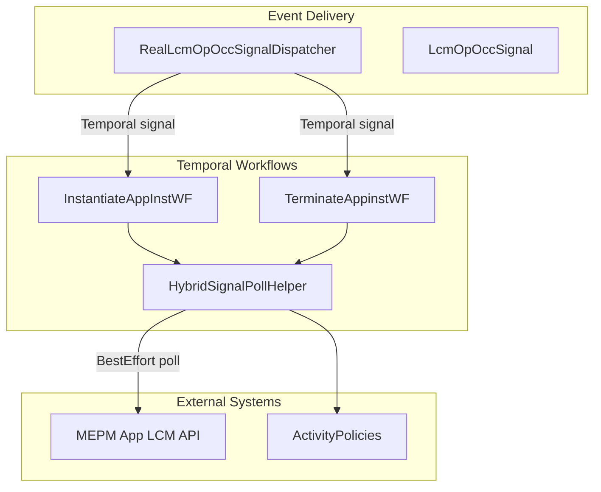
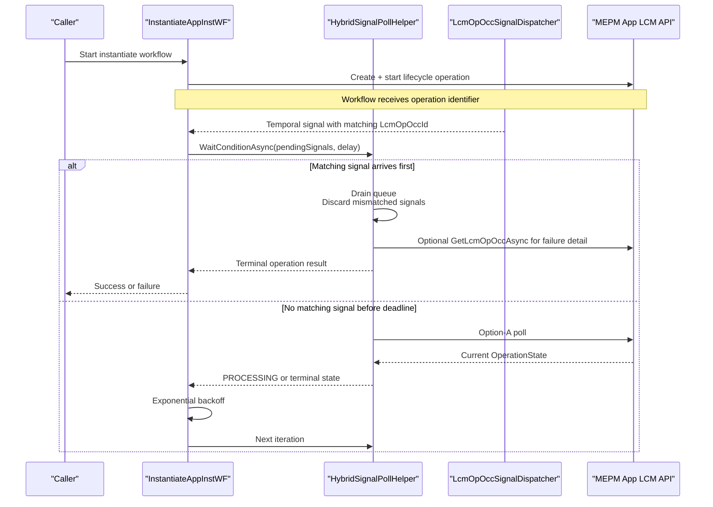
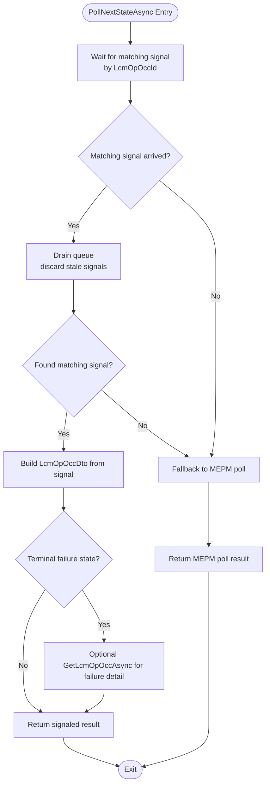
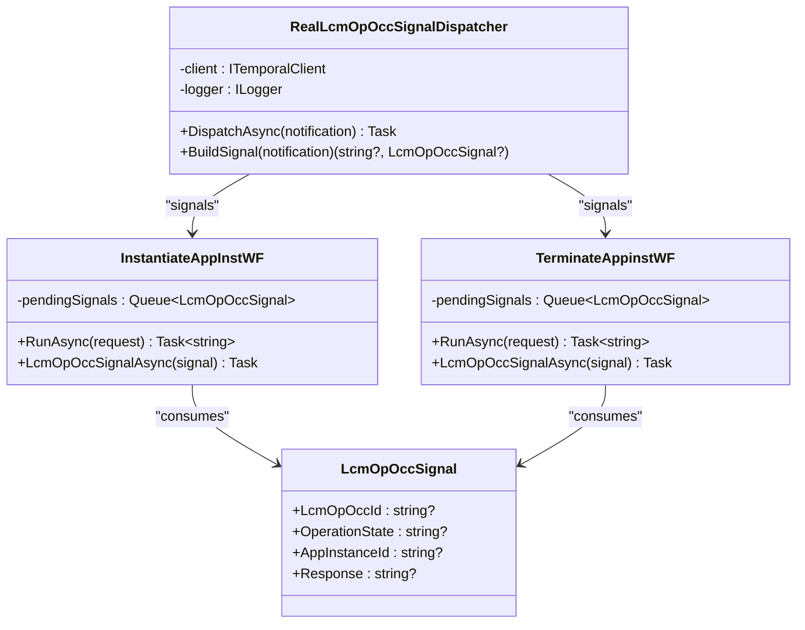
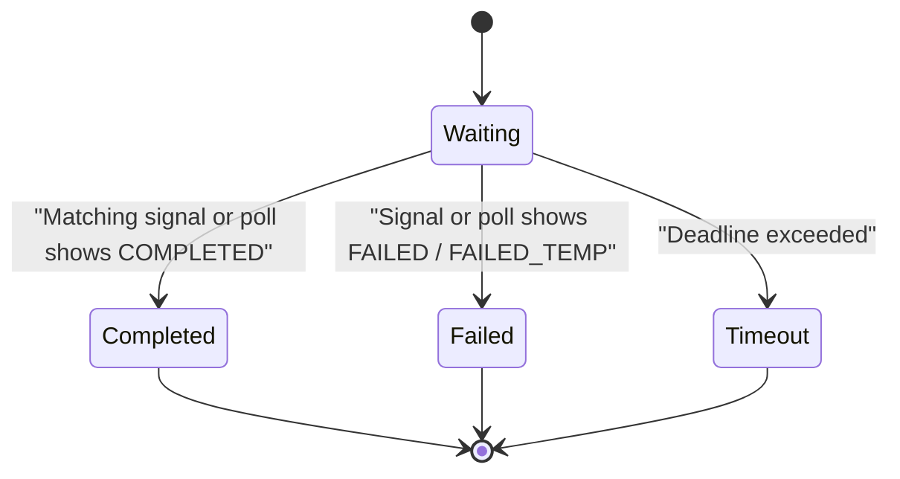
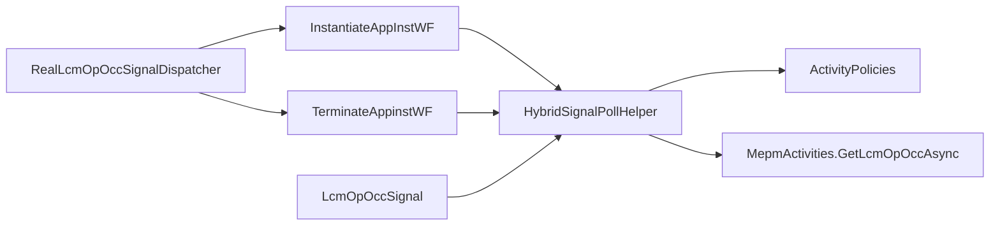

# Hybrid Signal Polling

## Table of Contents
1. [Introduction](#introduction)
2. [Project Structure](#project-structure)
3. [Core Components](#core-components)
4. [Architecture Overview](#architecture-overview)
5. [Detailed Component Analysis](#detailed-component-analysis)
6. [Dependency Analysis](#dependency-analysis)
7. [Performance Considerations](#performance-considerations)
8. [Troubleshooting Guide](#troubleshooting-guide)
9. [Conclusion](#conclusion)

## Introduction
This document explains the hybrid signal polling mechanism used by the MEAO orchestrator to monitor long-running application instance operations against the MEPM. The system combines two complementary strategies:

- **Signal fast-path**: When the MEPM emits a lifecycle operation state change, an event-driven dispatcher sends a Temporal workflow signal so the waiting workflow can short-circuit its polling loop.
- **Polling fallback**: If no signal arrives, or if the signal is stale, late, or missing failure detail, the workflow falls back to Option-A HTTP polling of the MEPM `GET /app_lcm_op_occs/{id}` endpoint.

The central coordination point is `HybridSignalPollHelper`, which preserves deterministic Temporal command sequencing while letting workflows wait efficiently on either a matching signal or an external status update. This design balances responsiveness with reliability in eventual-consistent distributed environments where callbacks may be delayed, reordered, dropped, or incomplete.

## Project Structure
The hybrid polling feature spans five main layers:

| Layer | Responsibility | Key Files |
|---|---|---|
| Workflow orchestration | Runs lifecycle workflows and owns the polling loop | `InstantiateAppInstWF.cs`, `TerminateAppinstWF.cs` |
| Coordination helper | Encapsulates signal-vs-poll decision logic | `HybridSignalPollHelper.cs` |
| Signal dispatchers | Deliver MEPM notifications into the correct workflow | `ILcmOpOccSignalDispatcher.cs` |
| Signal model | Carries op-occ identifiers and terminal state | `LcmOpOccSignal.cs` |
| Activity policies | Centralize retry, timeout, and best-effort semantics | `ActivityPolicies.cs` |
| External activities | Perform HTTP calls to APM/MEPM | `ApmActivities.cs` |

**Diagram sources**
- `src/Meao/Workflows/Common/HybridSignalPollHelper.cs#L17-L110`
- `src/Meao/Workflows/InstantiateAppInstWF.cs#L170-L242`
- `src/Meao/Workflows/TerminateAppinstWF.cs#L80-L163`
- `src/Meao/Services/ILcmOpOccSignalDispatcher.cs#L1-L92`
- `src/Meao/Workflows/Policies/ActivityPolicies.cs#L1-L126`

**Section sources**
- `src/Meao/Workflows/Common/HybridSignalPollHelper.cs#L1-L110`
- `src/Meao/Workflows/InstantiateAppInstWF.cs#L1-L353`
- `src/Meao/Workflows/TerminateAppinstWF.cs#L1-L272`
- `src/Meao/Services/ILcmOpOccSignalDispatcher.cs#L1-L92`
- `src/Meao/Models/LcmOpOccSignal.cs#L1-L21`
- `src/Meao/Workflows/Policies/ActivityPolicies.cs#L1-L126`
- `docs/ADR/0014-status-sync-option-a-polling.md#L1-L44`

## Core Components
The hybrid polling mechanism is built around a small set of focused components:

| Component | Role | Important Behavior |
|---|---|---|
| `HybridSignalPollHelper.PollNextStateAsync` | Coordinates one step of the signal-vs-poll loop | Waits for a matching signal, drains stale signals, falls back to MEPM polling, and optionally refreshes failure details |
| `InstantiateAppInstWF` | Instantiates an application instance | Starts the MEPM operation, then polls until completion, failure, or timeout |
| `TerminateAppinstWF` | Terminates an application instance | Same hybrid wait pattern as instantiation, followed by cleanup and compensation |
| `RealLcmOpOccSignalDispatcher` | Delivers MEPM lifecycle notifications | Maps a notification to a deterministic workflow ID and invokes the shared `LcmOpOccSignal` handler |
| `LcmOpOccSignal` | Signal payload | Carries the operation identifier, target app instance, operation state, and optional response detail |
| `ActivityPolicies.BestEffort` | Defines retry/timeout behavior for polling reads | Used for non-critical status reads such as `GetLcmOpOccAsync` |

**Section sources**
- `src/Meao/Workflows/Common/HybridSignalPollHelper.cs#L17-L110`
- `src/Meao/Workflows/InstantiateAppInstWF.cs#L170-L353`
- `src/Meao/Workflows/TerminateAppinstWF.cs#L80-L272`
- `src/Meao/Services/ILcmOpOccSignalDispatcher.cs#L1-L92`
- `src/Meao/Models/LcmOpOccSignal.cs#L1-L21`
- `src/Meao/Workflows/Policies/ActivityPolicies.cs#L88-L126`

## Architecture Overview
The architecture follows an event-driven fast-path with a durable polling fallback. It is designed for systems where the MEPM may eventually expose a terminal state through HTTP polling even when push notifications are delayed or absent.

**Diagram sources**
- `src/Meao/Workflows/Common/HybridSignalPollHelper.cs#L17-L110`
- `src/Meao/Workflows/InstantiateAppInstWF.cs#L170-L242`
- `src/Meao/Services/ILcmOpOccSignalDispatcher.cs#L35-L92`

The ADR for option-A polling documents that this repository uses polling as the active synchronization path while preserving the event-driven subscription infrastructure as the future target. The hybrid implementation keeps correctness intact regardless of whether the signal path is enabled.

**Section sources**
- `docs/ADR/0014-status-sync-option-a-polling.md#L1-L44`

## Detailed Component Analysis

### HybridSignalPollHelper
`HybridSignalPollHelper` is a static helper that encapsulates one iteration of the hybrid wait. Its responsibilities are intentionally narrow:

1. Wait for a pending signal whose `LcmOpOccId` matches the expected in-flight operation.
2. Drain the signal queue, discarding any signals for other operations.
3. Prefer the signaled operation result.
4. For terminal failure states, perform one additional MEPM read to capture detailed failure information when the signal did not include it.
5. Fall back to Option-A polling if no matching signal was found or if the matching signal was consumed by another drain path.

The helper preserves deterministic Temporal command ordering by using `Workflow.WaitConditionAsync` before scheduling activity tasks. This avoids nondeterministic replay failures caused by interleaving timers and activity scheduling decisions.

#### Processing Flow

**Diagram sources**
- `src/Meao/Workflows/Common/HybridSignalPollHelper.cs#L17-L110`

#### Complexity and Data Structures
- The signal queue is a FIFO `Queue<LcmOpOccSignal>`.
- Waiting is bounded by `Workflow.WaitConditionAsync` with a configurable delay.
- Draining is linear in the number of enqueued signals because every stale signal must be inspected and discarded.
- In steady-state operation, most iterations resolve after one signal or one poll; worst-case cost grows with queued stale signals rather than with the number of polling rounds.

**Section sources**
- `src/Meao/Workflows/Common/HybridSignalPollHelper.cs#L17-L110`

### Application Instance Status Monitoring Workflows
Both `InstantiateAppInstWF` and `TerminateAppinstWF` use the same hybrid polling pattern for application instance lifecycle monitoring:

| Aspect | Configuration |
|---|---|
| Timeout | 10 minutes per workflow operation |
| Initial polling interval | 2 seconds |
| Backoff strategy | Exponential growth up to 10 seconds |
| Polling activity policy | `BestEffort(TimeSpan.FromSeconds(30))` |
| Signal handler | Shared `LcmOpOccSignalAsync(LcmOpOccSignal)` |
| Terminal success state | `OperationStates.Completed` |
| Terminal failure states | `OperationStates.Failed` and `OperationStates.FailedTemp` |

#### InstantiateAppInstWF Monitoring Loop
The instantiation workflow:

1. Reserves capacity or accepts an operator-supplied host.
2. Registers the MEPM instance.
3. Creates a local grant.
4. Triggers MEPM instantiation.
5. Enters the hybrid polling loop.
6. On success, marks the grant consumed, updates MEAO state, registers the deployed MEC app in the catalogue, and returns success.
7. On failure, throws an error containing the MEPM response when available.
8. On timeout, triggers compensation: cancel the lifecycle operation, terminate the app instance on MEPM, release host capacity, reset MEAO state, and mark the grant failed.

#### TerminateAppinstWF Monitoring Loop
The termination workflow follows the same signal/poll structure but focuses on cleanup:

1. Reads the existing app instance.
2. Skips early if already `NOT_INSTANTIATED`.
3. Creates a termination grant and starts the MEPM terminate operation.
4. Waits for a terminal state using the hybrid helper.
5. Releases host capacity and removes the app from the catalogue.
6. Updates MEAO state only when cleanup succeeds.
7. Throws a cleanup-failure exception when cleanup steps fail.

**Section sources**
- `src/Meao/Workflows/InstantiateAppInstWF.cs#L170-L353`
- `src/Meao/Workflows/TerminateAppinstWF.cs#L80-L272`

### Signal Handling Patterns
Signal handling is implemented as a simple enqueue-and-consume pattern inside the workflow:

**Diagram sources**
- `src/Meao/Workflows/InstantiateAppInstWF.cs#L348-L353`
- `src/Meao/Workflows/TerminateAppinstWF.cs#L267-L272`
- `src/Meao/Models/LcmOpOccSignal.cs#L1-L21`
- `src/Meao/Services/ILcmOpOccSignalDispatcher.cs#L35-L92`

Key characteristics:

- The signal handler is idempotent at the enqueue level: duplicate signals are tolerated because the helper filters by `LcmOpOccId`.
- Mismatched signals are explicitly logged as stale and discarded.
- The dispatcher maps notifications to deterministic workflow IDs such as `instantiate-{AppInstanceId}` or `terminate-{AppInstanceId}`.
- Dispatcher failures are swallowed and logged so late or duplicate notifications do not break callback receivers.

**Section sources**
- `src/Meao/Services/ILcmOpOccSignalDispatcher.cs#L1-L92`
- `src/Meao/Models/LcmOpOccSignal.cs#L1-L21`
- `src/Meao/Workflows/Common/HybridSignalPollHelper.cs#L33-L73`

### Polling Interval Configuration
The polling configuration is defined in the workflow loops rather than centralized in a single settings object:

| Setting | Value | Scope |
|---|---:|---|
| Initial delay | 2 seconds | Both instantiation and termination workflows |
| Maximum delay | 10 seconds | Exponential backoff cap |
| Backoff multiplier | 1.5× | Applied per polling iteration |
| Operation timeout | 10 minutes | Per workflow execution |
| Poll activity timeout | 30 seconds | Best-effort `GetLcmOpOccAsync` call |
| Poll activity retries | Default `BestEffort` retry policy | Controlled by `ActivityPolicies` |

The backoff formula increases the delay each iteration until it reaches 10 seconds. This reduces load during long-running operations while still allowing reasonably quick detection of completed or failed states.

**Section sources**
- `src/Meao/Workflows/InstantiateAppInstWF.cs#L182-L232`
- `src/Meao/Workflows/TerminateAppinstWF.cs#L89-L143`
- `src/Meao/Workflows/Policies/ActivityPolicies.cs#L88-L126`

### Timeout Management
Timeouts operate at multiple levels:

| Level | Purpose | Behavior |
|---|---|---|
| Workflow-level timeout | Prevents indefinitely running lifecycle workflows | 10-minute deadline computed from `Workflow.UtcNow` |
| Activity-level timeout | Bounds individual HTTP calls | `BestEffort(TimeSpan.FromSeconds(30))` for status polling |
| Compensation timeout | Allows cleanup even under cancellation | Uses `CancellationToken.None` and longer retry budgets |
| Operation-specific overrides | Controls non-idempotent lifecycle POST calls | `LongRunning(..., maximumAttemptsOverride: 1)` |

The helper itself does not own the outer timeout; the workflow computes a deadline and exits the polling loop with a timeout exception if no terminal state is reached.

**Section sources**
- `src/Meao/Workflows/Common/HybridSignalPollHelper.cs#L17-L110`
- `src/Meao/Workflows/InstantiateAppInstWF.cs#L182-L242`
- `src/Meao/Workflows/TerminateAppinstWF.cs#L89-L163`
- `src/Meao/Workflows/Policies/ActivityPolicies.cs#L1-L126`

### Error Handling for Signal Failures
Signal delivery failures are handled defensively:

- If the MEPM notification has no `AppInstanceId`, the dispatcher returns without signaling.
- If the target workflow is not found or already closed, the dispatcher logs a warning and swallows the exception.
- Duplicate or late signals are safe because the workflow filters by `LcmOpOccId`.
- Stale signals for other operations are explicitly logged and discarded.

This design ensures that the event-driven fast-path improves responsiveness without making it a hard dependency for correctness.

**Section sources**
- `src/Meao/Services/ILcmOpOccSignalDispatcher.cs#L35-L92`
- `src/Meao/Workflows/Common/HybridSignalPollHelper.cs#L33-L73`

### Error Handling for Polling Failures
Polling errors are classified as non-critical status reads:

- `GetLcmOpOccAsync` is executed with `ActivityPolicies.BestEffort(TimeSpan.FromSeconds(30))`.
- The `BestEffort` policy defines bounded retries and timeouts suitable for transient network or service issues.
- If fetching failure detail fails during a terminal failure resolution, the helper logs a warning and continues using the signal’s response rather than failing the workflow.
- The workflow loop continues unless the MEPM reports a terminal failure state.

**Section sources**
- `src/Meao/Workflows/Common/HybridSignalPollHelper.cs#L74-L110`
- `src/Meao/Workflows/Policies/ActivityPolicies.cs#L88-L126`

### Conceptual Overview
The hybrid approach models three common distributed-system scenarios:

[No sources needed since this diagram shows conceptual workflow, not actual code structure]

## Dependency Analysis
The hybrid polling mechanism depends on Temporal workflow primitives, MEPM HTTP APIs, and centralized activity policies.

**Diagram sources**
- `src/Meao/Workflows/Common/HybridSignalPollHelper.cs#L17-L110`
- `src/Meao/Workflows/InstantiateAppInstWF.cs#L170-L353`
- `src/Meao/Workflows/TerminateAppinstWF.cs#L80-L272`
- `src/Meao/Services/ILcmOpOccSignalDispatcher.cs#L35-L92`
- `src/Meao/Workflows/Policies/ActivityPolicies.cs#L1-L126`

Coupling characteristics:

- Workflows depend on the helper rather than directly implementing signal-vs-poll logic, improving cohesion.
- Signal dispatchers depend on `ITemporalClient` and loggers, keeping integration concerns separate from workflow logic.
- Polling behavior is decoupled from workflow control flow through the helper and policy factory.
- There is no circular dependency between the helper, dispatchers, and workflows; the helper is invoked only by workflows.

**Section sources**
- `src/Meao/Workflows/Common/HybridSignalPollHelper.cs#L1-L110`
- `src/Meao/Services/ILcmOpOccSignalDispatcher.cs#L1-L92`
- `src/Meao/Workflows/Policies/ActivityPolicies.cs#L1-L126`

## Performance Considerations
The hybrid design trades off responsiveness and resource utilization across several dimensions:

| Concern | Current Behavior | Impact |
|---|---|---|
| Responsiveness | Signal arrival immediately wakes the workflow | Reduces latency compared to pure polling |
| Polling frequency | Starts at 2 seconds with exponential backoff to 10 seconds | Limits unnecessary MEPM load during slow operations |
| External call budget | Poll reads use `BestEffort` with a 2-minute schedule timeout | Avoids long-lived activity slots for non-critical reads |
| Memory usage | Pending signal queue grows only with unmatched notifications | Stale signals are drained once a match is found |
| Determinism | Uses `Workflow.WaitConditionAsync` before scheduling activities | Preserves Temporal replay safety |
| Failure recovery | Missing signal detail triggers one extra poll | Improves diagnostic fidelity without blocking progress |

Optimization opportunities worth considering:

- **Configurable polling intervals**: Move initial delay, backoff cap, and operation timeout into typed configuration so different lifecycle operations can tune responsiveness independently.
- **Adaptive backoff**: Increase backoff faster when the MEPM consistently returns `PROCESSING`, reducing wasted requests during long VIM/VIM adapter workloads.
- **Signal deduplication cache**: Keep a small in-memory set of recently processed `LcmOpOccId` values if duplicate signals become frequent.
- **Metrics**: Emit counters for signal-fast-path vs polling-only paths, stale-signal discard counts, and timeout rates.
- **Circuit-breaking for MEPM health**: If the MEPM becomes unreachable, prefer circuit-breaker behavior over repeated best-effort polls to avoid thread and connection pressure.

[No sources needed since this section provides general guidance]

## Troubleshooting Guide
Use the following techniques when diagnosing stuck or slow polling operations.

### Identify the Active Path
Check whether the workflow resolved via signal or polling:

- Look for logs indicating a stale signal was discarded.
- Look for logs indicating the workflow used a signaled op-occ state.
- Look for logs indicating a failed attempt to fetch MEPM failure detail.
- Inspect whether the operation reached a terminal state within the 10-minute deadline.

Relevant logging locations:

- Signal discard and signaled-result logging live in the helper.
- Dispatcher logs indicate whether a signal was sent.
- Workflow logs show timeout exceptions and compensation attempts.

**Section sources**
- `src/Meao/Workflows/Common/HybridSignalPollHelper.cs#L48-L104`
- `src/Meao/Services/ILcmOpOccSignalDispatcher.cs#L70-L92`
- `src/Meao/Workflows/InstantiateAppInstWF.cs#L222-L242`
- `src/Meao/Workflows/TerminateAppinstWF.cs#L144-L163`

### Diagnose Missed Signals
Common causes:

- Notification lacks `AppInstanceId`.
- Notification targets a workflow that is already closed.
- Callback delivery occurs after the workflow times out.
- Signal name mismatch due to incorrect SDK invocation.

Mitigations:

- Verify the dispatcher builds a valid workflow ID and signal.
- Confirm the signal handler is registered on both instantiation and termination workflows.
- Rely on polling fallback for correctness when signals are unreliable.

**Section sources**
- `src/Meao/Services/ILcmOpOccSignalDispatcher.cs#L35-L92`
- `src/Meao/Workflows/InstantiateAppInstWF.cs#L348-L353`
- `src/Meao/Workflows/TerminateAppinstWF.cs#L267-L272`

### Diagnose Stuck Polling
Symptoms:

- Operation remains in `PROCESSING`.
- Delay increases toward the 10-second cap.
- Workflow hits the 10-minute timeout.

Checks:

- Confirm the MEPM exposes the expected `LcmOpOccId`.
- Verify `GetLcmOpOccAsync` is reachable through the configured MEPM base URL.
- Check whether the operation reached a terminal state outside the helper’s view.
- Review compensation logs for canceled lifecycle operations or failed terminations.

**Section sources**
- `src/Meao/Workflows/Common/HybridSignalPollHelper.cs#L74-L110`
- `src/Meao/Workflows/InstantiateAppInstWF.cs#L242-L353`
- `src/Meao/Workflows/TerminateAppinstWF.cs#L163-L272`

### Debugging Signal-Based Workflows Beyond Lifecycle Operations
Although the lifecycle workflows use `LcmOpOccSignal`, the same hybrid philosophy appears in onboarding workflows through `AppDParseCompletedSignal` and `OnboardAppPkgWF`. These patterns demonstrate:

- A signal fast-path that resumes parsing as soon as the backend completes.
- A polling fallback that waits for completion when the signal path is unavailable.
- A dispatcher that targets deterministic workflow IDs and swallows delivery failures.

This reinforces that hybrid signal/polling is a reusable pattern across MEAO workflows, not limited to application instance lifecycle operations.

**Section sources**
- `src/Meao/Activities/ApmActivities.cs#L108-L170`

## Conclusion
The hybrid signal polling mechanism provides a robust balance between immediate responsiveness and reliable progress tracking in distributed MEPM interactions. By combining Temporal workflow signals with Option-A HTTP polling, the system:

- Responds quickly when the MEPM notifies MEO promptly.
- Remains correct when signals are delayed, duplicated, or lost.
- Captures meaningful failure details through targeted fallback polling.
- Preserves deterministic Temporal execution through guarded command sequencing.
- Keeps resource usage bounded through configurable timeouts, backoff, and best-effort activity policies.

For future evolution, the repository already retains the MEPM subscription and notification infrastructure described in the relevant ADR. As push-based delivery matures, the signal fast-path can become dominant while the polling fallback remains the durability guarantee for eventual consistency.

[No sources needed since this section summarizes without analyzing specific files]

> **Referenced Files in This Document**
>
> - `src/Meao/Workflows/Common/HybridSignalPollHelper.cs`
> - `src/Meao/Workflows/InstantiateAppInstWF.cs`
> - `src/Meao/Workflows/TerminateAppinstWF.cs`
> - `src/Meao/Workflows/Policies/ActivityPolicies.cs`
> - `src/Meao/Services/ILcmOpOccSignalDispatcher.cs`
> - `src/Meao/Models/LcmOpOccSignal.cs`
> - `src/Meao/Activities/ApmActivities.cs`
> - `docs/ADR/0014-status-sync-option-a-polling.md`
