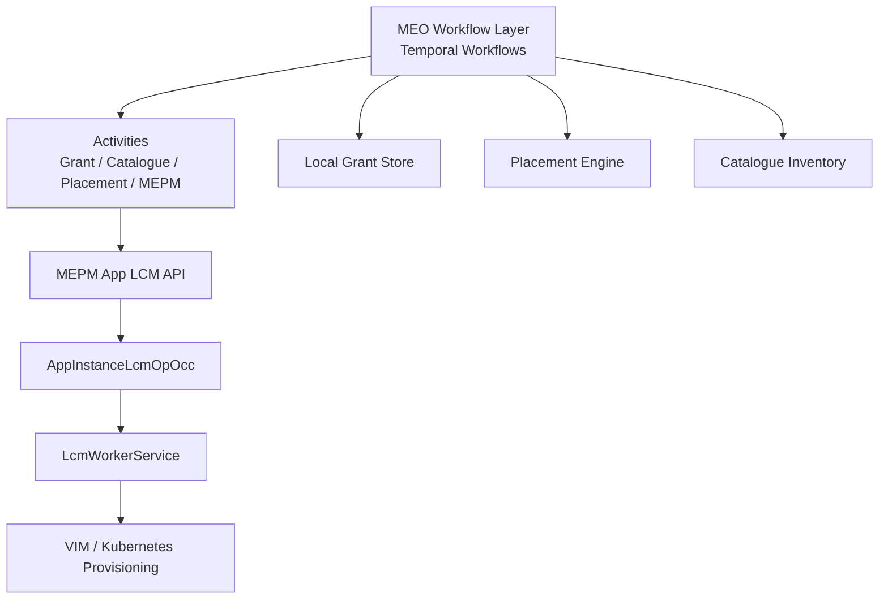
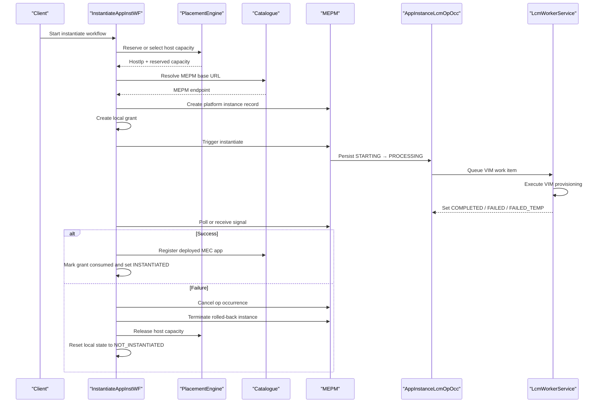
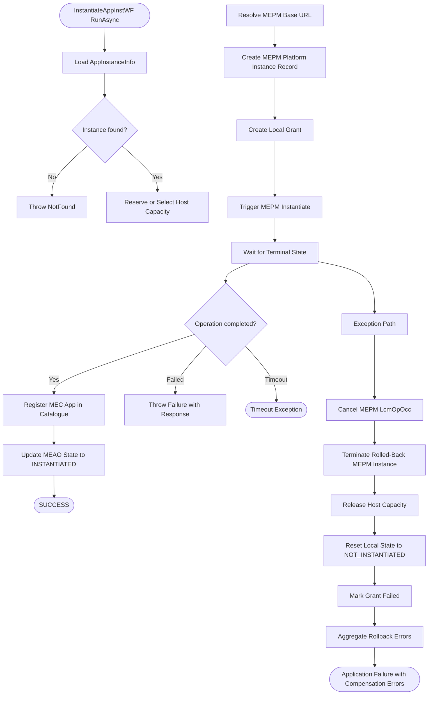
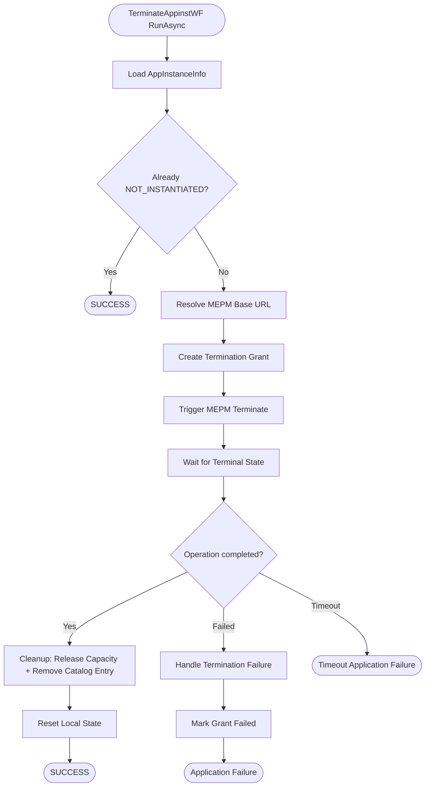
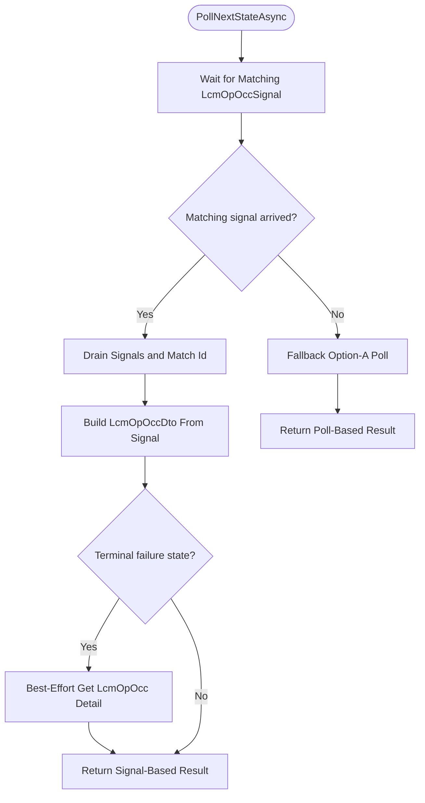
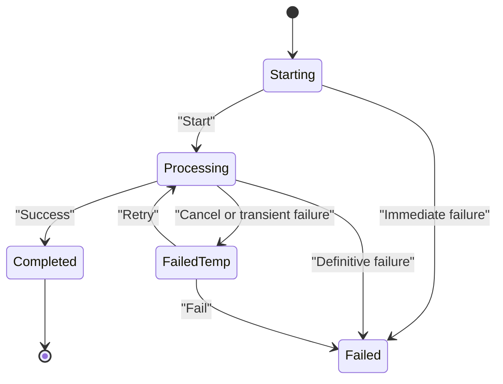
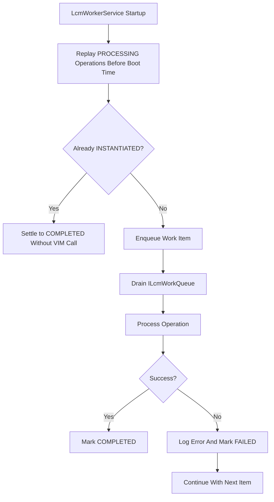
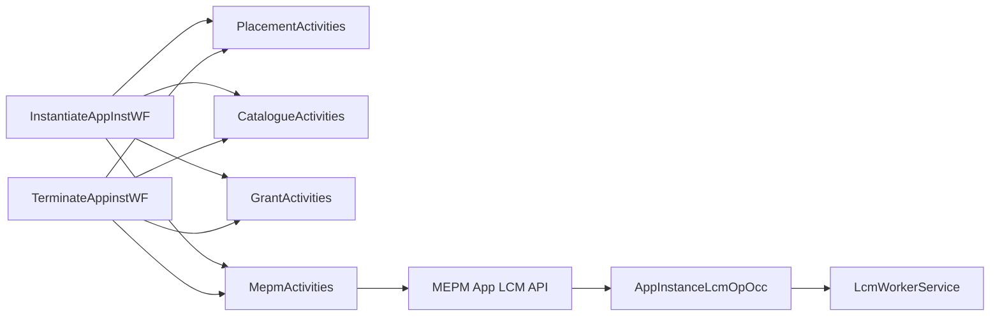

# Saga Compensation Pattern

## Table of Contents
1. [Introduction](#introduction)
2. [Project Structure](#project-structure)
3. [Core Components](#core-components)
4. [Architecture Overview](#architecture-overview)
5. [Detailed Component Analysis](#detailed-component-analysis)
6. [Dependency Analysis](#dependency-analysis)
7. [Performance Considerations](#performance-considerations)
8. [Troubleshooting Guide](#troubleshooting-guide)
9. [Conclusion](#conclusion)

## Introduction
This document explains the saga compensation pattern implemented for distributed application lifecycle operations in the system. The primary goal is to coordinate multi-step workflows across MEO (MEAO), MEPM, placement and catalog services, while guaranteeing that partial failures are detected, recorded, compensated, and made observable.

The key design choices are:
- Temporal workflows implement sagas as durable step sequences with explicit compensation paths.
- MEPM owns asynchronous lifecycle operation state through `AppInstanceLcmOpOcc`, which can be polled or signaled.
- Compensation activities use a dedicated retry policy intended for best-effort cleanup rather than strict idempotent retries.
- Failure scenarios include MEPM instantiation failure, MEPM termination failure, placement release failure, catalog update failure, and database state updates during rollback.

## Project Structure
The saga implementation spans two main services:

| Area | Responsibility |
|---|---|
| `src/Meao` | Temporal workflow orchestration, grant management, placement coordination, catalog registration, and MEPM client activities. |
| `src/PlatformManager` | Lifecycle operation occurrence persistence, state machine enforcement, background VIM worker, and manual cancellation/retry endpoints. |

**Diagram sources**
- `src/Meao/Workflows/InstantiateAppInstWF.cs#L1-L353`
- `src/Meao/Workflows/TerminateAppinstWF.cs#L1-L272`
- `src/PlatformManager/PlatformManager/Models/AppInstanceLcmOpOcc.cs#L1-L54`
- `src/PlatformManager/PlatformManager/Services/LcmWorkerService.cs#L1-L200`

**Section sources**
- `src/Meao/Workflows/InstantiateAppInstWF.cs#L1-L353`
- `src/Meao/Workflows/TerminateAppinstWF.cs#L1-L272`
- `src/PlatformManager/PlatformManager/Models/AppInstanceLcmOpOcc.cs#L1-L54`
- `src/PlatformManager/PlatformManager/Services/LcmWorkerService.cs#L1-L200`

## Core Components
The saga pattern is implemented by two principal workflows and supporting infrastructure:

| Component | Role |
|---|---|
| `InstantiateAppInstWF` | Coordinates host placement, MEPM instance creation, grant creation, MEPM instantiation trigger, hybrid signal/poll waiting, successful completion, and compensation on failure. |
| `TerminateAppinstWF` | Coordinates grant creation for termination, MEPM termination trigger, terminal-state polling, capacity release, catalog removal, and local state reset. |
| `ActivityPolicies` | Centralized Temporal activity options for standard, long-running, compensation, and best-effort execution. |
| `HybridSignalPollHelper` | Polls MEPM lifecycle operation occurrences while short-circuiting when an `LcmOpOccSignal` arrives. |
| `AppInstanceLcmOpOcc` | ETSI-aligned lifecycle operation occurrence model persisted by MEPM. |
| `LifecycleStateMachine` | Enforces legal ETSI state transitions. |
| `LcmOpOccEndpoints` | REST endpoints for listing, canceling, failing, and retrying operation occurrences. |
| `LcmWorkerService` | Background worker driving VIM provisioning and crash-replaying stranded processing operations. |

**Section sources**
- `src/Meao/Workflows/InstantiateAppInstWF.cs#L1-L353`
- `src/Meao/Workflows/TerminateAppinstWF.cs#L1-L272`
- `src/Meao/Workflows/Policies/ActivityPolicies.cs#L1-L126`
- `src/Meao/Workflows/Common/HybridSignalPollHelper.cs#L1-L110`
- `src/PlatformManager/PlatformManager/Models/AppInstanceLcmOpOcc.cs#L1-L54`
- `src/PlatformManager/PlatformManager/Services/LifecycleStateMachine.cs#L1-L51`
- `src/PlatformManager/PlatformManager/Endpoints/LcmOpOccEndpoints.cs#L1-L163`
- `src/PlatformManager/PlatformManager/Services/LcmWorkerService.cs#L1-L200`

## Architecture Overview
The saga architecture separates orchestration from execution:

1. **MEO orchestrates**: It owns workflow state, coordinates external services, and runs compensation logic.
2. **MEPM executes**: It owns lifecycle operation state and performs potentially long-running VIM operations asynchronously.
3. **Compensation is best-effort**: Cleanup steps may fail; failures are logged, aggregated, and surfaced without masking original errors.
4. **Monitoring is state-driven**: Observability relies on MEPM operation occurrences, grants, and local MEAO instance state.

**Diagram sources**
- `src/Meao/Workflows/InstantiateAppInstWF.cs#L1-L353`
- `src/PlatformManager/PlatformManager/Models/AppInstanceLcmOpOcc.cs#L1-L54`
- `src/PlatformManager/PlatformManager/Services/LcmWorkerService.cs#L1-L200`

## Detailed Component Analysis

### InstantiateAppInstWF Saga
The instantiation saga follows these logical phases:

| Phase | Action | Failure Handling |
|---|---|---|
| Instance lookup | Load `AppInstanceInfo` from MEAO database. | Throws not-found error before any side effects. |
| Capacity reservation | Dynamic placement or operator-supplied host reservation. | Reservation state is tracked via `capacityReserved`. |
| MEPM coordination | Ensure MEPM platform instance exists and resolve MEPM base URL. | Errors surface before grant creation where possible. |
| Grant creation | Create local grant for instantiate. | Grant tracking enables compensation marking. |
| MEPM instantiation trigger | Call MEPM instantiate; returns 202 with `LcmOpOccId`. | Non-idempotent POST uses maximum attempts override of one. |
| State synchronization | Update `LatestLcmOpOccId` on the local instance. | Updated after successful trigger. |
| Terminal wait | Hybrid signal/poll loop over 10 minutes. | Best-effort polling avoids blocking workflow retries. |
| Success path | Mark grant consumed, update MEAO state to `INSTANTIATED`, register catalog entry. | Catalog registration failure triggers outer compensation. |
| Compensation path | Cancel MEPM operation, terminate rolled-back instance, release capacity, reset local state, mark grant failed. | Each compensation step is isolated and best-effort. |

**Diagram sources**
- `src/Meao/Workflows/InstantiateAppInstWF.cs#L1-L353`
- `src/Meao/Workflows/Policies/ActivityPolicies.cs#L1-L126`

**Section sources**
- `src/Meao/Workflows/InstantiateAppInstWF.cs#L1-L353`

### TerminateAppinstWF Compensation Flow
Termination is itself a compensation-oriented workflow because it must undo previously successful instantiation:

| Step | Purpose |
|---|---|
| Instance validation | Reject missing instances and treat already-not-instantiated instances as success. |
| MEPM base URL resolution | Determine target MEPM using persisted host information. |
| Grant creation | Record termination intent locally. |
| MEPM termination trigger | Start asynchronous termination. |
| Terminal wait | Poll until completion, timeout, or failure. |
| Successful termination cleanup | Mark grant consumed, release capacity, remove catalog entry, reset local state. |
| Cleanup failure handling | Aggregate cleanup exceptions and surface them as a distinct cleanup failure. |
| Error path | Mark grant failed if termination did not complete successfully. |

**Diagram sources**
- `src/Meao/Workflows/TerminateAppinstWF.cs#L1-L272`

**Section sources**
- `src/Meao/Workflows/TerminateAppinstWF.cs#L1-L272`

### Activity Policies and Retry Semantics
The saga relies on four explicit policies:

| Policy | Typical Use | Retry Behavior |
|---|---|---|
| `Standard` | Short operations such as database access, grant creation, catalog queries. | Up to three attempts with exponential backoff. |
| `LongRunning` | MEPM lifecycle calls and OCI reference stages. | Up to three attempts with longer schedule-to-close budget. |
| `Compensation` | Rollback steps like capacity release, catalog removal, state reset. | Up to five attempts, detached cancellation token, designed for best-effort cleanup. |
| `BestEffort` | Polling and non-critical reads. | Up to three attempts with shorter timeouts; failures should not block workflow progress. |

Important details:
- Long-running MEPM POST operations intentionally override maximum attempts to one when idempotency cannot be guaranteed.
- Compensation retries do not inherit parent cancellation tokens, so cleanup continues even if the workflow is being canceled.
- Best-effort polling ensures the workflow remains responsive even when MEPM state retrieval is temporarily unavailable.

**Section sources**
- `src/Meao/Workflows/Policies/ActivityPolicies.cs#L1-L126`
- `src/Meao/Workflows/Common/HybridSignalPollHelper.cs#L1-L110`

### Hybrid Signal and Poll Coordination
The hybrid signal/poll mechanism reduces latency while preserving resilience:

1. A temporary queue holds incoming `LcmOpOccSignal` values.
2. The workflow waits for a signal whose `LcmOpOccId` matches the in-flight operation.
3. When a matching signal arrives, stale signals are discarded and the matched signal is used.
4. For terminal failure states, the helper makes one additional best-effort poll to capture richer failure detail.
5. If no matching signal arrives, Option-A polling against MEPM is used as fallback.

**Diagram sources**
- `src/Meao/Workflows/Common/HybridSignalPollHelper.cs#L1-L110`

**Section sources**
- `src/Meao/Workflows/Common/HybridSignalPollHelper.cs#L1-L110`

### LcmOpOcc Tracking Mechanism
`AppInstanceLcmOpOcc` is the canonical record of asynchronous lifecycle operations. Its fields provide both ETSI-required semantics and internal operational context:

| Field Category | Meaning |
|---|---|
| Identity | `Id`, `AppInstanceId`, `LifecycleOperation`. |
| State | `OperationState`, `StateEnteredTime`, `StartTime`, optional `EndTime`. |
| Diagnostics | `Response` containing VIM response or error detail. |
| Crash replay | `HostIp`, `VimType`, `AppPkgId`, `ChangeStateTo`, `ConfigPayloadJson`. |

The state machine enforces valid transitions:

| Current State | Allowed Next States |
|---|---|
| `STARTING` | `PROCESSING`, `FAILED` |
| `PROCESSING` | `COMPLETED`, `FAILED`, `FAILED_TEMP` |
| `FAILED` | `PROCESSING` |
| `FAILED_TEMP` | `PROCESSING`, `FAILED` |
| `COMPLETED` | None |

Manual operation occurrence control is exposed through REST endpoints:

| Endpoint | Purpose |
|---|---|
| GET `/app_lcm_op_occs` | Paginated list of operation occurrences. |
| GET `/app_lcm_op_occs/{id}` | Single operation occurrence. |
| POST `/app_lcm_op_occs/{id}/cancel` | Transition `PROCESSING` to `FAILED_TEMP`. |
| POST `/app_lcm_op_occs/{id}/fail` | Transition `FAILED_TEMP` to `FAILED`. |
| POST `/app_lcm_op_occs/{id}/retry` | Transition `FAILED_TEMP` to `PROCESSING` and enqueue work again. |

**Diagram sources**
- `src/PlatformManager/PlatformManager/Services/LifecycleStateMachine.cs#L1-L51`
- `src/PlatformManager/PlatformManager/Endpoints/LcmOpOccEndpoints.cs#L1-L163`

**Section sources**
- `src/PlatformManager/PlatformManager/Models/AppInstanceLcmOpOcc.cs#L1-L54`
- `src/PlatformManager/PlatformManager/Services/LifecycleStateMachine.cs#L1-L51`
- `src/PlatformManager/PlatformManager/Endpoints/LcmOpOccEndpoints.cs#L1-L163`

### MEPM Crash-Replay and Worker Behavior
`LcmWorkerService` provides durability guarantees for long-running VIM operations:

- On startup, it replays operation occurrences stranded in `PROCESSING` before draining the work queue.
- Replay isolates per-row failures so one bad operation does not strand the backlog.
- An `Instantiate` operation whose target instance is already instantiated is settled to `COMPLETED` without issuing another VIM call.
- Normal worker failures mark the operation as failed rather than completing it silently.
- Manual retry endpoints allow operators to re-enqueue stranded work.

**Diagram sources**
- `src/PlatformManager/PlatformManager/Services/LcmWorkerService.cs#L1-L200`

**Section sources**
- `src/PlatformManager/PlatformManager/Services/LcmWorkerService.cs#L1-L200`

## Dependency Analysis
The following diagram maps workflow dependencies between MEO orchestration and MEPM lifecycle execution:

**Diagram sources**
- `src/Meao/Workflows/InstantiateAppInstWF.cs#L1-L353`
- `src/Meao/Workflows/TerminateAppinstWF.cs#L1-L272`
- `src/PlatformManager/PlatformManager/Models/AppInstanceLcmOpOcc.cs#L1-L54`
- `src/PlatformManager/PlatformManager/Services/LcmWorkerService.cs#L1-L200`

Coupling observations:
- Workflows depend on activities rather than directly on HTTP clients, improving testability and retry policy binding.
- MEPM dependency is abstracted behind activities, but MEPM owns the authoritative lifecycle state.
- Compensation steps are loosely coupled: each failure is caught, logged, and optionally aggregated.
- Data consistency depends on multiple stores: MEAO database, MEPM operation occurrences, grants, placement inventory, and catalogue inventory.

**Section sources**
- `src/Meao/Workflows/InstantiateAppInstWF.cs#L1-L353`
- `src/Meao/Workflows/TerminateAppinstWF.cs#L1-L272`

## Performance Considerations
- **Polling latency**: The hybrid signal/poll approach reduces round-trips by accepting MEPM notifications early, falling back to polling when needed.
- **Retry bounds**: Standard and long-running policies cap retries at three; compensation caps at five; best-effort polls cap at three.
- **Workflow timeouts**: Instantiation and termination loops use a ten-minute deadline around polling.
- **Long-running operations**: MEPM lifecycle calls use a longer schedule-to-close budget because they delegate to asynchronous MEPM workers.
- **Crash replay**: MEPM startup replay avoids N+1 queries by batching instance lookups and processes rows deterministically.

[No sources needed since this section provides general guidance]

## Troubleshooting Guide

### Monitoring Failed Sagas
Use these data sources to identify incomplete or failed sagas:

| Source | What to Inspect |
|---|---|
| MEAO instance state | Look for instances stuck between `NOT_INSTANTIATED` and `INSTANTIATED`, or stopped instances still holding `HostIp`. |
| Grants | Identify grants that are neither consumed nor marked failed. |
| MEPM operation occurrences | Inspect `FAILED` and `FAILED_TEMP` occurrences for recent instantiate or terminate requests. |
| Catalogue inventory | Verify whether deployed applications are present despite failed catalog registration. |
| Placement inventory | Check whether reserved capacity has been released. |

Recommended checks:
- List operation occurrences and filter by `FAILED_TEMP` to find recoverable items.
- Inspect single operation occurrence responses for VIM-level diagnostics.
- Correlate `AppInstanceId` across MEAO, grants, MEPM occurrences, and catalogue entries.

**Section sources**
- `src/PlatformManager/PlatformManager/Endpoints/LcmOpOccEndpoints.cs#L1-L163`
- `src/PlatformManager/PlatformManager/Models/AppInstanceLcmOpOcc.cs#L1-L54`

### Manual Intervention Procedures
| Situation | Recommended Action |
|---|---|
| Operation occurrence stuck in `PROCESSING` after a MEPM restart | Let `LcmWorkerService` replay automatically; inspect replay logs. |
| Operation occurrence in `FAILED_TEMP` | Use the retry endpoint to transition back to `PROCESSING`. |
| Operation occurrence needs explicit failure confirmation | First cancel to reach `FAILED_TEMP`, then fail to reach `FAILED`. |
| Instance appears instantiated but catalog entry is missing | Re-run catalog registration manually; investigate why compensation did not succeed. |
| Capacity remains reserved after failed instantiation | Manually verify placement inventory and release capacity if safe. |
| Grant remains uncommitted | Investigate whether the workflow reached the consumption or failure branch. |

**Section sources**
- `src/PlatformManager/PlatformManager/Endpoints/LcmOpOccEndpoints.cs#L1-L163`
- `src/PlatformManager/PlatformManager/Services/LcmWorkerService.cs#L1-L200`

### Concrete Failure Scenarios and Recovery Strategies

#### Scenario 1: MEPM Instantiation Fails After Grant Creation
- **Observed state**: Grant created; MEPM operation occurrence in `FAILED` or `FAILED_TEMP`; local instance possibly partially updated.
- **Saga behavior**: The workflow throws a failure, cancels the MEPM operation occurrence, attempts to terminate the rolled-back instance, releases capacity, resets local state, and marks the grant failed.
- **Recovery strategy**:
  - Inspect MEPM operation occurrence response for root cause.
  - If compensation failed, run targeted compensations: terminate MEPM instance, release capacity, reset MEAO state, mark grant failed.
  - Do not retry instantiation until capacity and catalog state are reconciled.

**Section sources**
- `src/Meao/Workflows/InstantiateAppInstWF.cs#L201-L353`
- `src/Meao/Workflows/Policies/ActivityPolicies.cs#L1-L126`

#### Scenario 2: Catalog Registration Fails After Successful MEPM Instantiation
- **Observed state**: MEPM operation completed successfully; MEAO instance may be `INSTANTIATED`; catalogue inventory missing or inconsistent.
- **Saga behavior**: Catalog registration is treated as mandatory; failure triggers the outer compensation path.
- **Recovery strategy**:
  - Confirm MEPM instance is actually running.
  - Retry catalog registration.
  - If necessary, reconcile catalogue inventory against actual deployments.

**Section sources**
- `src/Meao/Workflows/InstantiateAppInstWF.cs#L201-L230`

#### Scenario 3: Termination Succeeds But Capacity Release Fails
- **Observed state**: MEPM termination completed; capacity still reserved; catalogue entry removed.
- **Saga behavior**: Cleanup exceptions are aggregated and surfaced as a cleanup failure.
- **Recovery strategy**:
  - Retry capacity release.
  - If repeated failures occur, perform manual capacity reconciliation.
  - Validate that local instance state is consistent with external resources.

**Section sources**
- `src/Meao/Workflows/TerminateAppinstWF.cs#L130-L205`

#### Scenario 4: Operation Occurrence Stranded in PROCESSING After MEPM Crash
- **Observed state**: MEPM process restarted; operation occurrence remains `PROCESSING`.
- **Saga behavior**: `LcmWorkerService` replays pre-boot `PROCESSING` rows; already-instanced instantiate operations are settled to `COMPLETED` without re-provisioning.
- **Recovery strategy**:
  - Allow automatic replay.
  - Inspect replay logs for settle or enqueue events.
  - If replay fails for a specific row, inspect isolation and retry manually.

**Section sources**
- `src/PlatformManager/PlatformManager/Services/LcmWorkerService.cs#L1-L200`

### Data Consistency Guarantees During Partial Failures
The system does not claim strong distributed ACID consistency across all services. Instead, it uses:

- **Durable orchestration**: Temporal workflows persist step history and can replay compensation.
- **Authoritative lifecycle state**: MEPM owns lifecycle operation state; MEO observes it.
- **Best-effort compensation**: Cleanup actions are retried more aggressively but are not guaranteed to succeed.
- **Operational visibility**: Failed sagas become observable through grants, operation occurrences, instance state, and catalogue entries.
- **Manual recovery**: Operators can cancel, fail, or retry operation occurrences to drive recovery.

Consistency caveats:
- Temporary inconsistency is expected during partial failures.
- Compensation failures require manual intervention.
- Catalogue and placement inventories may diverge briefly from actual runtime state.
- Grants provide a useful but secondary consistency signal compared to MEAO instance state and MEPM operation occurrences.

[No sources needed since this section summarizes observed behavior without quoting specific code]

## Conclusion
The saga compensation pattern in this system is centered on Temporal workflows coordinating external lifecycle services. `InstantiateAppInstWF` implements forward progress with compensation for grant allocation, placement selection, MEPM instantiation, and catalog registration. `TerminateAppinstWF` implements reverse compensation for capacity release and catalog cleanup. MEPM’s `AppInstanceLcmOpOcc` provides durable, observable, and manually recoverable lifecycle operation state.

The most important operational principle is that compensation is reliable but not infallible. Systems should monitor failed operation occurrences, stalled workflows, inconsistent catalogue or placement state, and unresolved grants. When compensation fails, manual intervention should reconcile external state before retrying higher-level operations.

> **Referenced Files in This Document**
>
> - `src/Meao/Workflows/InstantiateAppInstWF.cs`
> - `src/Meao/Workflows/TerminateAppinstWF.cs`
> - `src/Meao/Workflows/Policies/ActivityPolicies.cs`
> - `src/Meao/Workflows/Common/HybridSignalPollHelper.cs`
> - `src/PlatformManager/PlatformManager/Models/AppInstanceLcmOpOcc.cs`
> - `src/PlatformManager/PlatformManager/Endpoints/LcmOpOccEndpoints.cs`
> - `src/PlatformManager/PlatformManager/Services/LifecycleStateMachine.cs`
> - `src/PlatformManager/PlatformManager/Services/LcmWorkerService.cs`
