# Temporal Workflow Definitions

<cite>
**Referenced Files in This Document**
- `src/Meao/Program.cs`
- `src/Meao/Workflows/CreateAppInstWF.cs`
- `src/Meao/Workflows/InstantiateAppInstWF.cs`
- `src/Meao/Workflows/TerminateAppinstWF.cs`
- `src/Meao/Workflows/OnboardAppPkgWF.cs`
- `src/Meao/Workflows/Policies/ActivityPolicies.cs`
- `src/Meao/Infrastructure/TemporalWorkflowExceptionHandler.cs`
</cite>

## Table of Contents
1. [Introduction](#introduction)
2. [Project Structure](#project-structure)
3. [Core Components](#core-components)
4. [Architecture Overview](#architecture-overview)
5. [Detailed Component Analysis](#detailed-component-analysis)
6. [Dependency Analysis](#dependency-analysis)
7. [Performance Considerations](#performance-considerations)
8. [Testing and Replay](#testing-and-replay)
9. [Debugging Failed Executions](#debugging-failed-executions)
10. [Versioning Strategy](#versioning-strategy)
11. [Conclusion](#conclusion)

## Introduction
This document explains how the Meao service uses Temporal to implement durable, deterministic workflow state machines for application package onboarding and application instance lifecycle management. The four core workflow classes are:

| Workflow class | Lifecycle purpose | Main services coordinated |
|---|---|---|
| `CreateAppInstWF` | Creates an application instance record, validates the package, optionally binds MEPM when a host is known, and persists the instance as not instantiated. | ApmApi, Catalogue, PlatformManager (MEPM), MEAO database |
| `InstantiateAppInstWF` | Reserves capacity, registers the MEPM instance, creates a grant, triggers asynchronous instantiation via MEPM, polls or waits for completion, updates local state, and compensates on failure. | Placement engine, Catalogue, Grant service, MEPM |
| `TerminateAppinstWF` | Stops an instantiated instance through MEPM, releases host capacity, removes catalogue inventory, and marks the instance stopped. | Catalogue, MEPM, MEAO database |
| `OnboardAppPkgWF` | Durable package onboarding saga with claim verification, AppD validation/parsing, OCI reference resolution, catalogue inventory registration, publication/finalization, and compensation rollback. | ApmApi, Catalogue |

All workflows are registered with the Temporal worker in Meao’s ASP.NET Core host, run against a shared task queue, and use activities to call external services while keeping workflow logic deterministic.

## Project Structure
The Meao project contains:

- **Workflow definitions**: under `Workflows`, one file per workflow.
- **Activity policies**: under `Workflows/Policies`.
- **Activities**: under `Activities`, invoked by workflows.
- **Endpoints**: HTTP entry points that start workflows.
- **Domain models and requests**: request/response types consumed by workflows.
- **Infrastructure**: exception handling, HTTP client registration, and Temporal integration.

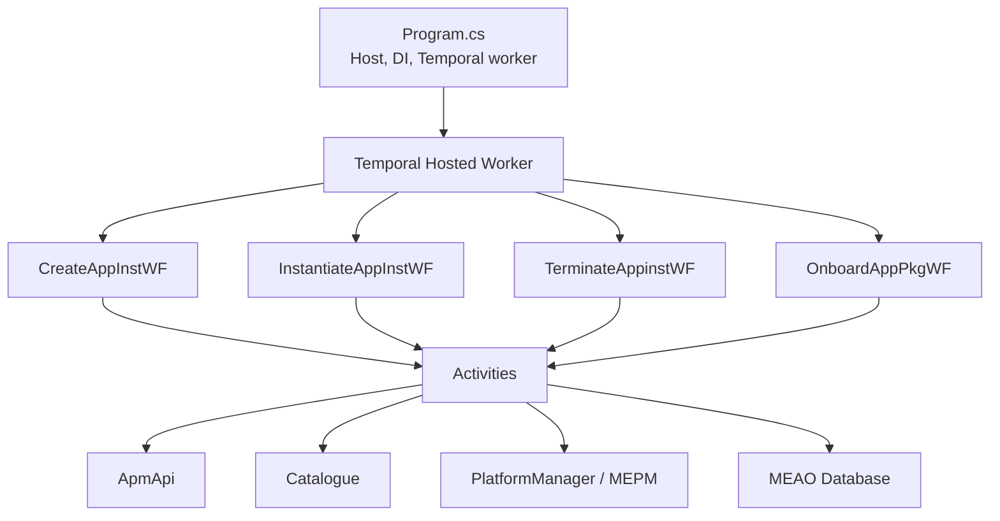

**Diagram sources**
- `src/Meao/Program.cs#L150-L175`
- `src/Meao/Workflows/CreateAppInstWF.cs#L1-L118`
- `src/Meao/Workflows/InstantiateAppInstWF.cs#L1-L353`
- `src/Meao/Workflows/TerminateAppinstWF.cs#L1-L272`
- `src/Meao/Workflows/OnboardAppPkgWF.cs#L1-L367`

**Section sources**
- `src/Meao/Program.cs#L1-L256`

## Core Components
The workflow layer is built around four deterministic orchestrators plus a centralized activity policy factory.

### Shared Activity Policies
`ActivityPolicies` centralizes retry, timeout, and compensation behavior:

| Policy | Typical use | Retry attempts | Schedule-to-close budget | Notes |
|---|---|---:|---:|---|
| `Standard` | Short operations such as DB writes, catalogue registration, token acquisition | 3 | 10 minutes | Can override maximum attempts for non-idempotent calls |
| `LongRunning` | LCM starts, publish/reference resolution | 3 | 20 minutes | Used where downstream processing may take longer |
| `Compensation` | Rollback/cleanup after failure | 5 | 10 minutes | Uses a detached cancellation token so cleanup can continue during workflow cancellation |
| `BestEffort` | Polls and non-critical reads | 3 | 2 minutes | Suitable for repeated status checks |

**Section sources**
- `src/Meao/Workflows/Policies/ActivityPolicies.cs#L1-L126`

### Workflow Registration
In `Program.cs`, the Temporal worker is configured with:

- Task queue: `meao-task-queue`.
- Namespace: `default`.
- Target host: configurable via `TEMPORAL_TARGET_HOST`, defaulting to `temporal:7233`.
- Scoped activities: `CatalogueActivities`, `ApmActivities`, `AuthActivities`, `MepmActivities`, `AppInstanceActivities`, `GrantActivities`, `PlacementActivities`.
- Registered workflows: `CreateAppInstWF`, `InstantiateAppInstWF`, `TerminateAppinstWF`, `OnboardAppPkgWF`.

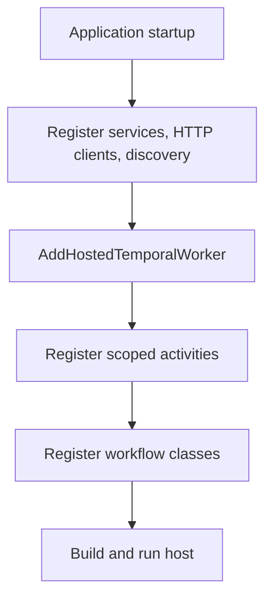

**Diagram sources**
- `src/Meao/Program.cs#L150-L175`

**Section sources**
- `src/Meao/Program.cs#L1-L175`

## Architecture Overview
Each workflow implements a state machine by sequencing Temporal activities, signals, timers, and wait conditions. External service calls are never made directly from workflow code; they go through activities, which keeps the workflow replay safe.

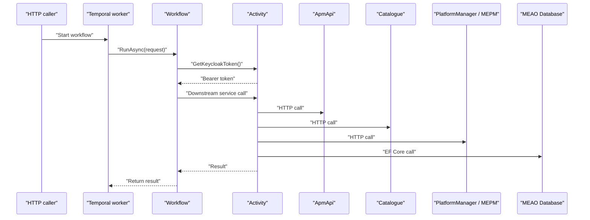

**Diagram sources**
- `src/Meao/Workflows/CreateAppInstWF.cs#L20-L118`
- `src/Meao/Workflows/InstantiateAppInstWF.cs#L30-L200`
- `src/Meao/Workflows/TerminateAppinstWF.cs#L30-L140`
- `src/Meao/Workflows/OnboardAppPkgWF.cs#L60-L170`

## Detailed Component Analysis

### CreateAppInstWF
`CreateAppInstWF` establishes the application instance identity resource. Its state machine has two main branches:

1. **No host IP provided**: create the instance in `NOT_INSTANTIATED` without MEPM binding. Dynamic placement happens later in `InstantiateAppInstWF`.
2. **Host IP provided**: validate the package in ApmApi, resolve MEPM base URL from Catalogue, register the instance in MEPM, persist the instance as `NOT_INSTANTIATED`, but do not emit MEC host information yet because instantiation has not completed.

#### Method Signature and Parameters
- **Entry method**: `RunAsync(CreateAppInstCommand command)`
- **Input**:
  - `command.Request`: contains package ID, optional app ID, instance name, description, app name, and optional host IP.
  - `command.AppInstanceId`: optional server-generated identifier; falls back to a generated UUID.
- **Output**: string `AppInstanceId`.

#### State Transition Pattern
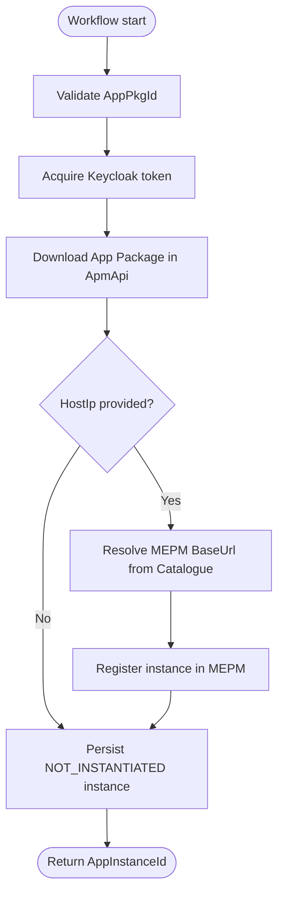

**Diagram sources**
- `src/Meao/Workflows/CreateAppInstWF.cs#L20-L118`

#### Parameter Validation
- If `request.AppPkgId` is null, the workflow throws an application failure with error type `ValidationError`.
- Missing or empty fields are normalized to defaults before persistence.

#### Service Coordination
- **Auth**: Acquires a Keycloak token.
- **ApmApi**: Downloads the package to validate it.
- **Catalogue**: Resolves MEPM base URL when a host IP constraint exists.
- **PlatformManager/MEPM**: Registers an instance record only when host placement is known at creation time.
- **Database**: Persists the instance with `InstantiationState.NOT_INSTANTIATED` and `OperationalState.STOPPED`.

**Section sources**
- `src/Meao/Workflows/CreateAppInstWF.cs#L1-L118`

### InstantiateAppInstWF
`InstantiateAppInstWF` coordinates the full instantiation lifecycle. It supports both dynamic placement and operator-supplied host placement, uses hybrid signal-and-poll waiting for MEPM operation completion, and performs compensation on failure.

#### Method Signature and Parameters
- **Entry method**: `RunAsync(InstantiateAppInstRequest request)`
- **Input**:
  - `request.AppInstanceId`: target instance to instantiate.
  - `request.HostIp`: optional operator override for placement.
- **Output**: string success marker.

#### State Transition Pattern
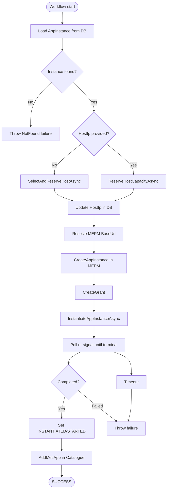

**Diagram sources**
- `src/Meao/Workflows/InstantiateAppInstWF.cs#L30-L200`
- `src/Meao/Workflows/InstantiateAppInstWF.cs#L201-L353`

#### Service Coordination
- **AppInstanceActivities**: Loads and updates MEAO database state.
- **AuthActivities**: Gets authentication tokens.
- **PlacementActivities**: Selects/reserves host capacity or reserves explicit capacity.
- **CatalogueActivities**: Resolves MEPM base URL and registers deployed apps.
- **GrantActivities**: Creates, consumes, or marks grants failed.
- **MepmActivities**: Registers instance, starts LCM operation, cancels operation on failure, terminates if needed during compensation, and releases capacity.

#### Error Handling and Compensation
- If instantiation fails after triggering MEPM, the workflow cancels the LcmOpOcc operation and may terminate the instance.
- Capacity reservation is released on failure.
- Local state is reset to `NOT_INSTANTIATED` and `STOPPED`.
- Grants are marked failed when appropriate.
- Cancellation exceptions and domain-specific application failures are propagated rather than wrapped.

**Section sources**
- `src/Meao/Workflows/InstantiateAppInstWF.cs#L1-L353`

### TerminateAppinstWF
`TerminateAppinstWF` handles termination, cleanup, and partial-compensation scenarios.

#### Method Signature and Parameters
- **Entry method**: `RunAsync(TerminateAppInstRequest request)`
- **Input**:
  - `request.appInstanceId`: instance to terminate.
- **Output**: string success marker.

#### State Transition Pattern
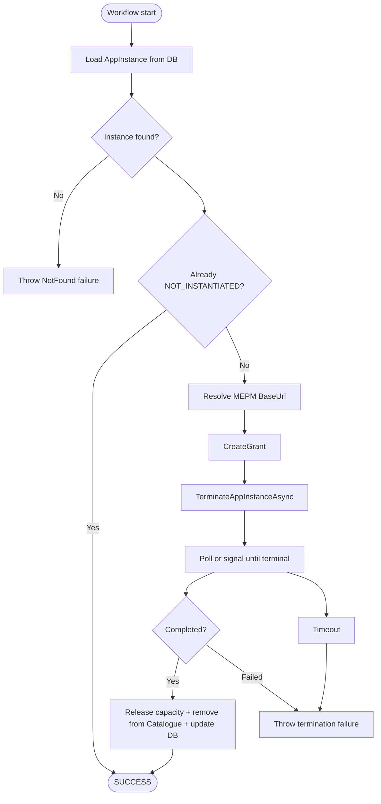

**Diagram sources**
- `src/Meao/Workflows/TerminateAppinstWF.cs#L30-L140`
- `src/Meao/Workflows/TerminateAppinstWF.cs#L141-L272`

#### Partial Cleanup Behavior
- If capacity release succeeds but catalogue removal fails, the workflow logs the failure and records an aggregate exception.
- If capacity release fails, `HostIp` is preserved to aid manual remediation.
- Successful cleanup sets `InstantiationState` to `NOT_INSTANTIATED`, `OperationalState` to `STOPPED`, clears `HostIp` and `MepmInstanceId`.
- If cleanup fails, the workflow returns a cleanup failure rather than silently marking the instance stopped.

**Section sources**
- `src/Meao/Workflows/TerminateAppinstWF.cs#L1-L272`

### OnboardAppPkgWF
`OnboardAppPkgWF` is a durable saga for package onboarding. It supports two execution paths using Temporal patches:

| Path | Description |
|---|---|
| Legacy path | Validates AppD synchronously, registers in Catalogue, publishes to Zot, finalizes onboarding. |
| Patched package-inventory path | Validates AppD asynchronously, resolves an OCI reference, registers a catalogue inventory record, finalizes, then marks the package onboarded. |

#### Method Signature and Parameters
- **Entry method**: `RunAsync(OnboardAppPkgRequest request)`
- **Input**:
  - `request.Claim.StagingId`: staging identifier.
  - `request.Claim.AppPkgId`: package identifier.
  - `request.Claim.Sha256`: integrity digest.
- **Output**: string success marker.

#### Saga Flow
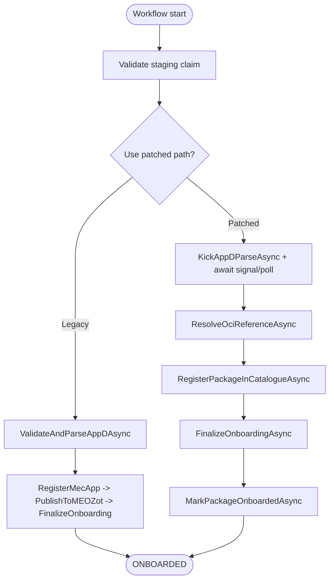

**Diagram sources**
- `src/Meao/Workflows/OnboardAppPkgWF.cs#L60-L170`

#### Durable Asynchronous AppD Parse
The async parse flow:

1. Kick ApmApi’s background parse.
2. Maintain a bounded deadline.
3. Use `WaitConditionAsync` to wake early when a webhook signal arrives.
4. Drain signals outside wait-condition predicates for replay safety.
5. Always poll for the authoritative AppD ID.
6. Fail fast on inconsistent terminal states or timeouts.

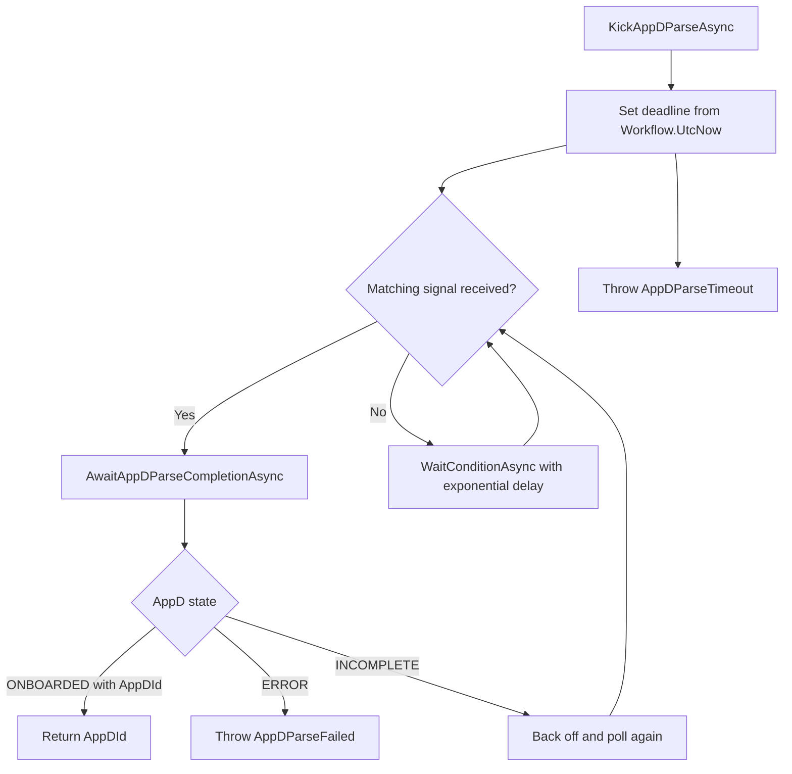

**Diagram sources**
- `src/Meao/Workflows/OnboardAppPkgWF.cs#L240-L367`

#### Compensation
On failure, the workflow:

- Logs the current stage.
- Attempts ApmApi rollback.
- Compensates catalogue inventory only when the patched path was used and the package was actually registered.
- Preserves cancellation and domain failure semantics.

**Section sources**
- `src/Meao/Workflows/OnboardAppPkgWF.cs#L1-L367`

## Dependency Analysis
The workflows depend on activities, not directly on external services. This decouples workflow logic from network failures and makes replay deterministic.

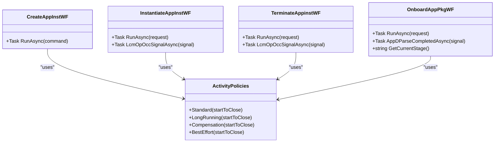

**Diagram sources**
- `src/Meao/Workflows/CreateAppInstWF.cs#L1-L118`
- `src/Meao/Workflows/InstantiateAppInstWF.cs#L1-L353`
- `src/Meao/Workflows/TerminateAppinstWF.cs#L1-L272`
- `src/Meao/Workflows/OnboardAppPkgWF.cs#L1-L367`
- `src/Meao/Workflows/Policies/ActivityPolicies.cs#L1-L126`

**Section sources**
- `src/Meao/Workflows/Policies/ActivityPolicies.cs#L1-L126`

## Performance Considerations
- **Deterministic timing**: Workflows use `Workflow.UtcNow`, not system clocks, ensuring consistent replay behavior.
- **Bounded retries**: Standard and long-running activities cap retries; compensation activities retry more aggressively but with detached cancellation.
- **Hybrid polling**: Signal-based short-circuit avoids unnecessary polling rounds while retaining polling as a fallback.
- **Exponential backoff**: Both instantiation and termination polling loops increase delays up to a ceiling, reducing pressure on MEPM and Catalogue.
- **Separate budgets**: Long-running activities get a larger schedule-to-close window, preventing premature timeouts for slow downstream operations.

[No sources needed since this section provides general guidance]

## Testing and Replay
The repository includes unit tests and test assets that cover workflow behavior and replay scenarios:

- `CreateAppInstWFTests`
- `InstantiateAppInstWFTests`
- `InstantiateAppInstWFPhaseBTests`
- `TerminateAppinstWFTests`
- `OnboardAppPkgWFTests`
- `Replay/WorkflowReplayTests`
- Test history fixtures under `TestAssets/WorkflowHistories`

These indicate the testing approach focuses on:

1. **Unit-style workflow execution**, likely using Temporal test infrastructure.
2. **Replay of recorded histories** to validate deterministic behavior across code changes.
3. **Coverage of signal-driven fast paths and polling fallbacks**.
4. **Verification of compensation behavior** when external steps fail.

Because the exact test harness implementation is not included in the analyzed files, this section describes observed structure rather than SDK API usage details.

**Section sources**
- `src/Meao.Tests.Unit/Workflows/CreateAppInstWFTests.cs`
- `src/Meao.Tests.Unit/InstantiateAppInstWFTests.cs`
- `src/Meao.Tests.Unit/InstantiateAppInstWFPhaseBTests.cs`
- `src/Meao.Tests.Unit/Workflows/TerminateAppinstWFTests.cs`
- `src/Meao.Tests.Unit/Workflows/OnboardAppPkgWFTests.cs`
- `src/Meao.Tests.Unit/Replay/WorkflowReplayTests.cs`

## Debugging Failed Executions
When a workflow fails, debugging should follow these layers:

1. **Temporal execution history**: Identify the last successful decision, the failing activity, and whether the failure was retried.
2. **Workflow stage tracking**: For `OnboardAppPkgWF`, query `GetCurrentStage()` to understand which saga phase failed.
3. **Domain error mapping**: `TemporalWorkflowExceptionHandler` maps certain `ApplicationFailureException.ErrorType` values to RFC 7807 Problem Details responses.
4. **Compensation inspection**: Check whether cleanup activities ran, especially capacity release, catalogue removal, grant marking, and local state updates.

### Domain Error Mapping
| ErrorType | HTTP status | Meaning |
|---|---:|---|
| `PlacementFailed` | 409 | Placement engine rejected the request |
| `NotFound` | 404 | Resource missing, typically AppInstanceInfo |
| `InvalidState` | 409 | Invalid lifecycle transition |
| `GrantRejected` | 409 | Grant validation or issuance rejected |
| `PackageInvalid` | 422 | Package validation or payload problem |

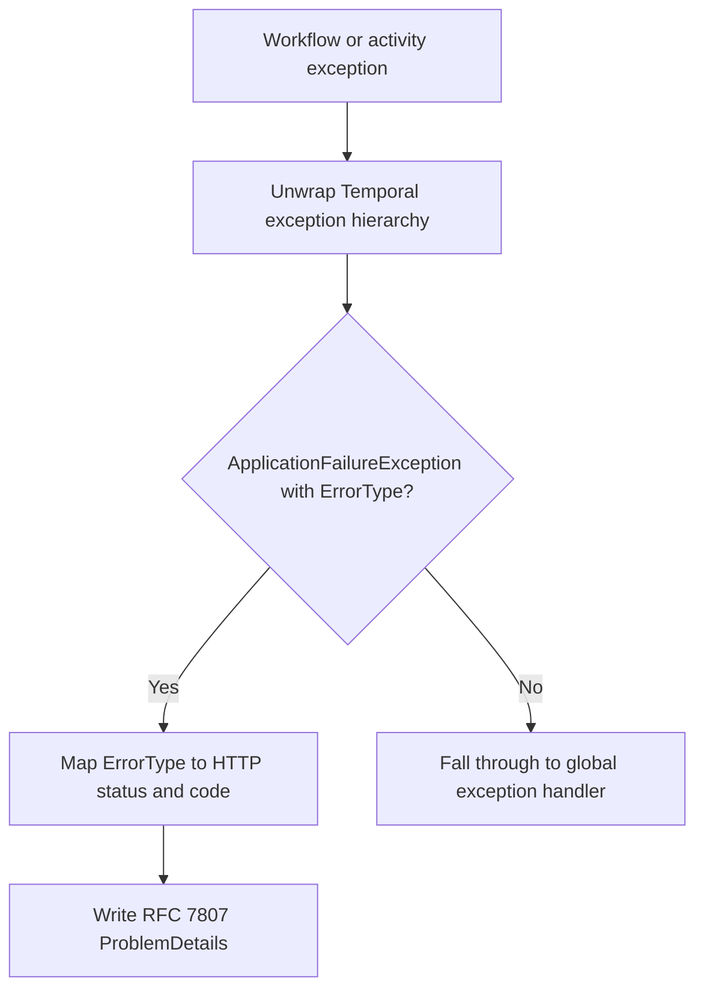

**Diagram sources**
- `src/Meao/Infrastructure/TemporalWorkflowExceptionHandler.cs#L1-L135`

**Section sources**
- `src/Meao/Infrastructure/TemporalWorkflowExceptionHandler.cs#L1-L135`

## Versioning Strategy
The codebase uses Temporal patching to evolve workflow behavior safely:

| Change ID | Purpose | Behavior |
|---|---|---|
| `catalogue-package-registration` | Switches legacy Catalogue registration to a package-inventory path | New runs register/update inventory and mark packages onboarded; pre-patch histories keep the original sequence |
| `async-appd-parse` | Switches synchronous AppD parsing to durable async parse with signal/fast-path and poll fallback | New runs kick a background parse and wait; pre-patch histories replay the synchronous command sequence |

Key versioning principles visible in the code:

- **Patch gates**: `Workflow.Patched(changeId)` selects execution path without changing historical decisions.
- **Deprecation markers**: Comments indicate planned deprecation once all pre-patch executions reach terminal state.
- **Ownership keys**: Deterministic workflow IDs act as ownership identifiers for idempotent inventory updates and compensation.
- **State queries**: Queries like `GetCurrentStage()` help operators inspect long-running workflow progress.

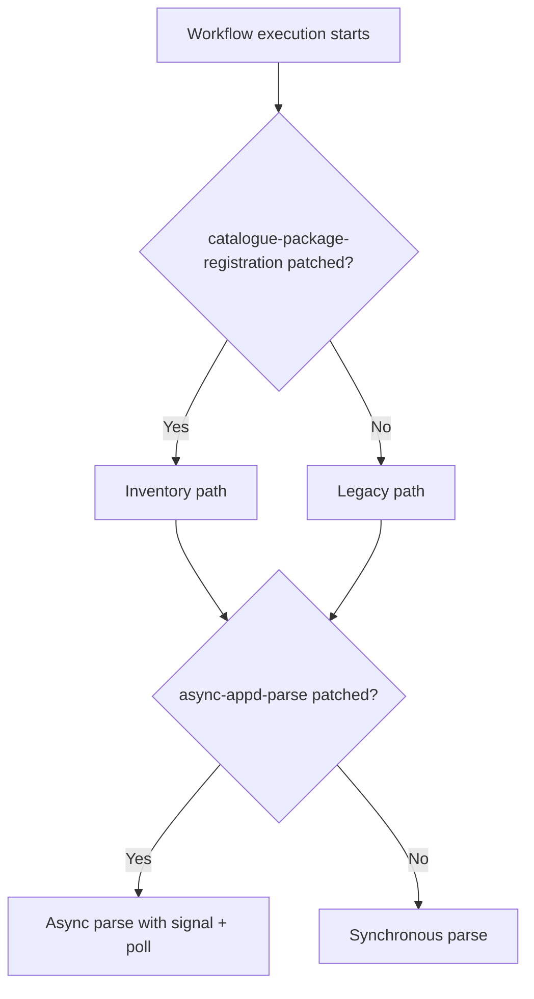

**Diagram sources**
- `src/Meao/Workflows/OnboardAppPkgWF.cs#L40-L120`

**Section sources**
- `src/Meao/Workflows/OnboardAppPkgWF.cs#L1-L120`

## Conclusion
The Meao service models application package onboarding and application instance lifecycle as deterministic Temporal workflows. Each workflow class is a focused state machine:

- `CreateAppInstWF` creates identity and optional MEPM binding.
- `InstantiateAppInstWF` plans placement, triggers asynchronous MEPM instantiation, waits for completion, and compensates on failure.
- `TerminateAppinstWF` stops instances, releases resources, and reconciles catalogue state.
- `OnboardAppPkgWF` is a compensated saga that evolved from synchronous parsing and legacy cataloguing to a durable async path with catalogue inventory ownership.

External service coordination is isolated behind activities, retries and timeouts are centralized in `ActivityPolicies`, and versioning is handled through Temporal patching. This design prioritizes determinism, recoverability, observability, and clear separation between orchestration logic and side-effecting operations.