# Workflow Activities

## Table of Contents
1. [Introduction](#introduction)
2. [Project Structure](#project-structure)
3. [Core Components](#core-components)
4. [Architecture Overview](#architecture-overview)
5. [Detailed Component Analysis](#detailed-component-analysis)
6. [Dependency Analysis](#dependency-analysis)
7. [Performance Considerations](#performance-considerations)
8. [Troubleshooting Guide](#troubleshooting-guide)
9. [Conclusion](#conclusion)

## Introduction
This document explains how Temporal activities encapsulate side-effecting operations for MEAO workflows. The seven activity classes covered here perform deterministic, non-blocking work by delegating external calls to HTTP services, database repositories, and placement engines while preserving replay safety.

Key design goals:
- Every activity method is marked with the Temporal `Activity` attribute so it can be scheduled, executed, retried, and replayed.
- Side effects are isolated from workflow logic; activities do not call workflow APIs or make nondeterministic decisions.
- External dependencies are injected through constructors so they can be mocked during tests.
- Cancellation tokens are propagated from `ActivityExecutionContext` to every asynchronous operation.
- Errors are mapped to Temporal `ApplicationFailureException`, with explicit retry behavior (`nonRetryable`) and domain-specific `ErrorType` values.
- HTTP clients are configured separately for activity execution, using dedicated named clients with resilience policies, service discovery, and Keycloak token injection.

## Project Structure
The activity implementations live under the MEAO service’s `Activities` directory. Activity registration occurs at application startup in `Program.cs`, where all seven activity classes are registered as scoped Temporal activities.

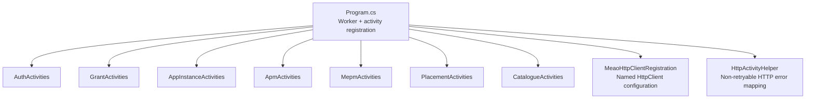

**Diagram sources**
- `src/Meao/Program.cs#L120-L160`
- `src/Meao/Infrastructure/MeaoHttpClientRegistration.cs#L28-L97`
- `src/Meao/Utils/HttpActivityHelper.cs#L1-L32`

**Section sources**
- `src/Meao/Program.cs#L120-L160`
- `src/Meao/Infrastructure/MeaoHttpClientRegistration.cs#L28-L97`

## Core Components
The following table summarizes each activity class, its primary responsibilities, external dependencies, and retry/error model.

| Activity Class | Responsibilities | External Dependencies | Determinism Notes | Retry / Error Model |
|---|---|---|---|---|
| `AuthActivities` | Acquires a Keycloak client-credentials access token. | Configuration, optional `IHttpClientFactory`, optional logger. | Reads environment/configuration only; returns deterministic token string. | Missing secret → non-retryable. Malformed response → retryable unless explicitly marked otherwise. Client errors below 5xx are wrapped as non-retryable. |
| `GrantActivities` | Creates grants, marks grants consumed, marks grants failed. | EF Core `MeaoDBContext`, `TimeProvider`. | Uses provided time provider instead of current wall clock. Database reads/writes are idempotent by grant ID. | Validation/key-not-found exceptions → non-retryable. |
| `AppInstanceActivities` | CRUD operations over `IAppInstanceRepository`. | Repository abstraction. | Repository methods encapsulate persistence; activity itself is a thin wrapper. | No special wrapping; repository/database failures propagate as application failures if converted upstream. |
| `ApmActivities` | Downloads, validates, parses, publishes, finalizes, rolls back onboarding steps via APM API. | Named HTTP clients, logger. | File system writes use temporary files and move into place; activity logs include activity identity for observability. | HTTP client errors <5xx → non-retryable via helper. Network/server errors may bubble as `HttpRequestException` for transient retries. |
| `MepmActivities` | Creates, instantiates, queries, terminates, lists, and cancels MEPM lifecycle operations. | Named HTTP client, telemetry `ActivitySource`, `TimeProvider`. | All network payloads are JSON DTOs; `TimeProvider` avoids wall-clock nondeterminism. | HTTP errors are normalized by helper; 409 Conflict is treated as idempotent success for creation. |
| `PlacementActivities` | Selects a host via placement engine, fetches service requirements, reserves/releases capacity. | Placement engine, HTTP clients, logger. | Service requirement fetching is conditional on `appPkgId`; missing requirements degrade gracefully. | Engine validation failure → non-retryable `PlacementFailed`. Capacity reservation/release errors go through helper. |
| `CatalogueActivities` | Resolves MEC hosts and MEPM endpoints, registers package inventory, transitions package state. | Named HTTP clients, logger. | Legacy stubs exist for historical workflow replay; real methods read/write idempotently. | Conflicts and ownership mismatches are tolerated or returned as structured outcomes rather than retryable errors. |

**Section sources**
- `src/Meao/Activities/AuthActivities.cs#L1-L109`
- `src/Meao/Activities/GrantActivities.cs#L1-L68`
- `src/Meao/Activities/AppInstanceActivities.cs#L1-L43`
- `src/Meao/Activities/ApmActivities.cs#L1-L251`
- `src/Meao/Activities/MepmActivities.cs#L1-L191`
- `src/Meao/Activities/PlacementActivities.cs#L1-L205`
- `src/Meao/Activities/CatalogueActivities.cs#L1-L356`

## Architecture Overview
At runtime, MEAO starts a Temporal hosted worker that discovers task queues and registers both workflows and activities. Each activity receives injected services from the DI container. HTTP requests flow through named `HttpClient` instances configured with service discovery, Keycloak token handlers, and standard resilience policies.

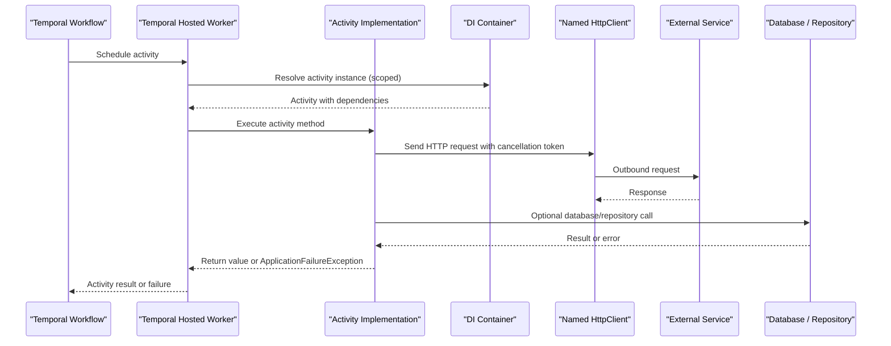

**Diagram sources**
- `src/Meao/Program.cs#L120-L160`
- `src/Meao/Infrastructure/MeaoHttpClientRegistration.cs#L28-L97`
- `src/Meao/Utils/HttpActivityHelper.cs#L1-L32`

## Detailed Component Analysis

### AuthActivities
`AuthActivities.GetKeycloakToken` performs a Keycloak client-credentials OAuth2 token exchange. It resolves configuration from `.NET` configuration providers and environment variables, builds an HTTP POST to the Keycloak token endpoint, and returns the `access_token`.

Determinism and safety:
- Configuration is read once per activity invocation.
- Cancellation is obtained from `ActivityExecutionContext` when available.
- Missing required secrets throw a non-retryable `ApplicationFailureException`.
- Non-success HTTP responses below 5xx are wrapped as non-retryable application failures.
- Missing `access_token` in the JSON response throws a retryable application failure because transient Keycloak misconfiguration should be detected quickly, but malformed responses may be retried.

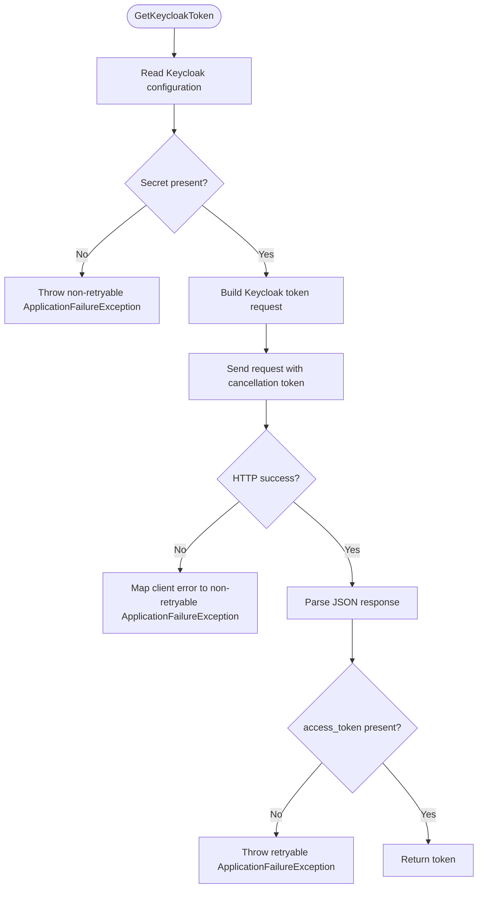

**Diagram sources**
- `src/Meao/Activities/AuthActivities.cs#L15-L109`

**Section sources**
- `src/Meao/Activities/AuthActivities.cs#L1-L109`
- `src/Meao.Tests.Unit/ApmAndAuthActivitiesTests.cs#L1-L181`

### GrantActivities
`GrantActivities` wraps grant-related database operations:
- `CreateGrantAsync` delegates to internal grant helper and converts validation/key-not-found exceptions to non-retryable application failures.
- `MarkGrantConsumedAsync` finds a grant by ID and transitions it from `GRANTED` to `CONSUMED`, recording consumption time through `TimeProvider`.
- `MarkGrantFailedAsync` transitions a `GRANTED` grant to `FAILED`.

Determinism and safety:
- All mutations are keyed by grant ID, making repeated executions safe.
- `TimeProvider` replaces direct wall-clock calls, improving testability and determinism.
- Database context is injected, allowing mocking in unit tests.

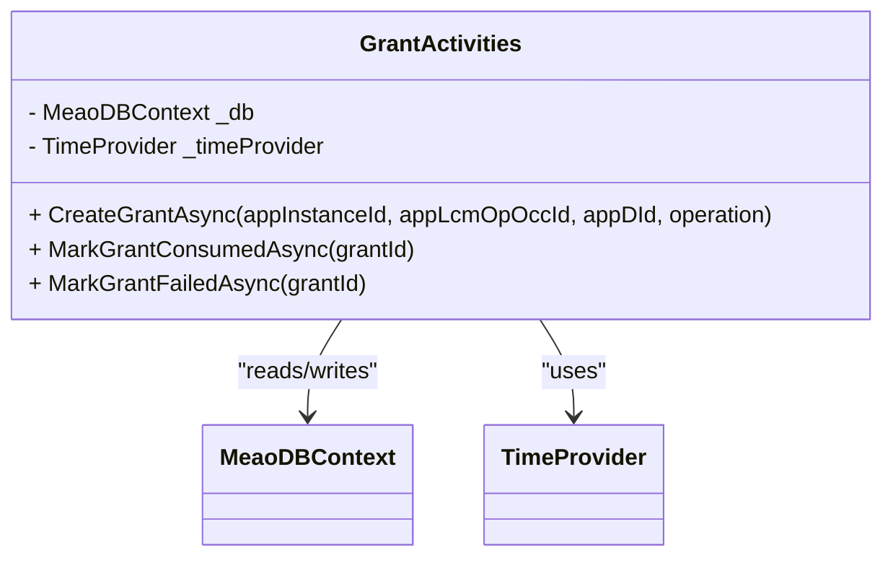

**Diagram sources**
- `src/Meao/Activities/GrantActivities.cs#L1-L68`

**Section sources**
- `src/Meao/Activities/GrantActivities.cs#L1-L68`

### AppInstanceActivities
`AppInstanceActivities` is a thin boundary between workflows and `IAppInstanceRepository`:
- `GetAppInstanceDB` retrieves one app instance.
- `CreateAppInstanceDB` checks existence before creating.
- `UpdateAppInstanceDB` updates an existing instance.
- `DeleteAppInstanceDB` removes an instance.

Determinism and safety:
- The create path includes an existence check, reducing duplicate-write risk.
- All work is delegated to the repository, keeping the activity deterministic and focused on orchestration.

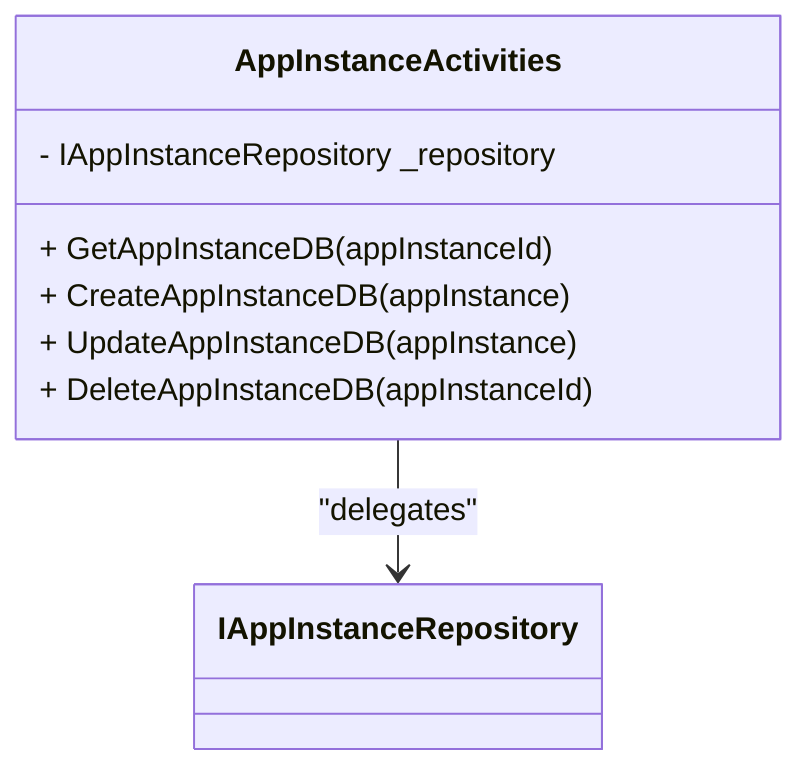

**Diagram sources**
- `src/Meao/Activities/AppInstanceActivities.cs#L1-L43`

**Section sources**
- `src/Meao/Activities/AppInstanceActivities.cs#L1-L43`

### ApmActivities
`ApmActivities` handles most application-package-onboarding interactions with the APM API:
- Downloading package content.
- Validating packages.
- Parsing and kicking off durable async parsing.
- Polling parse completion.
- Publishing or resolving OCI references.
- Finalizing or rolling back onboarding.

Determinism and safety:
- HTTP calls use named clients configured for activity execution.
- Cancellation tokens come from `ActivityExecutionContext`.
- Logging captures activity type and ID for traceability.
- File saving uses a temporary file followed by atomic rename, with best-effort cleanup.
- Some methods are declared `virtual` to support override in tests or future extensions.

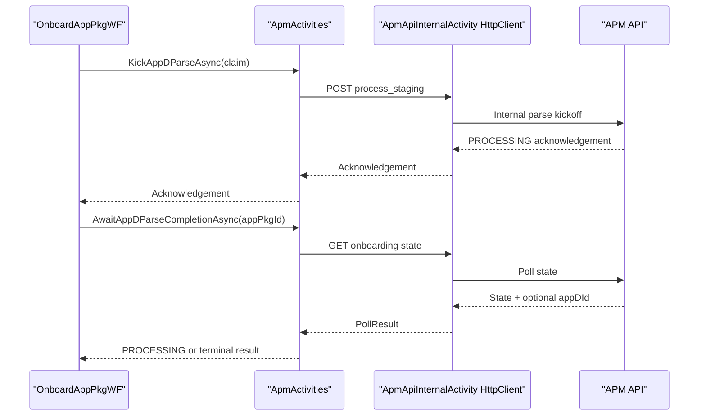

**Diagram sources**
- `src/Meao/Activities/ApmActivities.cs#L60-L160`

**Section sources**
- `src/Meao/Activities/ApmActivities.cs#L1-L251`
- `src/Meao.Tests.Unit/ApmAndAuthActivitiesTests.cs#L1-L181`

### MepmActivities
`MepmActivities` communicates with remote MEPM instances:
- Creating app instances, handling 409 Conflict as idempotent success.
- Instantiating app instances with lifecycle operation objects.
- Querying lifecycle operation occurrences.
- Terminating instances gracefully.
- Creating and updating lifecycle operation records.
- Listing app instances and cancelling lifecycle operations.

Determinism and safety:
- Each activity opens an OpenTelemetry client activity with tags such as base URL, app instance ID, and lifecycle operation ID.
- All HTTP calls pass the activity cancellation token.
- Deserialization failures are converted to clear exceptions.
- `TimeProvider` is used for idempotent timestamp creation.

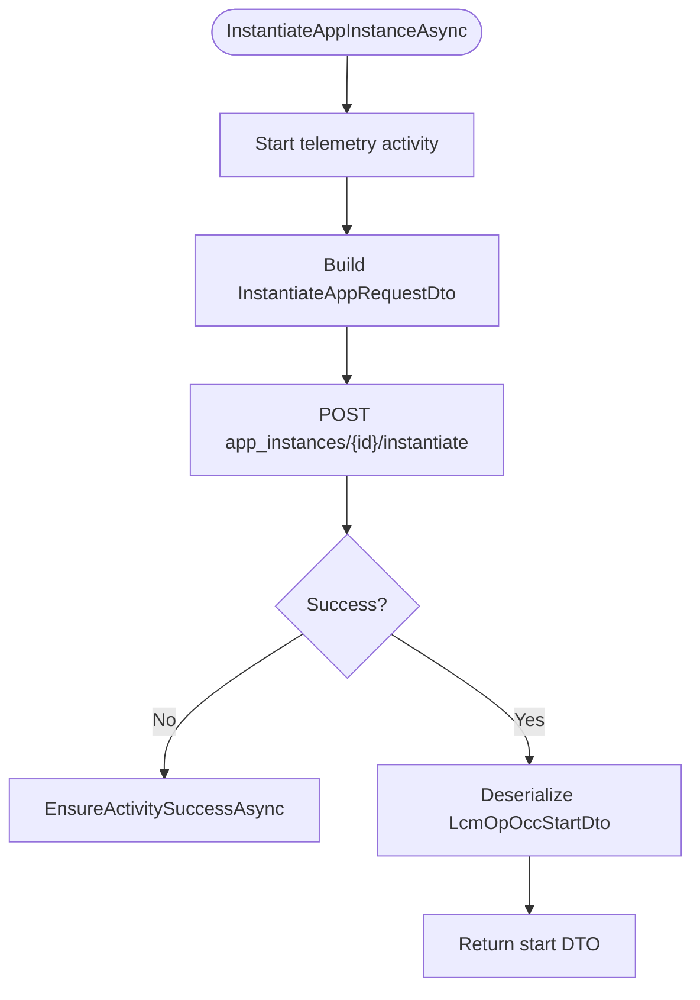

**Diagram sources**
- `src/Meao/Activities/MepmActivities.cs#L60-L120`

**Section sources**
- `src/Meao/Activities/MepmActivities.cs#L1-L191`

### PlacementActivities
`PlacementActivities` orchestrates host selection and capacity reservation:
- `SelectAndReserveHostAsync` optionally fetches service requirements from APM, constructs placement constraints, selects a host, and reserves capacity.
- `ReserveHostCapacityAsync` posts a reserve request to the catalogue.
- `ReleaseHostCapacityAsync` releases previously reserved capacity.

Determinism and safety:
- Service requirement fetching is conditional on `appPkgId` and optional auth token.
- Missing or empty requirements degrade to capacity-only placement.
- Placement engine validation failures are wrapped as non-retryable `PlacementFailed`.
- Capacity reservation/release calls use the catalogue activity client and normalize errors.

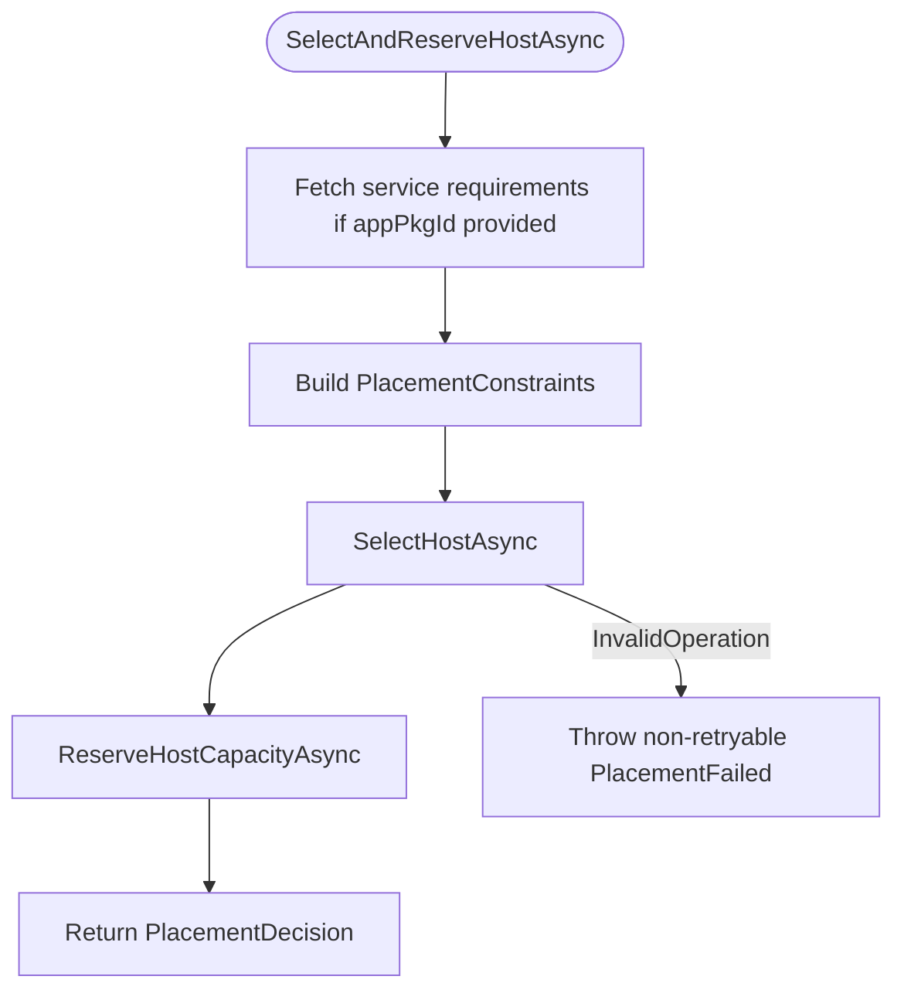

**Diagram sources**
- `src/Meao/Activities/PlacementActivities.cs#L15-L120`

**Section sources**
- `src/Meao/Activities/PlacementActivities.cs#L1-L205`
- `src/Meao.Tests.Unit/PlacementActivitiesTests.cs#L1-L200`

### CatalogueActivities
`CatalogueActivities` manages catalogue lookups and package inventory:
- Resolving MEC host IP to MEPM IP or full MEPM base URL.
- Adding/removing MEC apps.
- Listing MEPMs.
- Registering package inventory with digest-pinned OCI reference and owning operation ID.
- Transitioning package state to `ONBOARDED` or `ERROR/DISABLED`.
- Providing legacy stubs for historical workflow replay paths.

Determinism and safety:
- Real registration and state-transition methods are idempotent or ownership-scoped.
- 404/409 conflicts in compensation paths are tolerated and returned as skip outcomes.
- Metadata reads always use APM as source of truth before writing catalogue inventory.

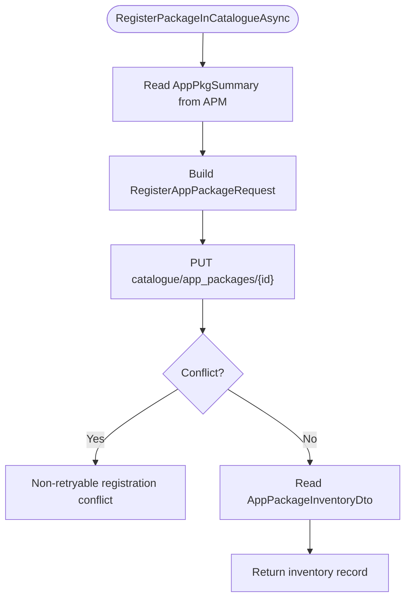

**Diagram sources**
- `src/Meao/Activities/CatalogueActivities.cs#L220-L356`

**Section sources**
- `src/Meao/Activities/CatalogueActivities.cs#L1-L356`

## Dependency Analysis
Activities depend on three broad categories of collaborators:

1. **HTTP clients**: Named clients for APM, catalogue, MEPM, and internal APM shims. They use service discovery, Keycloak token handlers, and standard resilience handlers.
2. **Persistence**: EF Core context and repository abstractions for MEAO-local state.
3. **Domain services**: Placement engine and telemetry infrastructure.

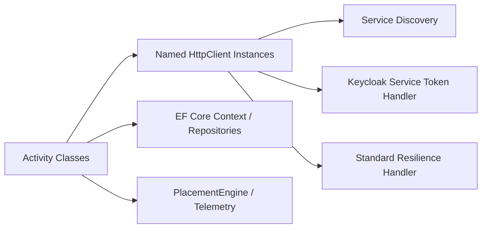

**Diagram sources**
- `src/Meao/Program.cs#L100-L160`
- `src/Meao/Infrastructure/MeaoHttpClientRegistration.cs#L28-L97`

### Activity Registration Pattern
All seven activity classes are registered as scoped activities through the Temporal extension:

- `AddScopedActivities<CatalogueActivities>()`
- `AddScopedActivities<ApmActivities>()`
- `AddScopedActivities<AuthActivities>()`
- `AddScopedActivities<MepmActivities>()`
- `AddScopedActivities<AppInstanceActivities>()`
- `AddScopedActivities<GrantActivities>()`
- `AddScopedActivities<PlacementActivities>()`

Workflows are also registered alongside activities in the same worker configuration.

**Section sources**
- `src/Meao/Program.cs#L120-L160`

### Retry Policies, Timeouts, and Cancellation
- **Cancellation**: Activities obtain the cancellation token from `ActivityExecutionContext` when available and pass it to HTTP requests, database operations, and other asynchronous work.
- **Retry policy**: Explicit retry behavior is encoded in `ApplicationFailureException(nonRetryable, errorType)`. There is no global retry policy applied uniformly inside these activity classes; retry semantics are therefore local to each activity’s error handling.
- **Timeouts**: Dedicated activity HTTP clients set `HttpClient.Timeout` to `Infinite` and rely on resilience attempt timeouts and total request timeouts defined in `MeaoHttpClientRegistration`. This prevents `HttpClient` from aborting before Temporal’s activity timeout.
- **Transient vs non-transient HTTP errors**: `HttpActivityHelper.EnsureActivitySuccessAsync` treats client errors below 5xx as non-retryable application failures. Server errors and timeouts may propagate as `HttpRequestException`, allowing higher-level retry mechanisms or Temporal retries to act depending on how the exception is wrapped.

**Section sources**
- `src/Meao/Infrastructure/MeaoHttpClientRegistration.cs#L28-L97`
- `src/Meao/Utils/HttpActivityHelper.cs#L1-L32`
- `src/Meao/Activities/AuthActivities.cs#L25-L109`
- `src/Meao/Activities/ApmActivities.cs#L25-L120`
- `src/Meao/Activities/MepmActivities.cs#L20-L191`
- `src/Meao/Activities/PlacementActivities.cs#L15-L205`

### Error Propagation to Workflows
Activities communicate failures to workflows through `ApplicationFailureException`. For HTTP errors, the helper distinguishes:
- Client errors below 5xx → non-retryable application failure.
- Other failures → may bubble up as `HttpRequestException` or be wrapped with an explicit `errorType`.

For domain errors, `TemporalWorkflowExceptionHandler` maps known `ApplicationFailureException.ErrorType` values to RFC 7807 ProblemDetails responses, including `PlacementFailed` → 409 conflict.

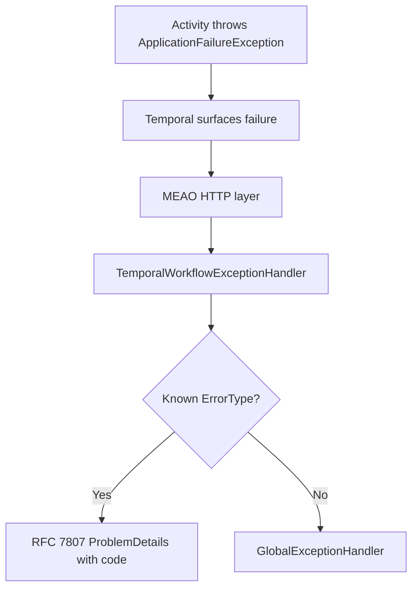

**Diagram sources**
- `src/Meao/Infrastructure/TemporalWorkflowExceptionHandler.cs#L1-L135`
- `src/Meao/Utils/HttpActivityHelper.cs#L1-L32`

**Section sources**
- `src/Meao/Infrastructure/TemporalWorkflowExceptionHandler.cs#L1-L135`
- `src/Meao/Utils/HttpActivityHelper.cs#L1-L32`

## Performance Considerations
- **Named HttpClient reuse**: Activities use `IHttpClientFactory`-managed clients rather than creating ad-hoc `HttpClient` instances, reducing socket exhaustion.
- **Infinite HttpClient timeout with resilience timeouts**: Activity HTTP clients disable raw `HttpClient.Timeout` and instead use resilience attempt and total request timeouts aligned with expected activity durations.
- **Zero HTTP-level retry for activity clients**: Transient retries are intentionally owned by Temporal activity retry policies, avoiding double-retry behavior.
- **Streaming downloads**: Package download writes directly to a stream and uses a temporary file plus atomic move to avoid partial artifacts.
- **Conditional data loading**: Placement activities only fetch service requirements when an `appPkgId` is supplied and degrade gracefully when requirements are unavailable.
- **Telemetry tagging**: MEPM activities tag outbound calls with contextual identifiers, improving tracing performance diagnostics without adding blocking overhead.

[No sources needed since this section provides general guidance]

## Troubleshooting Guide

### Diagnosing Failed Activity Executions
1. **Identify the activity and method**: Look at the workflow history for the failing activity type and method name. Many activities log activity type and ID for correlation.
2. **Check HTTP status codes**: If an activity uses `HttpActivityHelper.EnsureActivitySuccessAsync`, client errors below 5xx will be non-retryable application failures.
3. **Inspect error type**: Domain errors such as `PlacementFailed` are mapped to specific HTTP problem details by `TemporalWorkflowExceptionHandler`.
4. **Validate configuration**: `AuthActivities.GetKeycloakToken` requires `KEYCLOAK_CLIENT_SECRET_MEAO`, URL, realm, client ID, and scopes. Missing secrets cause immediate non-retryable failures.
5. **Review cancellation**: Long-running activities must honor cancellation tokens. If a workflow cancels an activity, downstream HTTP calls should fail promptly.

**Section sources**
- `src/Meao/Activities/ApmActivities.cs#L25-L120`
- `src/Meao/Activities/AuthActivities.cs#L25-L109`
- `src/Meao/Infrastructure/TemporalWorkflowExceptionHandler.cs#L1-L135`

### Testing Strategies
- **Unit tests for HTTP-dependent activities**: Use a custom `IHttpClientFactory` implementation that returns `HttpClient` instances backed by a fake `HttpMessageHandler`. This allows asserting request URLs, headers, authorization schemes, and response behaviors.
- **Unit tests for placement logic**: Mock `IPlacementEngine` to capture constraints and return deterministic decisions. Verify that APM and catalogue clients are invoked with correct endpoints.
- **Integration-style tests for Keycloak**: `AuthActivitiesKeycloakTests` exercises a real Keycloak test container fixture to validate token acquisition and JWT validation.
- **Mocking databases and repositories**: Inject `TimeProvider`, `MeaoDBContext`, or repository interfaces to avoid real side effects during unit tests.

**Section sources**
- `src/Meao.Tests.Unit/ApmAndAuthActivitiesTests.cs#L1-L181`
- `src/Meao.Tests.Unit/PlacementActivitiesTests.cs#L1-L200`
- `src/Meao.Tests.Unit/Activities/AuthActivitiesKeycloakTests.cs#L1-L162`

### Debugging Tips
- Enable detailed logging around activity entry points. Several activities log parameters such as app instance ID, package ID, host IP, and lifecycle operation ID.
- Check the activity client name being used: `ApmActivityAPI`, `ApmApiInternalActivity`, `CatalogueActivityAPI`, and `MepmActivityAPI` have different authentication and discovery configurations.
- Confirm that Keycloak service token handler is attached to internal clients when calling `/internal/*` APM endpoints.
- When debugging workflow replays, verify that activity methods do not depend on mutable global state, random numbers, or uncontrolled wall-clock time.

**Section sources**
- `src/Meao/Program.cs#L100-L160`
- `src/Meao/Infrastructure/MeaoHttpClientRegistration.cs#L28-L97`
- `src/Meao/Activities/MepmActivities.cs#L1-L191`

## Conclusion
The MEAO activity layer isolates side effects from workflow logic while preserving deterministic replay behavior. Each activity class focuses on a bounded responsibility: authentication, grants, app-instance persistence, APM onboarding, MEPM lifecycle management, placement, and catalogue inventory. External calls are routed through carefully configured HTTP clients, errors are mapped to structured application failures, and cancellation is propagated consistently. Testing relies on constructor-injected dependencies, fake HTTP handlers, mock placement engines, and optional integration fixtures. Together, these patterns provide a durable, observable, and testable foundation for long-running MEAO workflows.

> **Referenced Files in This Document**
>
> - `src/Meao/Program.cs`
> - `src/Meao/Activities/AuthActivities.cs`
> - `src/Meao/Activities/GrantActivities.cs`
> - `src/Meao/Activities/AppInstanceActivities.cs`
> - `src/Meao/Activities/ApmActivities.cs`
> - `src/Meao/Activities/MepmActivities.cs`
> - `src/Meao/Activities/PlacementActivities.cs`
> - `src/Meao/Activities/CatalogueActivities.cs`
> - `src/Meao/Utils/HttpActivityHelper.cs`
> - `src/Meao/Infrastructure/TemporalWorkflowExceptionHandler.cs`
> - `src/Meao/Infrastructure/MeaoHttpClientRegistration.cs`
> - `src/Meao.Tests.Unit/ApmAndAuthActivitiesTests.cs`
> - `src/Meao.Tests.Unit/PlacementActivitiesTests.cs`
