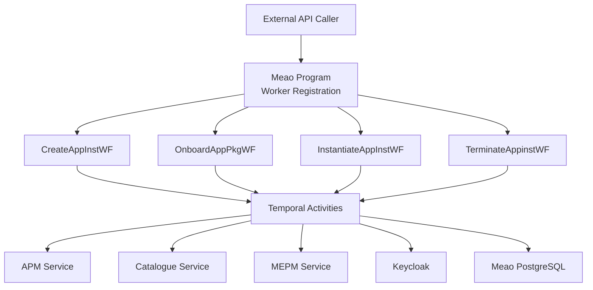
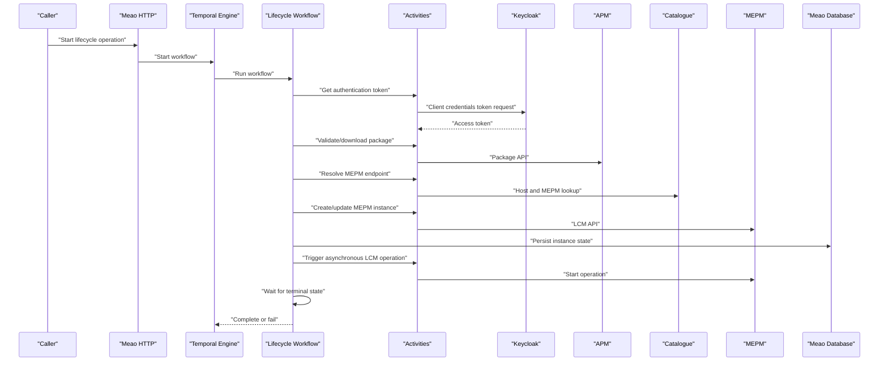
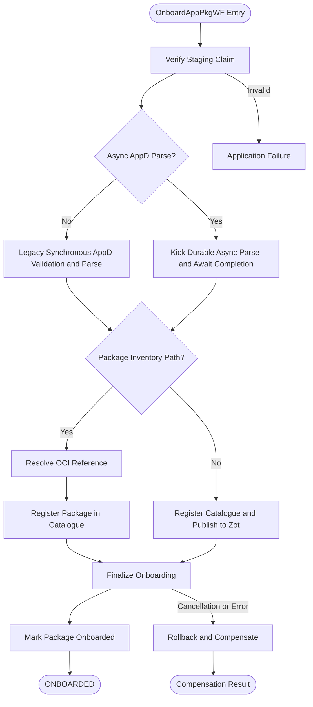
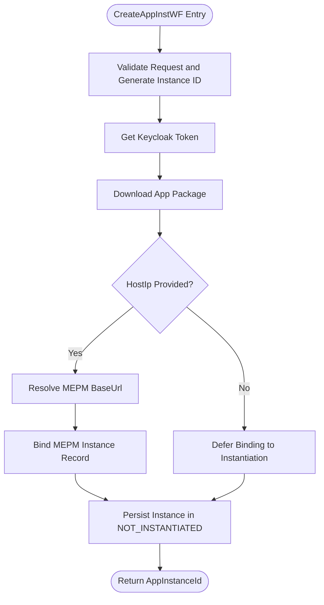
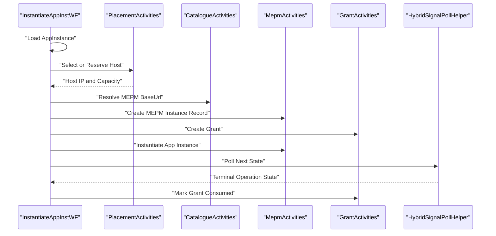
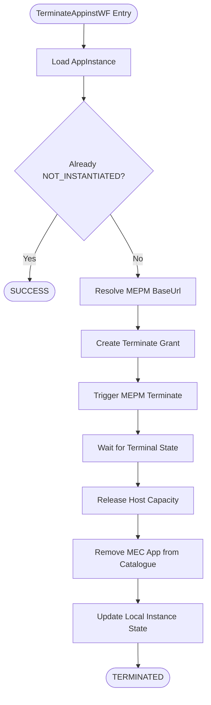
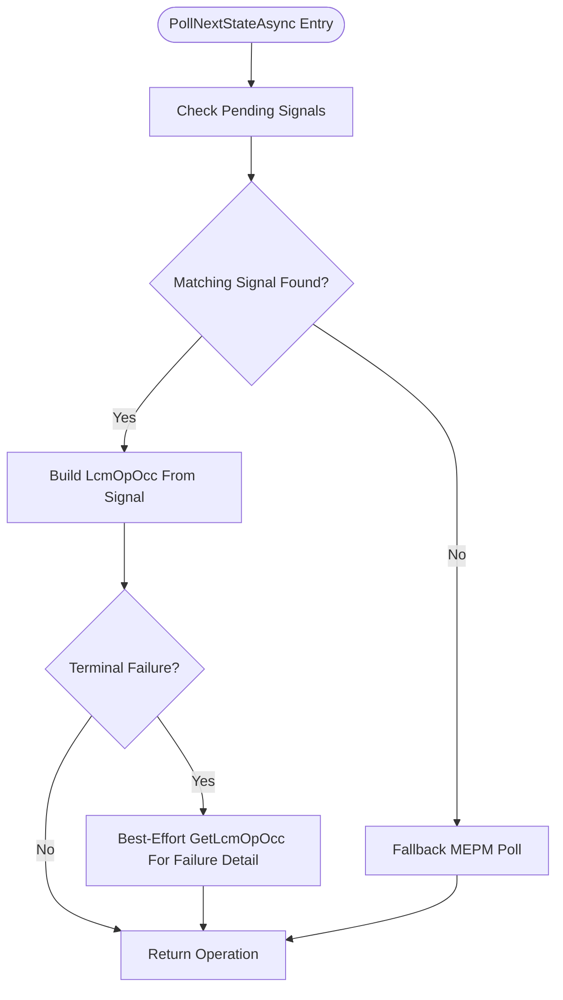
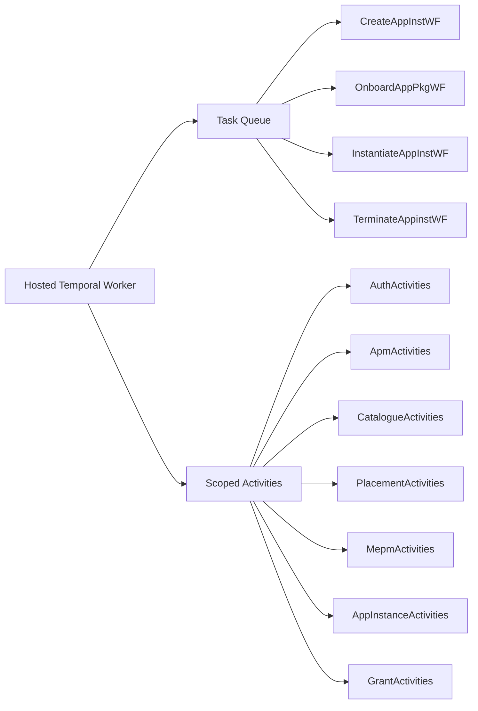

# Workflow Orchestration

<cite>
**Referenced Files in This Document**   
- `docs/ADR/0006-temporal-orchestration-engine.md`
- `docs/ADR/0053-mepm-lcm-op-occ-persisted-replay.md`
- `docs/CSAR_DISTRIBUTION_AND_LIFECYCLE_ARCHITECTURE.md`
- `src/Meao/Program.cs`
- `src/Meao/Workflows/CreateAppInstWF.cs`
- `src/Meao/Workflows/OnboardAppPkgWF.cs`
- `src/Meao/Workflows/InstantiateAppInstWF.cs`
- `src/Meao/Workflows/TerminateAppinstWF.cs`
- `src/Meao/Workflows/Policies/ActivityPolicies.cs`
- `src/Meao/Workflows/Common/HybridSignalPollHelper.cs`
- `src/Meao/Infrastructure/TemporalWorkflowExceptionHandler.cs`
- `src/Meao/Activities/CatalogueActivities.cs`
- `src/Meao/Activities/ApmActivities.cs`
- `src/Meao/Activities/MepmActivities.cs`
- `src/Meao/Activities/AppInstanceActivities.cs`
- `src/Meao/Activities/PlacementActivities.cs`
- `src/Meao/Activities/AuthActivities.cs`
- `src/Meao/Activities/GrantActivities.cs`
</cite>

## Table of Contents
1. [Introduction](#introduction)
2. [Project Structure](#project-structure)
3. [Core Components](#core-components)
4. [Architecture Overview](#architecture-overview)
5. [Detailed Component Analysis](#detailed-component-analysis)
6. [Dependency Analysis](#dependency-analysis)
7. [Performance Considerations](#performance-considerations)
8. [Troubleshooting Guide](#troubleshooting-guide)
9. [Conclusion](#conclusion)

## Introduction
This document explains how the MEO (MEC Orchestrator) uses Temporal.io as its durable execution engine to orchestrate long-running CSAR lifecycle operations. The system coordinates multi-step workflows for CSAR onboarding, application instance creation, placement selection, instantiation, operation, and termination. Workflows are deterministic state machines; side-effecting calls to APM, Catalogue, MEPM, Keycloak, and local persistence are implemented as Temporal activities. Failures use a saga-style compensation model: successful steps are recorded in Temporal history, and cleanup steps attempt to roll back partial state when later stages fail.

The design emphasizes:
- Durable execution that survives process restarts and Temporal outages.
- Deterministic replay through Temporal-safe time, random ID, and activity APIs.
- Explicit compensation handlers rather than implicit transactional rollback.
- Hybrid signal-and-polling waiting for asynchronous MEPM LCM operations.
- Bounded retry policies with explicit non-idempotent call protection.
- Clear separation between workflow logic (state machine) and activity logic (external integration).

**Section sources**
- `docs/ADR/0006-temporal-orchestration-engine.md#L1-L57`

## Project Structure
The Temporal-based orchestration lives primarily in the Meao service:

| Area | Responsibility |
|---|---|
| `src/Meao/Workflows` | Temporal workflow definitions representing lifecycle state machines |
| `src/Meao/Activities` | Temporal activities wrapping HTTP calls and database operations |
| `src/Meao/Workflows/Policies` | Centralized Temporal retry, timeout, and compensation configuration |
| `src/Meao/Workflows/Common` | Reusable workflow helpers such as hybrid signal/poll waiting |
| `src/Meao/Infrastructure` | Exception handling, HTTP client registration, and token handling |
| `src/Meao/Program.cs` | Worker registration, dependency injection, and Temporal client setup |
| `docs/ADR/0006-temporal-orchestration-engine.md` | Architectural decision adopting Temporal |
| `docs/ADR/0053-mepm-lcm-op-occ-persisted-replay.md` | Crash-survival and replay semantics for MEPM LCM operations |
| `docs/CSAR_DISTRIBUTION_AND_LIFECYCLE_ARCHITECTURE.md` | End-to-end CSAR distribution and lifecycle context |

**Diagram sources**
- `src/Meao/Program.cs#L160-L200`
- `src/Meao/Workflows/CreateAppInstWF.cs#L1-L118`
- `src/Meao/Workflows/OnboardAppPkgWF.cs#L1-L200`
- `src/Meao/Workflows/InstantiateAppInstWF.cs#L1-L200`
- `src/Meao/Workflows/TerminateAppinstWF.cs#L1-L200`

**Section sources**
- `src/Meao/Program.cs#L160-L200`
- `docs/ADR/0006-temporal-orchestration-engine.md#L1-L57`

## Core Components
The core components fall into two layers:

### Workflow Layer
- `CreateAppInstWF`: Establishes an application instance resource, validates the package, optionally binds a MEPM instance record, and persists the instance in NOT_INSTANTIATED state.
- `OnboardAppPkgWF`: Runs the CSAR onboarding saga: claim verification, AppD validation or durable async parse, package inventory registration or legacy publication, finalization, and terminal onboarded marking.
- `InstantiateAppInstWF`: Selects or reserves a host, resolves MEPM endpoint, creates a grant, triggers asynchronous instantiation via MEPM, and waits for completion using signals or polling.
- `TerminateAppinstWF`: Validates current state, triggers asynchronous termination via MEPM, waits for completion, releases capacity, removes catalog entry, and updates local state.

### Activity Layer
- `AuthActivities`: Acquires Keycloak bearer tokens used by downstream services.
- `ApmActivities`: Downloads packages, validates and parses AppD, kicks durable parse jobs, polls parse completion, and publishes or resolves OCI references.
- `CatalogueActivities`: Resolves MEPM endpoints, registers/removes MEC apps, manages package inventory, and queries edge hosts.
- `PlacementActivities`: Evaluates placement constraints, selects a host, and reserves/releases capacity.
- `MepmActivities`: Creates MEPM instance records, starts instantiate/terminate operations, queries LCM operation occurrences, cancels operations, and lists instances.
- `AppInstanceActivities`: Reads, creates, updates, and deletes application instance records in Meao’s database.
- `GrantActivities`: Creates grants, marks them consumed, or marks them failed.

**Section sources**
- `src/Meao/Workflows/CreateAppInstWF.cs#L1-L118`
- `src/Meao/Workflows/OnboardAppPkgWF.cs#L1-L200`
- `src/Meao/Workflows/InstantiateAppInstWF.cs#L1-L200`
- `src/Meao/Workflows/TerminateAppinstWF.cs#L1-L200`
- `src/Meao/Activities/AuthActivities.cs#L1-L109`
- `src/Meao/Activities/ApmActivities.cs#L1-L200`
- `src/Meao/Activities/CatalogueActivities.cs#L1-L200`
- `src/Meao/Activities/PlacementActivities.cs#L1-L200`
- `src/Meao/Activities/MepmActivities.cs#L1-L191`
- `src/Meao/Activities/AppInstanceActivities.cs#L1-L43`
- `src/Meao/Activities/GrantActivities.cs#L1-L68`

## Architecture Overview
At runtime, external callers invoke Meao HTTP endpoints. The endpoints start Temporal workflows. Workflows coordinate external systems through activities. External systems include:

- **Keycloak**: Authentication and token issuance.
- **APM**: Application Package Management, including package download, validation, parsing, and internal processing.
- **Catalogue**: Host and MEPM discovery, capacity reservation, and MEC app registry.
- **MEPM**: Application lifecycle management, including asynchronous instantiation and termination.
- **PostgreSQL**: Meao’s own application instance and grant state.

**Diagram sources**
- `src/Meao/Program.cs#L160-L200`
- `src/Meao/Workflows/CreateAppInstWF.cs#L1-L118`
- `src/Meao/Workflows/InstantiateAppInstWF.cs#L1-L200`
- `src/Meao/Activities/MepmActivities.cs#L1-L191`
- `src/Meao/Activities/CatalogueActivities.cs#L1-L200`
- `src/Meao/Activities/ApmActivities.cs#L1-L200`
- `src/Meao/Activities/AuthActivities.cs#L1-L109`

## Detailed Component Analysis

### CSAR Onboarding Saga: OnboardAppPkgWF
Onboarding is a saga with multiple stages and explicit compensation paths. It supports both legacy behavior and a newer package-inventory path through Temporal patching.

Key stages:
1. Validate staging claim fields.
2. Determine whether to use the legacy synchronous AppD parse or the durable async parse path.
3. Resolve or publish the CSAR reference.
4. Register package inventory or perform legacy catalogue registration and Zot publication.
5. Finalize onboarding.
6. Mark the package as onboarded only after finalization succeeds.
7. On cancellation or failure, run compensation handlers that roll back prior side effects.

**Diagram sources**
- `src/Meao/Workflows/OnboardAppPkgWF.cs#L1-L200`

Important behaviors:
- Replay-safe branching uses Temporal patch IDs so pre-patch histories continue executing their original command sequence while new executions take updated paths.
- The durable async AppD parse uses a signal fast-path from APM followed by bounded polling fallback.
- Package inventory registration is idempotent and uses the workflow ID as a stable correlation key.
- Compensation is best-effort: it attempts to reverse earlier side effects even if cleanup itself fails.

**Section sources**
- `src/Meao/Workflows/OnboardAppPkgWF.cs#L1-L200`

### Instance Creation: CreateAppInstWF
This workflow establishes the application instance identity before instantiation. Its responsibilities include:

- Validating required package identity.
- Generating or accepting a server-provided instance ID.
- Obtaining a Keycloak token.
- Verifying that the package exists in APM.
- Optionally binding the MEPM instance record when a host IP constraint is provided.
- Persisting the instance in NOT_INSTANTIATED state.

**Diagram sources**
- `src/Meao/Workflows/CreateAppInstWF.cs#L1-L118`

Design notes:
- When no host IP is supplied, MEPM binding is deferred until dynamic placement runs during instantiation.
- Even without MEPM binding, the local Meao instance record is created immediately.

**Section sources**
- `src/Meao/Workflows/CreateAppInstWF.cs#L1-L118`

### Placement Selection and Instantiation: InstantiateAppInstWF
Instantiation orchestrates placement, MEPM preparation, grant creation, asynchronous VIM deployment, and terminal-state waiting.

Key phases:
1. Load the application instance from Meao’s database.
2. Determine required CPU, RAM, and storage from the virtual compute descriptor, falling back to defaults when parsing fails.
3. Select a host dynamically or reserve capacity for an explicitly provided host IP.
4. Resolve the target MEPM base URL from the Catalogue.
5. Ensure the MEPM instance record exists.
6. Create a grant tied to the LCM operation occurrence ID.
7. Trigger asynchronous instantiation via MEPM.
8. Wait for completion using hybrid signal/poll with a deadline.
9. On success, consume the grant and update instance state.
10. On failure, cancel the LCM operation and trigger compensation.

**Diagram sources**
- `src/Meao/Workflows/InstantiateAppInstWF.cs#L1-L200`
- `src/Meao/Activities/PlacementActivities.cs#L1-L200`
- `src/Meao/Activities/CatalogueActivities.cs#L1-L200`
- `src/Meao/Activities/MepmActivities.cs#L1-L191`
- `src/Meao/Workflows/Common/HybridSignalPollHelper.cs#L1-L110`

Important details:
- Non-idempotent LCM start calls override retry behavior so failures surface to compensation instead of silently retrying potentially unsafe POST operations.
- The workflow enforces a 10-minute deadline around the wait loop.
- Signals matching the expected LCM operation occurrence short-circuit polling.

**Section sources**
- `src/Meao/Workflows/InstantiateAppInstWF.cs#L1-L200`

### Termination: TerminateAppinstWF
Termination is a compensating workflow that rolls back infrastructure resources after a successful asynchronous termination completes.

Key phases:
1. Load the application instance.
2. Treat already-not-instantiated instances as successful.
3. Resolve the target MEPM endpoint.
4. Create a terminate grant.
5. Trigger asynchronous termination via MEPM.
6. Wait for terminal state.
7. Release host capacity.
8. Remove the deployed MEC app from the Catalogue.
9. Update local instance state to NOT_INSTANTIATED and STOPPED.

**Diagram sources**
- `src/Meao/Workflows/TerminateAppinstWF.cs#L1-L200`

Important behaviors:
- Capacity release and catalogue removal are executed as compensation steps.
- If cleanup fails, the workflow logs errors and still attempts to persist the most consistent local state possible.

**Section sources**
- `src/Meao/Workflows/TerminateAppinstWF.cs#L1-L200`

### Activity Definitions and Responsibilities
Activities encapsulate all side effects. They must remain deterministic from the workflow perspective and should not contain business-time or random logic directly.

| Activity Class | Primary Responsibility | External Dependency |
|---|---|---|
| `AuthActivities` | Obtain Keycloak bearer tokens | Keycloak OAuth2 |
| `ApmActivities` | Download, validate, parse, poll, and publish CSAR-related data | APM Service |
| `CatalogueActivities` | Discover hosts and MEPM endpoints, manage MEC app registry and capacity | Catalogue Service |
| `PlacementActivities` | Evaluate placement policies and reserve/release capacity | Placement Engine + Catalogue |
| `MepmActivities` | Manage MEPM LCM operations | MEPM Service |
| `AppInstanceActivities` | Read/write application instance records | Meao PostgreSQL |
| `GrantActivities` | Create, consume, and fail grants | Meao PostgreSQL |

```mermaid
classDiagram
    class AuthActivities {
        +GetKeycloakToken() Task<string>
    }
    class ApmActivities {
        +DownloadAppPackage(appPkgId, token) Task<string>
        +ValidateAndParseAppDAsync(claim) Task<string>
        +KickAppDParseAsync(claim) Task<string>
        +AwaitAppDParseCompletionAsync(appPkgId) Task<AppDParsePollResult>
        +ResolveOciReferenceAsync(claim) Task<string>
    }
    class CatalogueActivities {
        +GetMecHostByIp(hostIp) Task<string>
        +GetMepmBaseUrlForHostAsync(hostIp) Task<string>
        +RegisterPackageInCatalogueAsync(...) Task
        +MarkPackageOnboardedAsync(...) Task
        +RemoveMecApp(appInstanceId) Task<string>
    }
    class PlacementActivities {
        +SelectAndReserveHostAsync(cpu, ramMb, storageGb, vimType, appId, pkgId, token) Task<PlacementDecision>
        +ReserveHostCapacityAsync(hostIp, cpu, ramMb, storageGb, appId) Task
        +ReleaseHostCapacityAsync(hostIp, cpu, ramMb, storageGb, appId) Task
    }
    class MepmActivities {
        +CreateAppInstanceAsync(baseUrl, req) Task<AppInstanceMepmDto>
        +InstantiateAppInstanceAsync(baseUrl, appId, hostIp, pkgId, grantId) Task<LcmOpOccStartDto>
        +TerminateAppInstanceAsync(baseUrl, appId, hostIp) Task<LcmOpOccStartDto>
        +GetLcmOpOccAsync(baseUrl, occId) Task<LcmOpOccDto>
        +CancelLcmOpOccAsync(baseUrl, occId) Task
    }
    class AppInstanceActivities {
        +GetAppInstanceDB(appId) Task<AppInstanceInfo?>
        +CreateAppInstanceDB(instance) Task
        +UpdateAppInstanceDB(instance) Task
        +DeleteAppInstanceDB(appId) Task
    }
    class GrantActivities {
        +CreateGrantAsync(appId, lcmOpOccId, appDId, operation) Task<GrantDto>
        +MarkGrantConsumedAsync(grantId) Task
        +MarkGrantFailedAsync(grantId) Task
    }
```

**Diagram sources**
- `src/Meao/Activities/AuthActivities.cs#L1-L109`
- `src/Meao/Activities/ApmActivities.cs#L1-L200`
- `src/Meao/Activities/CatalogueActivities.cs#L1-L200`
- `src/Meao/Activities/PlacementActivities.cs#L1-L200`
- `src/Meao/Activities/MepmActivities.cs#L1-L191`
- `src/Meao/Activities/AppInstanceActivities.cs#L1-L43`
- `src/Meao/Activities/GrantActivities.cs#L1-L68`

**Section sources**
- `src/Meao/Activities/AuthActivities.cs#L1-L109`
- `src/Meao/Activities/ApmActivities.cs#L1-L200`
- `src/Meao/Activities/CatalogueActivities.cs#L1-L200`
- `src/Meao/Activities/PlacementActivities.cs#L1-L200`
- `src/Meao/Activities/MepmActivities.cs#L1-L191`
- `src/Meao/Activities/AppInstanceActivities.cs#L1-L43`
- `src/Meao/Activities/GrantActivities.cs#L1-L68`

### Retry, Timeout, and Compensation Policies
All workflow activity calls go through centralized policy factories:

| Policy | Typical Use | Retry Behavior | Timeout Characteristics |
|---|---|---|---|
| `Standard` | Short operations up to 10 minutes ScheduleToClose budget | Up to 3 attempts, exponential backoff starting at 2 seconds | Configurable StartToCloseTimeout, capped ScheduleToCloseTimeout |
| `LongRunning` | LCM and MEPM lifecycle calls and OCI reference resolution | Up to 3 attempts unless overridden | Longer ScheduleToCloseTimeout budget |
| `Compensation` | Cleanup and rollback steps | Higher maximum attempts | Detached cancellation token so cleanup can continue during parent cancellation |
| `BestEffort` | Polling reads and non-critical operations | Lower timeout budget | Designed to avoid blocking the main workflow path |

Key safety mechanisms:
- Non-idempotent MEPM start calls override `MaximumAttempts` to 1 so failures surface to compensation rather than being retried automatically.
- Non-retryable error types such as validation or placement failures skip automatic retry.
- Compensation retries use detached cancellation tokens because cleanup may need to complete even if the parent workflow is cancelling.

**Section sources**
- `src/Meao/Workflows/Policies/ActivityPolicies.cs#L1-L126`
- `src/Meao/Workflows/InstantiateAppInstWF.cs#L1-L200`
- `src/Meao/Workflows/TerminateAppinstWF.cs#L1-L200`

### Error Handling and Domain Mapping
Temporal domain failures are translated into RFC 7807 ProblemDetails responses:

| Error Type | HTTP Status | Machine Code | Meaning |
|---|---:|---|---|
| `PlacementFailed` | 409 | `MEAO_PLACEMENT_FAILED` | Placement engine could not select or reserve a host |
| `NotFound` | 404 | `MEAO_NOT_FOUND` | Required resource was missing |
| `InvalidState` | 409 | `MEAO_INVALID_LIFECYCLE_STATE` | Invalid lifecycle transition |
| `GrantRejected` | 409 | `MEAO_GRANT_REJECTED` | Grant validation or creation failed |
| `PackageInvalid` | 422 | `MEAO_PACKAGE_INVALID` | Package validation or integrity problem |

The handler unwraps Temporal exception hierarchy to find the innermost `ApplicationFailureException`, then maps its `ErrorType` to a stable status code and code field.

**Section sources**
- `src/Meao/Infrastructure/TemporalWorkflowExceptionHandler.cs#L1-L135`

### Signal and Poll Waiting Mechanism
Long-running MEPM operations return an asynchronous LCM operation occurrence. Workflows do not block indefinitely; they combine:

1. A deterministic `WaitConditionAsync` over an in-memory queue of incoming signals.
2. Matching signals against the expected LCM operation occurrence ID.
3. Fallback polling of the MEPM operation occurrence.
4. Best-effort enrichment of failure details when a terminal failure arrives via signal but lacks full response data.

**Diagram sources**
- `src/Meao/Workflows/Common/HybridSignalPollHelper.cs#L1-L110`
- `src/Meao/Activities/MepmActivities.cs#L1-L191`

**Section sources**
- `src/Meao/Workflows/Common/HybridSignalPollHelper.cs#L1-L110`

## Dependency Analysis
Temporal worker registration ties workflows and activities together in a single hosted worker process:

**Diagram sources**
- `src/Meao/Program.cs#L160-L200`

Coupling summary:
- Workflows depend only on Temporal workflow APIs and activity proxies.
- Activities depend on HTTP clients, repository interfaces, or database contexts.
- Workflows do not call external services directly.
- Activities should not contain non-deterministic business logic; randomness and time belong to Temporal-safe APIs where needed.

**Section sources**
- `src/Meao/Program.cs#L160-L200`
- `docs/ADR/0006-temporal-orchestration-engine.md#L1-L57`

## Performance Considerations
- **Concurrent workflow instances**: Each lifecycle operation is a separate workflow execution. The shared task queue allows horizontal scaling through additional worker processes.
- **Bounded retries**: Default retry uses exponential backoff with finite attempts. Long-running and compensation policies tune attempt counts and timeouts per responsibility.
- **Non-idempotent calls**: MEPM start operations override retry to 1 to avoid unsafe duplication. Idempotency is enforced elsewhere, for example by treating MEPM create conflicts as success.
- **Polling cost**: Polling uses best-effort activity policies and is gated by deadlines. Signals short-circuit polling when available.
- **Database access**: Database writes are wrapped in activities, allowing Temporal to retry transient failures deterministically.
- **Network resilience**: Named HTTP clients use standard resilience handlers and service discovery, reducing transient network failures from affecting workflow logic directly.
- **Memory usage**: In-memory queues hold pending signals for active workflows; they are lightweight compared to long-lived external connections.

[No sources needed since this section provides general guidance]

## Troubleshooting Guide

### Diagnosing Failed Workflow Executions
1. Identify the workflow type:
   - `CreateAppInstWF` for instance resource creation.
   - `OnboardAppPkgWF` for CSAR onboarding.
   - `InstantiateAppInstWF` for placement and instantiation.
   - `TerminateAppinstWF` for teardown.
2. Inspect Temporal history to determine which activity failed.
3. Check the activity’s external dependency:
   - Authentication failures often originate from Keycloak configuration or token acquisition.
   - Package failures usually involve APM validation or OCI reference resolution.
   - Placement failures map to `PlacementFailed`.
   - MEPM failures usually appear as asynchronous LCM operation occurrences.
4. Review the workflow stage variable where present, especially in onboarding.

**Section sources**
- `src/Meao/Workflows/OnboardAppPkgWF.cs#L1-L200`
- `src/Meao/Infrastructure/TemporalWorkflowExceptionHandler.cs#L1-L135`

### Handling Timeouts
- Short operations use a 10-minute ScheduleToClose budget.
- Long-running lifecycle operations use a 20-minute ScheduleToClose budget.
- Compensation steps use a higher retry count and detached cancellation.
- Instantiation and termination loops enforce a 10-minute deadline around the wait phase.
- If a timeout occurs, inspect whether the external system completed the operation asynchronously; MEPM may still be processing the LCM operation occurrence.

**Section sources**
- `src/Meao/Workflows/Policies/ActivityPolicies.cs#L1-L126`
- `src/Meao/Workflows/InstantiateAppInstWF.cs#L1-L200`
- `src/Meao/Workflows/TerminateAppinstWF.cs#L1-L200`

### Investigating Compensation Failures
Compensation is best-effort. Common causes:
- MEPM operation could not be cancelled.
- Host capacity release failed.
- Catalogue entry removal failed.
- Database update during cleanup failed.

Recommended approach:
- Inspect the compensation step that failed in Temporal history.
- Manually reconcile inconsistent state: check MEPM operation occurrence, Catalogue MEC app entries, and Meao instance state.
- Remember that compensation does not guarantee perfect rollback across distributed systems.

**Section sources**
- `src/Meao/Workflows/TerminateAppinstWF.cs#L1-L200`
- `src/Meao/Workflows/OnboardAppPkgWF.cs#L1-L200`

### Monitoring Workflow Progress
Observable indicators:
- Workflow type and workflow ID in Temporal UI/history.
- Current stage for onboarding workflows.
- Pending signals for instantiation and termination.
- Grant state: `GRANTED`, `CONSUMED`, or `FAILED`.
- Application instance instantiation and operational states.
- HTTP error responses mapped through the Temporal workflow exception handler.

**Section sources**
- `src/Meao/Workflows/OnboardAppPkgWF.cs#L1-L200`
- `src/Meao/Activities/GrantActivities.cs#L1-L68`
- `src/Meao/Infrastructure/TemporalWorkflowExceptionHandler.cs#L1-L135`

### Scaling Concurrent Workflow Instances
Guidelines:
- Scale Temporal worker processes horizontally against the same task queue.
- Keep activities stateless and deterministic.
- Avoid heavy computation inside activities; prefer background jobs where appropriate.
- Tune activity policies based on external service latency and retry characteristics.
- Monitor task queue depth, activity execution duration, and workflow completion rate.

[No sources needed since this section provides general guidance]

## Conclusion
The MEO’s Temporal-based orchestration separates workflow state machines from external integration logic. CSAR onboarding, instance creation, placement, instantiation, and termination are modeled as durable workflows with explicit compensation. Activities isolate network and database calls, while centralized policies define retry, timeout, and compensation behavior. Hybrid signal-and-poll waiting enables efficient coordination with asynchronous MEPM LCM operations.

Operational reliability depends on:
- Deterministic workflow implementations.
- Correct use of Temporal-safe APIs.
- Properly configured activity policies.
- Careful handling of non-idempotent external calls.
- Robust monitoring of workflow history, activity failures, and compensation outcomes.

[No sources needed since this section summarizes without analyzing specific files]